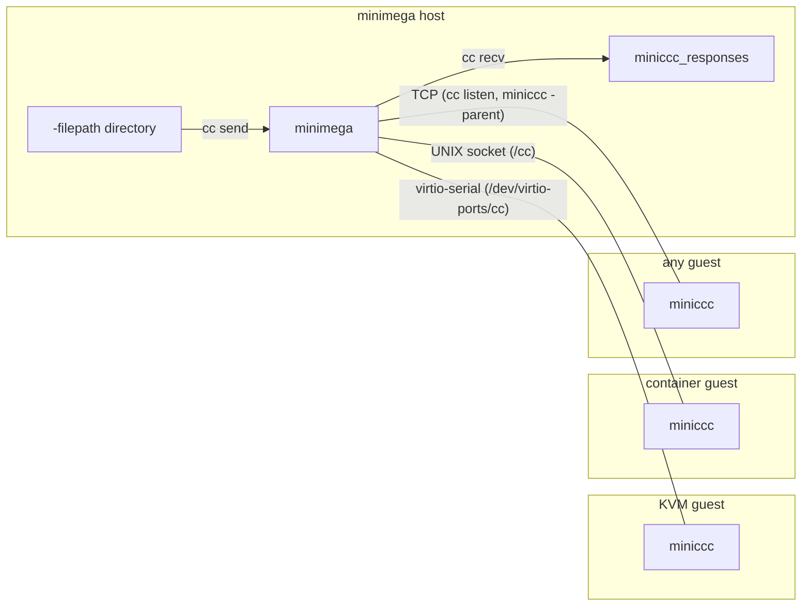

# Command and control

The command and control (cc) API has two halves: the `cc` commands in minimega
and the miniccc agent that runs inside each guest. From the minimega prompt,
you use the API for these tasks:

- Run programs on VMs.
- Move files in and out of VMs.
- Open TCP tunnels through VMs.
- Mount the filesystems of VMs on the host.

The API needs no experiment network.

This page assumes a running minimega and at least one VM whose image contains
miniccc. The stock vmbetter configurations (`miniccc.conf`,
`miniccc_container.conf`) build such images. See
[Building images with vmbetter](vmbetter.md). Windows guests need extra setup,
which [Windows guests](windows.md) describes.

## How it works

Every VM with `vm config backchannel true` (the default) gets a dedicated
channel to the minimega instance that runs it. KVM VMs get a virtio-serial port
named `cc`. Containers get a UNIX domain socket. miniccc opens that channel
from inside the guest and speaks a small gob-encoded protocol over it. The
guest needs no IP address for this, so cc is useful for bootstrapping an
experiment.



minimega queues commands and delivers them to clients in creation order. You
can therefore chain steps such as "send a file, run it, fetch its output", and
the steps happen in sequence. A command stays queued until you delete it. A
client that reboots, or a VM that you launch later, receives every command that
matches its filter.

Use `exec-once` and `background-once` for commands that must run on each
client only once. Clients report a heartbeat every five seconds. When a
client is silent for 30 seconds, minimega marks it as inactive. The `cc_active`
column of `vm info` shows this state.

The connection is namespace aware. Each namespace has its own cc server,
command list, filter, prefix and response directory. `cc` commands run against
the active namespace across every host in it.

## Running miniccc

miniccc is a single static binary with the same flags on Linux and Windows.
`-tag`, `-pipe`, and the PID file work only on Linux. `-install` exists only on
Windows:

| Flag | Meaning |
|---|---|
| `-serial <device>` | Connect over the virtio-serial port instead of TCP. |
| `-parent <host or path>` | Host running minimega (TCP) or socket path (`-family unix`). |
| `-port <n>` | TCP port to connect to (default 9002). |
| `-family tcp\|unix` | Dial family for `-parent` (default `tcp`). |
| `-path <dir>` | Where miniccc keeps its state, received files and, on Linux, its PID file (default `/tmp/miniccc`). |
| `-uuid <uuid>` | Override the UUID that the client reports. |
| `-pipe <name>` | Attach standard input and output to a minimega named pipe, then exit (Linux only). |
| `-tag <key> <value>` | Set a VM tag through a running miniccc, then exit (Linux only). |
| `-level`, `-logfile`, `-v` | Logging, as for every minimega tool. |
| `-version` | Print the version and exit. |

### Serial (KVM guests)

On Linux, the port appears as `/dev/virtio-ports/cc`. On Windows, it is
`\\.\Global\cc`. The stock miniccc image starts the agent from its init
script:

```bash
/miniccc -v=false -serial /dev/virtio-ports/cc -logfile /miniccc.log &
```

miniccc reads the VM's UUID from `/sys/devices/virtual/dmi/id/product_uuid`.
If a serial client cannot read a UUID, minimega binds the client to the VM that
owns the port. minimega knows which VM it dialed. If you name one of your own
`vm config virtio-ports` ports `cc`, it collides with the backchannel. minimega
logs only a warning, but QEMU receives two ports named `cc` and refuses to
start the VM.

If the guest loses the host, for example because minimega restarted, miniccc
closes the port. It dials again every 15 seconds for up to two hours, and then
it stops. While the VM exists, minimega dials the port again on the host side,
so a restarted agent reconnects automatically.

### UNIX socket (containers)

minimega listens on a socket inside every container's filesystem. The init of
the container image runs:

```bash
miniccc -family unix -parent /cc -logfile /miniccc.log
```

### TCP (any guest)

TCP mode is for guests that cannot use the serial device. Examples are
bare-metal nodes and images that you do not control at the device level. The guest must reach the
minimega host over a routable path, typically a `tap` with an IP on the
experiment VLAN (see [Host networking](networking.md)). minimega does not
listen for TCP clients until you ask it to. Ask it once for each namespace:

```minimega
minimega$ cc listen 9002
```

Each namespace needs a different port. Guests of the second namespace must
pass the matching `-port`.

Then run this command in the guest:

```bash
miniccc -parent 10.0.0.1
```

A TCP client must present a UUID that matches a VM in the namespace. If it does
not, minimega rejects the handshake with `unregistered client`. Guests without
a DMI UUID must pass `-uuid` with the UUID of the VM from `vm info`.

!!! warning "TCP mode is not authenticated"
    The serial and UNIX socket transports are host-only and cannot be reached
    from the experiment network. A TCP listener accepts any client that knows
    a valid VM UUID. See [Security considerations](security.md).

### Windows service

`miniccc.exe -install auto-start` (or `manual-start`) registers a Windows
service named `miniccc`, with the display name "minimega Agent". The service
runs `miniccc.exe -serial \\.\Global\cc` with the `-logfile` and `-level`
values that you passed at install time. The command also configures the
service to restart five seconds after a failure. That restart is how Windows
guests reconnect. When the agent loses the host, it exits instead of dialing
again, because Windows refuses to reopen the virtual serial port from the same
process. If you run `miniccc.exe` interactively, you restart it by hand.
[Windows guests](windows.md) describes the full guest setup and the virtio
drivers that the port depends on.

!!! warning "Keep miniccc and minimega at the same version"
    The cc protocol is not stable across releases. If the build of a client
    differs from the build of the server, minimega logs
    `mismatched miniccc version on <hostname>: <revision>` at handshake and
    continues. Commands can be dropped or misreported. minimega refuses clients
    that were built before the current heartbeat protocol, with
    `miniccc client too old -- please update`. Rebuild your images with the
    miniccc from the release that you run, or use
    [automatic updates](#automatic-updates).

## Clients

Clients report their UUID, hostname, OS, architecture, IPs and MACs on every
heartbeat, so an address change appears within seconds.

```minimega title="clients.mm"
--8<-- "articles/cc/clients.mm"
```

[Download this example](cc/clients.mm){ download="clients.mm" }

`cc` on its own prints the number of connected clients.

### Automatic updates

When miniccc connects to minimega, it can update itself. Enable this for each
namespace with `cc auto-update true`. If a miniccc binary in the files
directory of minimega differs from the client binary, minimega then serves that
binary. Disable it with `cc auto-update false`. Run `cc auto-update` to show
the current configuration.

Only a client that has the `auto-update` capability can update. The
`capabilities` column of `cc clients` shows the capabilities of each client. A
client that cannot create a file in the folder that contains its binary does
not have this capability. Older miniccc binaries do not have this capability,
so you must update them manually. For each of these clients that runs a
different revision, minimega logs a warning.

To keep a fixed miniccc version in a VM, mount the folder that contains the
miniccc binary as read-only. The client then does not have the `auto-update`
capability.

For each client, minimega looks for these file names in this order:

1. `miniccc-<os>-<arch>`, for example `miniccc-linux-arm64`. On Windows, add
   the `.exe` extension, for example `miniccc-windows-amd64.exe`.
2. `miniccc`, or `miniccc.exe` for a Windows client. If the client
   architecture differs from the host architecture, minimega does not use this
   name.

For each name, minimega looks in the namespace subdirectory of the files
directory first, and then in the files directory. When minimega does not find
a binary for a client, it logs a warning and does not update the client.

When you run `cc auto-update true`, each host in the namespace gets the miniccc
binaries over the mesh, as `cc send` gets files. Put the binaries in the files
directory of one host before you run the command. If no host has a miniccc
binary, the command fails and the configuration does not change.

If no `-headnode` is set, a host keeps its existing copy of a binary. To
change the binaries, first remove the old copies from the files directory on
the other hosts. Then run `cc auto-update true` again.

When you add hosts with `ns add-hosts` on the node that ran `cc auto-update`,
the new hosts also get the configuration. This works only until that node
restarts. If you run `ns add-hosts` on another node, the new hosts do not get
the configuration.

minimega holds commands for a client during its update. When the client
connects again, minimega sends the commands. If the client does not connect
again in two minutes, minimega logs a warning and sends the commands.

A miniccc Windows service exits after it installs the update. The service
recovery action that `miniccc.exe -install` sets then starts the new binary.

!!! warning "The update kills background processes"
    The update kills the background processes that miniccc started with
    `cc background`. When this occurs, both miniccc and minimega log a warning.
    If you do not need background commands, enable auto-update. Otherwise,
    start them again after the update.

## Executing commands

`cc exec` queues a command for every client that matches the current filter.
Quote arguments that contain spaces or characters that minimega otherwise
interprets. The response is not printed. It is written under the response
directory, and you read it back with `cc responses`.

```minimega title="exec.mm"
--8<-- "articles/cc/exec.mm"
```

[Download this example](cc/exec.mm){ download="exec.mm" }

Command ids start at 1 and continue from one example to the next. Each example
on this page assumes an empty command list. `clear cc` empties the list and
starts the ids at 1 again. If your list is not empty, use the ids that
`cc commands` shows.

`cc commands` lists every queued command with this information:

- Its id and prefix.
- How many clients responded.
- Whether it is a background command or a once-only command.
- The files that it sends and receives.
- The filter that it was created under.

You use the command id for everything else: responses, exit codes and
deletion.

If a command name is not on the `PATH` of the guest, miniccc also looks for it
in its `files` directory. An executable script that you sent with `cc send`
therefore runs by name.

### Background commands

`cc background` starts the program and continues with the next command without
waiting for it to exit. Use it for daemons, traffic generators and anything
else that does not return. Background commands record no exit code, and
their output goes to the miniccc log rather than a response.

### Once-only commands

When you issue `cc exec-once` or `cc background-once`, minimega sends the
command once, to the matching clients that are connected. It never sends the
command again. A client that connects or reconnects later does not receive it.
minimega sends a plain command again to a client that reconnects. You rarely
want this for `shutdown -r now`:

```minimega
minimega$ cc exec-once shutdown -r now
```

### Process control

Processes that you start with `cc background` are tracked by PID, and you can
list and kill them. `killall` matches a substring of the command line.

```minimega title="process.mm"
--8<-- "articles/cc/process.mm"
```

[Download this example](cc/process.mm){ download="process.mm" }

### User sessions

Commands run as the user that runs miniccc. On Windows, miniccc normally runs
as a service in a session that is isolated from the desktop. Therefore a
command cannot show a window to the logged-in user, change the display, or use
the profile of that user. To run a command in the desktop session of the
logged-in user, add a `session` option before the command:

```minimega
cc exec session=user whoami
cc background session=user charmap.exe
cc background session=elevated regedit.exe
```

On Windows, `session=user` runs the command as the logged-in user, with the
environment and profile of that user. `session=elevated` does the same with the
administrator rights of the user. It differs from `session=user` only for an
administrator who is logged in with User Account Control enabled. miniccc finds
the program with the `PATH` of the user, and the program runs in the working
directory of miniccc.

miniccc tries to identify the user who is logged in on the console. If it
cannot, it picks the lowest numbered active session (for example, a remote
desktop connection). The command fails if:

- no user is logged in
- `session=elevated` is used and the user is not an administrator
- miniccc is not running as the LocalSystem service

On Linux, miniccc ignores the session option, and commands run as the user of
miniccc. A miniccc client that predates this option also ignores it and runs
the command normally.

Applications that you install from the Microsoft Store start only from a
process that is already running in the session of the user. Launch them through
a shell:

```minimega
cc background session=user cmd /c start notepad
```

### Testing connectivity

`cc test-conn` asks the guest to connect to a TCP or UDP endpoint. A TCP test
tries again until the wait expires. A UDP test sends one probe. If no reply
arrives within 0.5 seconds, the test fails. miniccc writes the verdict to the
stdout of the command as `<host>:<port> | pass` or `| fail`. UDP tests need a
base64-encoded probe packet that provokes a reply.

```minimega
minimega$ cc test-conn tcp 10.0.0.68 443 wait 10s
```

## Responses and exit codes

minimega stores each response under its files directory:

```text
<filepath>/[<namespace>/]miniccc_responses/<command id>/<client uuid>/
```

The directory has the files `stdout` and `stderr`. An empty file is not
written. For foreground commands, the directory also has the file `exitcode`.
The default `<filepath>` is `/tmp/minimega/files`.

`cc responses <id>` prints every file for that command except `exitcode`. It
prefixes each file with its path relative to the responses directory. Add `raw`
to print only the contents. You can also give a prefix (see below) or `all`.

`cc exitcode <id> <vm>` prints the exit status of a foreground command on one
client, by VM name, hostname or UUID. A status of `-1` means that the program did
not start, for example because the program was not found.

Responses accumulate until you remove them:

```minimega
minimega$ cc delete response 3
minimega$ cc delete command all
minimega$ clear cc responses
```

`cc delete command|response` accepts an id, a prefix or `all`. `clear cc`
resets everything in the namespace: commands, responses, filter, prefix and
mounts.

## File transfer

### Sending files

Files that you send with `cc send` must be under the `-filepath` directory of
minimega, `/tmp/minimega/files` by default. Inside a namespace, minimega looks
in the namespace subdirectory first and then in the top level. You can use
globs. Put a script `setup.bash` there:

```bash
#!/bin/bash
echo "hello cc!"
```

Then send and run the script. Clients fetch files before they run any later
command.

```minimega title="send.mm"
--8<-- "articles/cc/send.mm"
```

[Download this example](cc/send.mm){ download="send.mm" }

On the guest, files go to `<path>/files/`, `/tmp/miniccc/files` by default,
under the same relative path that they had on the host. miniccc skips a file
that already exists there and does not overwrite it. To replace a file, send it
under a new name.

### Receiving files

`cc recv` takes any path on the guest. A path can be a glob. It stores what it
finds in the response directory of the command, under the full guest path. This
script, `collect.bash`, writes a file that we then fetch:

```bash
#!/bin/bash
ip address > /var/log/inventory.out
```

```minimega title="recv.mm"
--8<-- "articles/cc/recv.mm"
```

[Download this example](cc/recv.mm){ download="recv.mm" }

The received file is at
`<filepath>/miniccc_responses/3/<uuid>/var/log/inventory.out`.

### Mounting a guest filesystem

`cc mount <vm> <path>` mounts the root filesystem of a VM on the host over the
cc connection. It uses a 9p server that is built into miniccc. It works from
any host in the namespace, because minimega finds the host that runs the VM and
forwards the mount. The mount point must already exist. minimega must run as
root to do the mount. miniccc serves the system drive of a Windows guest as
read/write.

```minimega title="mounts.mm"
--8<-- "articles/cc/mounts.mm"
```

[Download this example](cc/mounts.mm){ download="mounts.mm" }

`cc mount` with no arguments lists mounts. `clear cc mount` takes a VM name,
UUID or mount path, or nothing to unmount everything. Unmount before you kill
or stop the VM. `clear namespace` does this for you.

## Prefixes

A prefix groups the commands that you issue after it under a name. You can use
this name in place of an id with `cc responses` and `cc delete`. `cc prefix`
alone shows the current prefix. `clear cc prefix` removes it.

```minimega title="prefix.mm"
--8<-- "articles/cc/prefix.mm"
```

[Download this example](cc/prefix.mm){ download="prefix.mm" }

## Filtering clients

Without a filter, every client runs every command. `cc filter` sets
`key=value` pairs. A client must match these pairs for commands that you issue
afterwards. minimega records the filter on each command, so a later change to
the filter does not affect commands that are already queued.

```minimega title="filter.mm"
--8<-- "articles/cc/filter.mm"
```

[Download this example](cc/filter.mm){ download="filter.mm" }

The keys `uuid`, `hostname`, `arch`, `os`, `ip` and `mac` match what the
client reports. `ip` accepts a single address or CIDR notation and matches any
address of the client. minimega looks up any other key first as a column of
`vm info` (`name`, `vlan`, `state` and so on). If the key is not a column,
minimega looks it up as a VM tag. If both exist, the `vm info` column wins.
`tag=key:value` names a tag explicitly. Several pairs combine with AND:

```minimega
minimega$ cc filter os=windows ip=10.0.0.0/24
minimega$ cc filter vlan=DMZ
minimega$ cc filter tag=role:server
```

`cc filter` with no arguments prints the current filter. `clear cc filter`
removes it.

## Tags

A guest can push key/value tags to minimega through a running miniccc. On
Linux, `miniccc -tag <key> <value>` connects to the socket of the agent in
`-path`, passes the pair to the agent, and exits. The agent sends the pair on
the next heartbeat. The pair then appears in the `tags` column of `vm info`.
Filters and `vm tag` can use it there.

```bash
miniccc -tag role webserver
```

If the agent runs with a non-default `-path`, pass the same `-path` to the
tagging invocation.

## TCP tunnels

`cc tunnel` is the equivalent of `ssh -L`. It opens a listening port on the
cluster host that runs the VM. minimega forwards the port through the guest to
a host and port that the guest can reach. That includes `127.0.0.1` inside the guest
itself. This gives you a way into a VM that has no network.

```minimega title="tunnels.mm"
--8<-- "articles/cc/tunnels.mm"
```

[Download this example](cc/tunnels.mm){ download="tunnels.mm" }

The example starts a web server inside the VM and forwards a host port to it.
Then it fetches the page through the tunnel with `shell curl`.
`.preprocess false` stops minimega from replacing the URL with a path in the
files directory. The client runs the queued commands on its next check-in, so
curl tries again until protonuke answers. minimega opens the listening port on
the host that runs the VM. On a cluster, therefore, run the client there and
not on the head node.

`cc tunnel list <vm>` (or `all`) shows the forward tunnels with their ids.
`cc tunnel close <vm> <id>` closes one tunnel.

`cc rtunnel` is the `ssh -R` counterpart. Every client that matches the current
filter listens on the source port. The client tunnels TCP connections back to
the cluster host that it is connected to. That host then connects to the
destination host and port.

The destination can be any host that the cluster host can reach. You can
therefore give every client a port to a resource outside of the experiment.
Reverse tunnels take no VM name. To restrict which clients open a tunnel, use
`cc filter`:

```minimega
cc rtunnel 4444 myserver 80
```

If no client matches the filter, `cc rtunnel` returns an error. If a client
does not open its tunnel, the error gives the UUID of that client, and the
tunnels on the other clients stay open. `cc rtunnel list` shows the reverse
tunnels that are open on each client. `cc rtunnel list <vm>` shows only the
reverse tunnels on one VM. `cc tunnel list` does not show reverse tunnels.

## Plumbing

You can attach the standard streams of foreground and background commands to
minimega named pipes. To do this, prefix the command with `stdin=`, `stdout=`
and `stderr=` pairs. Inside the guest, `miniccc -pipe <name>` connects a shell
pipeline to the same pipe. Use this to feed a program on one VM from a program
on another VM. You can also use it to stream a guest log into a pipeline on the
host.

```minimega title="plumber.mm"
--8<-- "articles/cc/plumber.mm"
```

[Download this example](cc/plumber.mm){ download="plumber.mm" }

The client starts the shell on its next check-in, and a write to a pipe with
no reader is discarded. Therefore the example waits until the shell reads
`shell_in` before it writes the command.

Pipes, delivery modes and pipelines are described in [Plumbing](plumbing.md).

## Client logging

`cc log level <debug|info|warn|error|fatal>` changes the log level of every
client that matches the current filter at runtime. Logs go to the location that
the `-logfile` flag of the agent names.

## See also

- [Plumbing](plumbing.md) for pipes and pipelines used with `cc exec`.
- [Windows guests](windows.md) for installing the agent as a service.
- [File management](file.md) for the `-filepath` directory that `cc send`
  reads from and where responses are written.
- [Security considerations](security.md) for what the agent trusts.
- [Troubleshooting](troubleshooting.md) for clients that never connect.
- Reference: [`cc`](../reference/minimega.md#cc),
  [`cc mount`](../reference/minimega.md#cc-mount),
  [`clear cc`](../reference/minimega.md#clear-cc),
  [`vm config backchannel`](../reference/minimega.md#vm-config-backchannel).
