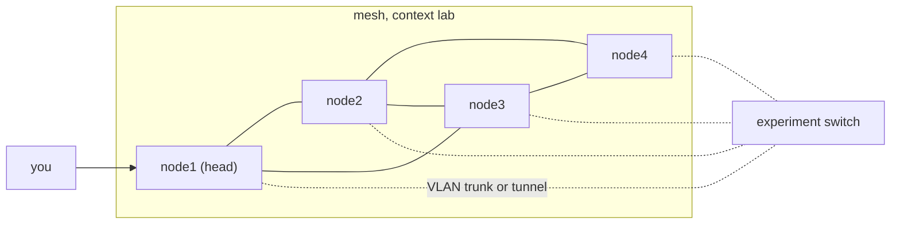

# Cluster setup

A single host runs out of memory and cores long before a realistic experiment runs out of VMs. minimega scales through a mesh of instances, with one instance on each host. A namespace can then place VMs across every host, and you keep typing at one prompt. This page covers how to prepare the hosts and how to carry experiment VLANs between them. It also covers how to start the mesh by hand, with `deploy`, under systemd, or in Docker. Last, it covers how to make sure that the mesh works, and what changes with more than one host.

It assumes that you [installed](installing.md) minimega on every host and know how to [run it](running.md) on one. [Host networking](networking.md) explains VLANs, trunks, and tunnels. [Namespaces](namespaces.md) explains how a namespace decides where a VM runs.

## How a cluster works

Every minimega instance is a node in a mesh built by meshage, minimega's message-passing layer. Nodes find each other by UDP broadcast and hold TCP connections to a few peers. Nodes route messages to any node through the mesh, so no host needs a connection to every other host. There is no server. Any node can send a command to any other node. The "head node" is the host that you type on and, usually, the host that holds the images. Three flags define a mesh:

- `-context` is a label. Only nodes with the same context connect to each other during discovery, so several clusters can share a network.
- `-degree` is how many peers a node tries to keep. `0`, the default, disables discovery. `3` or `4` is enough for a cluster of any size.
- `-port` is the TCP port for peer connections and the UDP port for discovery. The default is `9000`. `-broadcast` sets the discovery address. The default is `255.255.255.255`. `-msa` sets the period in seconds of the mesh state announcements that detect lost peers. The default is `10`.

Do not confuse a context with a namespace. minimega fixes the context at start-up. The context decides which hosts form one mesh. You create namespaces at runtime inside that mesh. A namespace decides which hosts of the mesh an experiment uses.



## Preparing the hosts

On every host, install the same version of minimega with the same external tools (QEMU, Open vSwitch, dnsmasq). Mesh commands are ordinary minimega commands that run remotely, so a difference in versions shows up as unknown commands or missing fields.

Every host needs a hostname that is unique in the cluster and that every other host can resolve. minimega identifies nodes by hostname. `deploy`, `mesh dial`, and file transfer all connect by hostname. Use predictable names with a common prefix and a number (`node1`, `node2`, ...). Every command that takes hosts accepts ranges, so these names are useful. For example, `node[1-10]` and `node[1-3],node7` are valid ranges. If you have no DNS, put every host in `/etc/hosts` on every host:

```bash
$ for i in $(seq 1 10); do echo "192.168.1.$((100 + i)) node$i"; done | sudo tee -a /etc/hosts
$ sudo hostnamectl set-hostname node1      # on each host, its own name
```

Open TCP and UDP port 9000 (or your `-port`) between the hosts. For VXLAN tunnels, also open UDP port 4789, which is the Open vSwitch default. If a host firewall or the network drops UDP broadcast, discovery does not work. Join the nodes by hand with `mesh dial` instead.

For `deploy`, you also need SSH from the head node to every other host, as a user that can run minimega, without a password. We recommend that you use an SSH key. `ssh-copy-id` copies the key, and a short loop copies it to the whole cluster:

```bash
$ ssh-keygen -t ed25519
$ for i in $(seq 2 10); do ssh-copy-id admin@node$i; done
```

The user does not have to be root. If the account can run `sudo` without a password prompt, `deploy launch` can use `sudo` on the remote side.

## Carrying experiment traffic between hosts

If a VM on `node1` and a VM on `node2` both name the VLAN `dmz`, they get the same tag. This is because the mesh shares alias assignments across hosts. For the VMs to exchange frames, you must connect the bridge of each host to the other bridges. The two options are the same as on one host, but you use them on every host.

### A trunked NIC

The normal cluster design has two networks. The management network is the network that the hosts use to talk to each other and to you. The experiment network has one dedicated NIC on each host. Each NIC connects to a switch whose ports accept 802.1q tags. Add that NIC to the bridge on each host:

```minimega
mesh send all bridge trunk mega_bridge eth1
bridge trunk mega_bridge eth1
```

The switch does the rest. Tagged frames from VLAN 101 on one host reach VLAN 101 on every other host and nothing else. This works like one switch that all the VMs share. A trunk that you set this way lasts until minimega exits. To keep the trunk, put the command in the file that you `read` at startup. Or make the port a permanent part of a bridge that exists before minimega starts. See [Running minimega](running.md) for startup files.

If a host has only one NIC, the same interface must carry the management traffic and the trunk. That works, but then the bridge, not the NIC, must hold the address of the host. Make the change from the console, because the host drops off the network while the address moves.

Define the bridge with the network configuration of your distribution. Use netplan or NetworkManager on Ubuntu, and NetworkManager on RHEL-family systems. Both can create an Open vSwitch bridge with a physical port. This way, the bridge comes up at boot and is `preexisting` at minimega start.

minimega adopts an existing `mega_bridge` and never deletes it, so `nuke` and `bridge destroy` leave the uplink alone. If minimega created the bridge and `bridge trunk` added your only NIC, `nuke` destroys the bridge together with your connectivity.

### Tunnels

Sometimes routers separate the hosts, the hosts sit inside the VLAN of a cloud provider, or the switch cannot trunk. In these cases, connect the bridges over IP instead:

```minimega
bridge tunnel vxlan mega_bridge 192.168.1.102
```

Run that command on each host, toward each other host. With three or more hosts, these tunnels make a loop. Thus, before you make the tunnels, run `bridge config mega_bridge rstp_enable=true` on each host. Or let a namespace build the full mesh of tunnels between its hosts with one command, which also enables RSTP:

```minimega
ns bridge mega_bridge vxlan
```

When you clear the namespace, minimega runs `bridge destroy` for that bridge on each host of the namespace. That command removes all taps, trunks, and tunnels on the bridge, also those of other experiments. If other experiments use `mega_bridge`, give this experiment its own bridge.

Tunnels reduce the MTU. Allow for the encapsulation on the physical path, or lower the MTU in the guests.

## Starting the mesh

All instances need the same `-context` and `-port`, a `-degree` above zero, and a `-broadcast` address that reaches the others. This applies to every method that you use to start the instances.

### As a service

The packages install a systemd unit that reads `/etc/minimega/minimega.conf`. In that file, the mesh flags below have an `MM_` variable (see [Running minimega](running.md)). Flags such as `-headnode` and `-hashfiles` have no `MM_` variable. To set them, override the systemd unit. `MM_APPEND` exists only in the Docker image. On each host, set the mesh values and restart the service:

```text
MM_CONTEXT="lab"
MM_DEGREE=3
MM_PORT=9000
MM_BROADCAST="255.255.255.255"
MM_MSA=10
```

The instances discover each other as they come up. You do not need to run anything on the head node first. Because the file is per host, `MM_CONTEXT` is the one value that you must make identical everywhere.

### With deploy

If you start minimega by hand on the head node, `deploy` copies that binary to the other hosts with `scp`. Then `deploy` starts the binary there with `ssh`:

```minimega
minimega$ deploy launch node[2-10]
minimega$ deploy launch node[2-10] admin sudo
```

The first form logs in as the user that runs minimega. The second form logs in as `admin` and prefixes the remote command with `sudo`.

The remote instances get the flags that the head node started with. They also get `-nostdin=true`, so that they can run in the background. They also get `-headnode=<this host>`, so that they send their logs here. When the head node ran with `-hashfiles`, they also fetch files from here.

To change the flags that they get, set `deploy flags` before you launch. `deploy flags` alone prints the flags that `deploy` sends. `clear deploy flags` goes back to the default:

```minimega
minimega$ deploy flags -context=lab -degree=3 -level=info -logfile=/var/log/minimega.log
minimega$ deploy stdout /var/log/minimega.out
minimega$ deploy stderr /var/log/minimega.err
```

`deploy stdout` and `deploy stderr` redirect the output of the remote process. Otherwise, the output goes to `/dev/null`. The binary lands in the remote temporary directory as `minimega_deploy_<timestamp>`, so repeated deploys never overwrite a running instance. You must start the head node itself with the mesh flags, and attach to it with `minimega -attach`. A typical start is `minimega -nostdin -context lab -degree 3` plus any other flags that you need.

You can do the same thing without `deploy` in a loop. This is also how you do it from a host that is not a mesh node:

```bash
$ for i in $(seq 2 10); do
    scp /usr/bin/minimega admin@node$i:/tmp/minimega-bin
    ssh admin@node$i 'sudo nohup /tmp/minimega-bin -nostdin -context lab -degree 3 >/dev/null 2>&1 &'
  done
```

Do not copy the binary to `/tmp/minimega`. That path is the default base directory. If a file has that name, minimega cannot start.

### In Docker

Each host runs the container from [Running in Docker](docker.md). Set the mesh values in the environment of the container, or in the file that is bound to `/etc/default/minimega`. The variables are `MM_CONTEXT`, `MM_DEGREE`, `MM_PORT`, `MM_BROADCAST`, and `MM_APPEND` for anything else, for example `MM_APPEND="-headnode=node1 -hashfiles"`.

For discovery to work, the container must use the network of the host (`--network host`). Published ports do not carry the discovery broadcasts between hosts. Without the host network, connect the nodes with `mesh dial`. The start script can add a physical NIC to the bridge for you with `OVS_HOST_IFACE=mega_bridge:eth1`, instead of you running `bridge trunk` afterwards. To use `deploy launch` from inside a container, mount the SSH key that `deploy launch` uses, for example `-v /root/.ssh:/root/.ssh:ro`. See `docker/README.md` in the source tree for the full variable list.

## Checking the mesh

Give discovery a few seconds, then ask any node:

```minimega
minimega$ mesh status
host  | size | degree | peers | context | port
node1 | 10   | 3      | 4     | lab     | 9000
minimega$ mesh list
node1
 |--node2
 |--node5
 |--node8
 |--node9
node2
 |--node1
 |--node3
 |--node7
...
```

`size` is the number of nodes in the mesh, and it is the number to watch. If it equals your host count, every host is in the mesh. `peers` is the connection count of this node. It can exceed `degree`, because nodes accept connections from any node that asks.

`mesh list` prints the adjacency list. `mesh list all` prints only the hostnames. `mesh list peers` prints the hostnames minus the local one. `mesh dot <file>` writes the topology as a Graphviz file.

The rest of the `mesh` commands are for running the mesh:

- `mesh degree [n]` reads or changes the degree at runtime.
- `mesh dial <host>` connects to a node directly. Use it to join hosts that cannot hear each other's broadcasts. A dialed connection ignores contexts, so `mesh dial` can also splice two meshes together.
- `mesh hangup <host>` drops a connection.
- `mesh timeout [seconds]` is the time that a command sent over the mesh waits for its responses. `0`, the default, waits forever. Unless you script against unreliable hosts, keep the default.
- `mesh send <hosts> <command>` runs a command on other nodes and prints their responses here. Hosts can be a name, a range, a list, or `all` for every node but this one. minimega refuses commands that only make sense locally, such as `read` and another `mesh send`.

```minimega
minimega$ mesh send node[2-4] host
host  | cpus | load           | memused | memtotal | rx  | tx  | vms | vmlimit | androidvms | cpucommit | memcommit | netcommit | uptime
node2 | 32   | 0.12 0.10 0.08 | 1204    | 128000   | 0.0 | 0.0 | 3   | -1      | 0          | 6         | 6144      | 3         | 2h14m10s
node3 | 32   | 0.08 0.07 0.05 | 980     | 128000   | 0.0 | 0.0 | 2   | -1      | 0          | 4         | 4096      | 2         | 2h14m8s
node4 | 32   | 0.31 0.28 0.24 | 4410    | 128000   | 0.0 | 0.0 | 9   | -1      | 0          | 18        | 18432     | 9         | 2h13m55s
minimega$ mesh send all vm info
```

The `host` column is not part of the output of `host`. minicli adds it to every table unless `.annotate false` is set.

You rarely need `mesh send` for experiment work, because namespaces send commands to all hosts for you. Use `mesh send` for host administration. For example, use it to run `host` on every node, read a file everywhere, or fix the bridge of one host.

## Using the cluster

Everything else about a cluster is a namespace. The default namespace contains only the local host, so VMs that you launch there stay on that host. A new namespace contains every host in the mesh except the host that you created it on. That host is normally the head node, which you want to keep free. `ns hosts` shows the hosts. `ns add-hosts` and `ns del-hosts` adjust the list.

Within a namespace, `vm launch` places each VM on the least loaded host. `vm info` reports VMs from every host, with the `host` column that minicli adds to every table. Every VM command addresses VMs wherever they are. If placement matters, `vm config schedule`, `coschedule`, and `colocate` steer it. [Namespaces](namespaces.md) covers all of it.

Images must be where the VMs are. minimega looks up any path that is relative or prefixed with `file:` in the iomeshage files directory. A host that does not have the file fetches it from a host that does, before it launches the VM. If every node also runs with `-hashfiles`, `-headnode` makes every node ask the head node first. `-hashfiles` makes every node make sure that what it received is correct.

[File management](file.md) explains the transfer layer, `file get`, `file list`, and `file status`. Files that a VM produces on a remote host, such as PCAPs from [capture](capture.md), come back the same way. VLAN aliases, as noted above, are mesh-wide. Host taps, bridges, and captures on bridges are per host.

## When hosts do not join

Compare `mesh status` on the missing host with `mesh status` on a good host. `context` and `port` must match exactly. If they match, the host is not hearing broadcasts. Possible causes are a different subnet, a filtered UDP port, or a `-broadcast` address that points elsewhere. Run `mesh dial <host>` from a member, and the host joins the mesh.

If `mesh dial` fails, make sure that name resolution and the TCP port work, with the usual tools. If a node is in the mesh but never receives VMs, the node is not in the namespace. Run `ns hosts` to see the hosts in the namespace.

Two hosts with the same hostname behave as one node, and the results are confusing. Fix the names. The `mesh status` of one host can show a `size` of 1 while every other host shows 10. That instance probably started with a different context or before its network was up. Restart it.

## See also

- [Running minimega](running.md): flags, `MM_*` variables and the systemd unit.
- [Running in Docker](docker.md): the container's configuration.
- [Namespaces](namespaces.md): placing VMs across the hosts.
- [File management](file.md): moving images and results between hosts.
- [Host networking](networking.md): trunks and tunnels.
- Reference: [`mesh status`](../reference/minimega.md#mesh-status), [`mesh send`](../reference/minimega.md#mesh-send), [`mesh dial`](../reference/minimega.md#mesh-dial), [`deploy`](../reference/minimega.md#deploy), [`ns`](../reference/minimega.md#ns).
