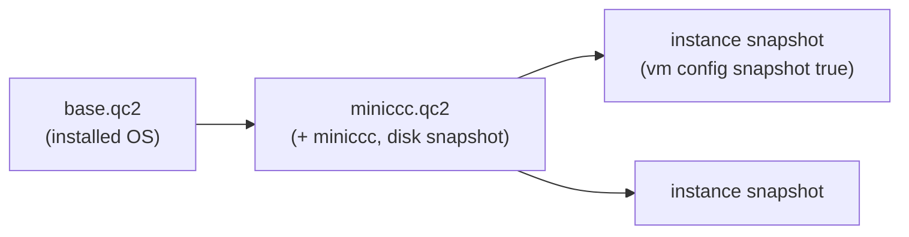

# Disk images and the disk API

minimega's `disk` API wraps `qemu-img` and `qemu-nbd`. With it, you can create,
inspect, layer, resize, and edit disk images without leaving the minimega
prompt. This page covers every `disk` subcommand and how qcow2 backing chains
work. It explains how `vm config snapshot` builds on backing chains. It also
gives the `qemu-img` recipes for converting and shrinking images. Last, it
describes how to mount an image by hand and the cases where injection does not
work.

Use this page in these cases:

- You build a base image (see [Creating VMs from install media](newvm.md) and
  [Building images with vmbetter](vmbetter.md)).
- You want to add files to an image without booting it.
- You must understand what happens to the disk of a VM in snapshot mode.

This page shows commands at the minimega prompt. The same strings work through
`-e`, a command file, or the Python bindings.

## Where images live

Every `disk` command resolves a relative image path against minimega's files
directory (`-filepath`, `/tmp/minimega/files` by default). `disk` also accepts
absolute paths. Keep images in the files directory, because other nodes can
reach them there with the `file:` prefix (see [File management](file.md)). Also,
`disk snapshot` writes a relative or omitted destination to the files directory.
`disk` commands run on the node where you issue them. To run one elsewhere, use
`mesh send`.

## Creating and inspecting images

`disk create` makes an empty image in either format. Sizes take `k`, `M`, `G`,
or `T` suffixes. A qcow2 file starts near zero bytes and grows as the guest
writes. A raw image is a plain byte-for-byte disk, created sparse:

```minimega
minimega$ disk create qcow2 base.qc2 20G
minimega$ disk create raw scratch.img 512M
```

`disk info` reports what `qemu-img info` knows. It also reports whether any
process currently holds a lock on the file. You can use this lock to tell that a
VM has the file open. To walk the backing chain, add `recursive`:

```minimega
minimega$ disk info miniccc.qc2 recursive
host | image                           | format | virtualsize | disksize | backingfile | inuse
mm1  | /tmp/minimega/files/miniccc.qc2 | qcow2  | 20.0 GiB    | 1.2 GiB  | base.qc2    | false
mm1  | /tmp/minimega/files/base.qc2    | qcow2  | 20.0 GiB    | 3.4 GiB  |             | false
```

`virtualsize` is the size that the guest sees. `disksize` is the space that the
file uses on the host.

## Backing chains

A qcow2 image can name a *backing file*. Reads of clusters that are not written
in the image fall through to the backing file. Writes stay in the image. The
backing file is never modified, so one base can support any number of overlays.
Each overlay costs only the blocks that it changes.



`disk snapshot` creates an overlay. If you omit the destination, minimega
picks a random name in the files directory:

```minimega
minimega$ disk snapshot base.qc2 miniccc.qc2
```

The new image records its backing file as a path *relative* to itself. Because
of this, you can copy a files directory or serve it to another node as a unit,
and the chain still resolves. When a node fetches an image with `file:`,
minimega fetches its backing file the same way. If you prefer absolute paths,
start minimega with `-abssnapshot` (or `MM_ABSSNAPSHOT=true`). Then the help
text for `disk snapshot` and `disk rebase` says `absolute` instead of
`relative`.

Three commands change a chain after the fact:

- `disk rebase <image> [backing]` moves `image` onto a different backing file.
  It copies whatever differs between the old and new backing files into `image`,
  so that its contents do not change. With no backing file, minimega copies
  everything in, and the image becomes standalone.
- `disk set-backing <image> [backing]` only rewrites the pointer
  (`qemu-img rebase -u`). If the backing file was renamed or moved but its
  content is identical, use it. Do not point it at a different image, because
  this corrupts the overlay.
- `disk commit <image>` pushes the changes of the overlay down into its backing
  file. The overlay stays as it is. You can delete it or keep using it on top of
  the updated base.

Do not modify a base image while overlays depend on it. This includes booting
the base image with `snapshot false` and committing a different overlay into it.
Modify it only to change what every overlay sees.

`disk resize <image> <size>` changes the virtual size, either absolutely (`50G`)
or relatively (`+512M`). minimega does not change the partition table or the
filesystem inside the image. After you enlarge the image, grow them from inside
the guest. Before you shrink the image, shrink them from inside the guest.
minimega passes `--shrink`, and `qemu-img` then cuts off data.

## How vm config snapshot uses backing files

`vm config snapshot` defaults to `true`. In that mode, minimega does not touch
the image that you named. QEMU writes to a temporary overlay in the instance
directory of the VM, and `vm flush` discards that overlay. This lets one image
back hundreds of VMs at once.

In snapshot mode, the cache mode of the drive is `unsafe`. Because of this, the
temporary overlay can miss data even after a clean guest shutdown. If you intend
to keep the overlay, set a different cache mode with
`vm config disks image.qc2,ide,writeback`.

With `snapshot false`, QEMU writes into the image itself, exactly one VM can
have it open, and `disk info` shows it `inuse`. Use this mode to install an
operating system or to update a base. The usual workflow is:

1. Install into `base.qc2` with `snapshot false`, shut down cleanly, and leave
   it alone from then on.
2. Run `disk snapshot base.qc2 role.qc2`. Boot `role.qc2` with `snapshot false`,
   customize the guest, and shut it down.
3. Launch experiments from `role.qc2` with the default `snapshot true`.

On a cluster, name the image with `file:`. Every node then fetches the overlay
and its chain before launching.

## Injecting files

`disk inject` attaches the image to an NBD device, mounts one partition, copies
files in or deletes them, flushes, and detaches. The VM must not be running.

Each `files` argument is `source:destination`. The source is a path on the host.
The destination is relative to the root of the mounted partition. Neither can
contain a colon. minimega creates parent directories and overwrites existing
files:

```minimega
minimega$ disk inject role.qc2 files /opt/minimega/bin/miniccc:/usr/local/bin/miniccc /tmp/minimega/files/miniccc.service:/etc/systemd/system/miniccc.service
```

Partition selection follows the image name:

- No suffix: the image must have one partition, and `disk inject` uses
  partition 1. An image with several partitions produces
  `please specify a partition; multiple found`.
- `image.qc2:2`: partition 2. Windows images normally need this. See
  [Windows guests](windows.md).
- `image.qc2:none`: the image has no partition table and the filesystem starts
  at byte 0, as with a USB stick made by `mkfs.vfat usb.img`.

Mounting tries the kernel's own drivers first (`mount -w`) and falls back to
`ntfs-3g` for NTFS. `options "<args>"` replaces the mount arguments entirely.
You need it for filesystems that `mount` cannot detect or for an offset inside a
partition. With `options`, minimega accepts only a single `source:destination`
pair:

```minimega
minimega$ disk inject scratch.img:none options "-t vfat" files /tmp/minimega/files/miniccc.exe:miniccc.exe
```

`delete` removes files or directories. List them separated by commas:

```minimega
minimega$ disk inject role.qc2 delete files "etc/ssh/ssh_host_rsa_key,var/log/miniccc.log"
```

Injection loads the `nbd` kernel module with `max_part=10` and picks a free
`/dev/nbdN`. If `nbd` was already loaded without `max_part`, partitions never
appear and `disk inject` fails with "no partitions found on image". In that
case, unload the module and let minimega load it again.

## Converting and shrinking with qemu-img

minimega does not wrap `qemu-img convert`, but you will want it for two jobs.
The first is changing format, for example to import a VMware disk:

```bash
$ qemu-img convert -f vmdk -O qcow2 appliance.vmdk appliance.qc2
```

`convert` always writes a standalone image, so it is also a way to flatten a
backing chain. `-c` compresses the output at the cost of speed.

The second job is reclaiming space. A qcow2 file never shrinks on its own. A
guest that writes and then deletes 10 GB leaves 10 GB of allocated clusters
behind. `disk resize` changes only the virtual size. To get the space back,
overwrite the free space with zeros from inside the guest. Then shut down the
guest and convert the image:

```bash
# in a Linux guest
dd if=/dev/zero of=/zero bs=1M; rm -f /zero
```

```text
REM in a Windows guest (size in bytes; pick something close to the free space)
fsutil file createnew C:\zero 100000000000
del C:\zero
```

```bash
$ mv base.qc2 base.qc2.orig
$ qemu-img convert -O qcow2 base.qc2.orig base.qc2
```

If overlays depend on the image, remember that each of them records the name of
the image. Converting in place under the same name, as above, keeps the chain
intact.

## Mounting an image by hand

You can do everything that `disk inject` does from a root shell. Use a root
shell to look around an image or to handle layouts that injection does not
support:

```bash
$ sudo modprobe nbd max_part=10
$ sudo qemu-nbd -c /dev/nbd0 /tmp/minimega/files/base.qc2
$ sudo fdisk -l /dev/nbd0
$ sudo mount /dev/nbd0p1 /mnt
$ sudo cp miniccc /mnt/usr/local/bin/
$ sudo umount /mnt
$ sudo qemu-nbd -d /dev/nbd0
```

Do this only while no VM has the image open. minimega chooses NBD devices by
checking for `/var/lock/qemu-nbd-nbdN` and `/sys/block/nbdN/pid`. Because of
this, concurrent `disk inject` commands skip a device that you connect with
`qemu-nbd -c`. When you are done, always disconnect the device.

For a guest whose root is on LVM, the partition holds a physical volume, not a
filesystem. `disk inject` cannot mount it. To mount it by hand, do these steps:

1. Connect the NBD device.
2. Run `vgchange -ay <vg>`, where `<vg>` is the volume group of the guest. `vgs` lists it.
3. Mount the logical volume from `/dev/mapper/`.
4. When you are done, unmount the logical volume.
5. Run `vgchange -an <vg>`.
6. Disconnect the NBD device.

## Caveats

- For LVM and encrypted guests, `disk inject` mounts one partition as a
  filesystem. It cannot activate LVM or open LUKS. For LVM, use the manual
  method above. Alternatively, add files through `cc` after the guest starts.
- For Windows guests, choose the system partition explicitly (`:2` on BIOS/MBR
  installs, usually `:3` on UEFI/GPT). Make sure that `ntfs-3g` is installed on
  the host. Shut Windows down fully so that the volume is not marked dirty.
  Details are in [Windows guests](windows.md).
- Interface names depend on the PCI slot that minimega assigned. A Linux guest
  that uses the predictable names of systemd sees `ens3` on one `vm config` and
  `enp0s4` on another. To keep `eth0`, add `net.ifnames=0` to the kernel command
  line of the guest. Use `vm config append` for kernel and initrd boots, and the
  boot loader configuration for disk images. See the
  [naming scheme](https://www.freedesktop.org/software/systemd/man/latest/systemd.net-naming-scheme.html)
  of systemd.
- Modifying a base while overlays reference it gives inconsistent results. A
  snapshot of an image that a `snapshot false` VM currently has open also gives
  inconsistent results. Check `disk info` for `inuse` first.
- Instance overlays of snapshot-mode VMs can be incomplete in the `unsafe` cache
  mode. If you do not set a different cache mode, do not copy them out and
  expect a clean filesystem.

## See also

- [Creating VMs from install media](newvm.md)
- [Building images with vmbetter](vmbetter.md)
- [Windows guests](windows.md)
- [File management](file.md) for the `file:` prefix and the files directory
- [Running minimega](running.md) for `-filepath` and `-abssnapshot`
- Reference: [`disk`](../reference/minimega.md#disk),
  [`disk create`](../reference/minimega.md#disk-create),
  [`disk info`](../reference/minimega.md#disk-info),
  [`disk snapshot`](../reference/minimega.md#disk-snapshot),
  [`disk commit`](../reference/minimega.md#disk-commit),
  [`disk resize`](../reference/minimega.md#disk-resize),
  [`vm config disks`](../reference/minimega.md#vm-config-disks),
  [`vm config snapshot`](../reference/minimega.md#vm-config-snapshot)
- [qemu-img](https://www.qemu.org/docs/master/tools/qemu-img.html) and
  [qemu-nbd](https://www.qemu.org/docs/master/tools/qemu-nbd.html) manuals
