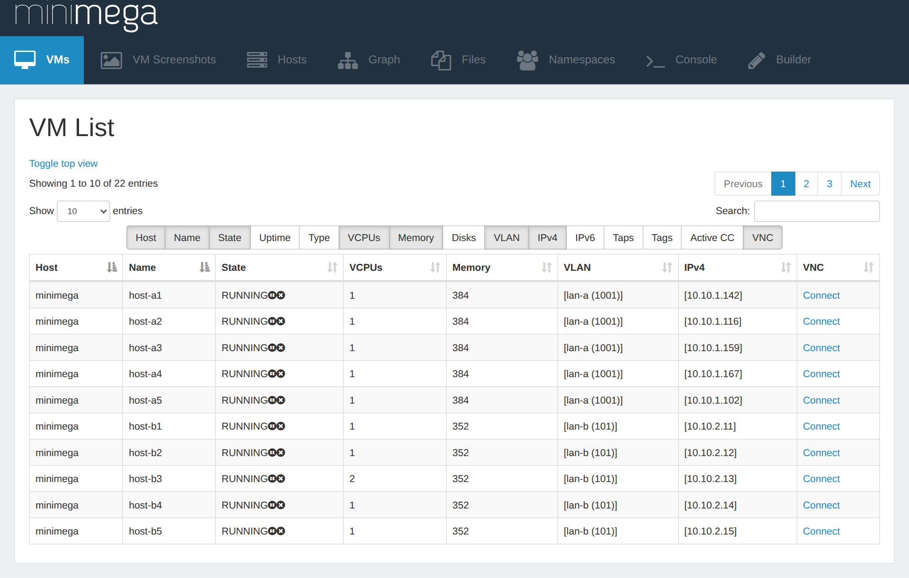
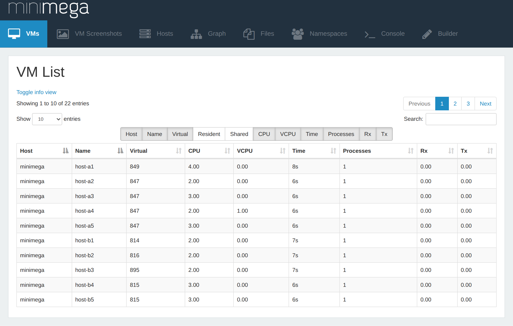
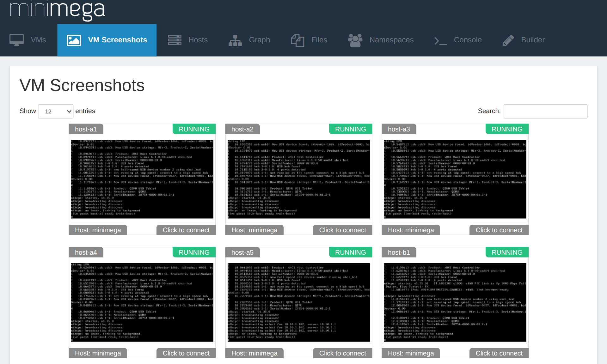
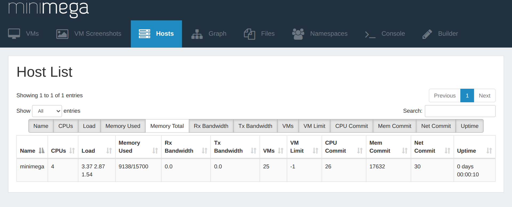
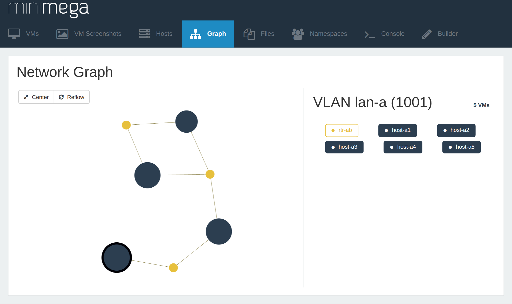
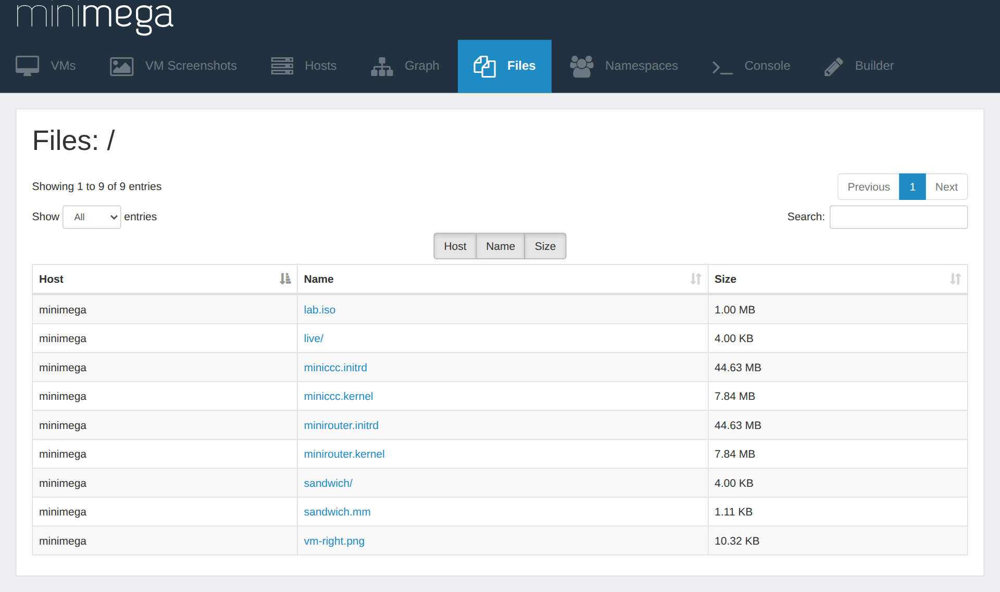
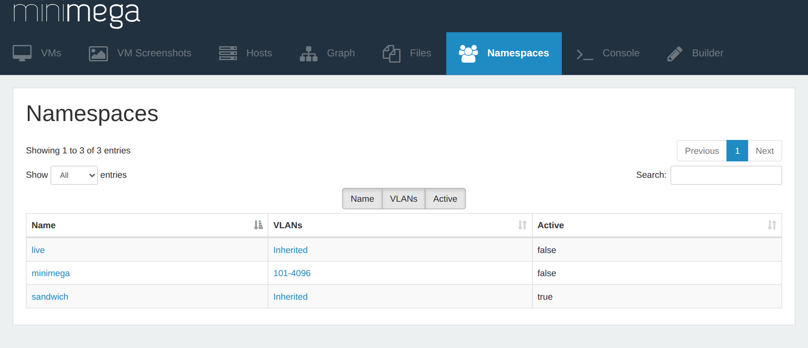
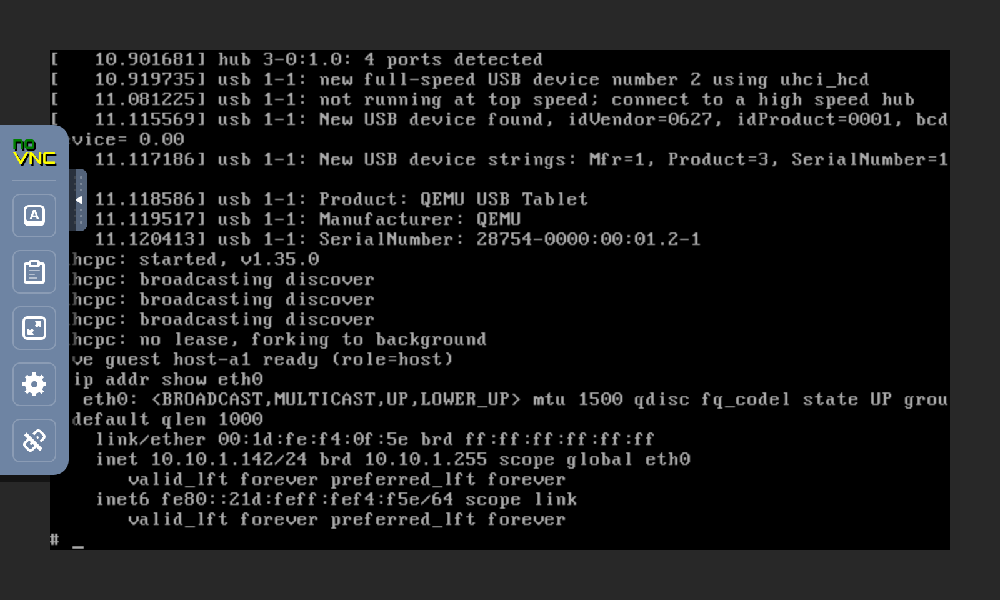
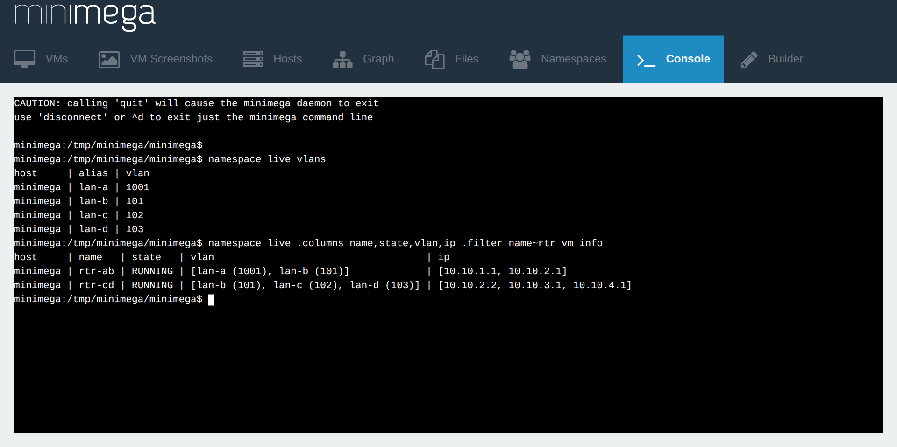

# miniweb

miniweb is the web interface for a running minimega. It lists VMs, hosts, VLANs,
and files. It opens VNC, terminal, and Android consoles in the browser and draws
the network graph. It can also expose a minimega console and a JSON command API.
This page covers starting miniweb, what each URL does, how namespaces map to
URLs, and how to add authentication and TLS.

You need a running minimega first. See [Running minimega](running.md). The
Docker image starts miniweb for you. See [Running in Docker](docker.md).

## How it connects

miniweb talks to minimega over the command socket in the base directory of
minimega, `<base>/minimega`. It must run on a host that runs minimega, normally
the head node. miniweb prefixes every command that it sends with
`.record false`, so browsing does not show up in the `history` of minimega. If
the socket goes away, miniweb redials on the next request.

## Starting miniweb

The packages install the binary as `/opt/minimega/bin/miniweb` (linked to
`/usr/bin/miniweb`) and the web assets under `/opt/minimega/web`. In a source
checkout, the assets are in the `web/` directory of the repository. This
directory is also the default `-root`. Run miniweb from the repository root, or
pass `-root`:

```bash
$ miniweb -root /opt/minimega/web
```

Then open <http://localhost:9001/>.

By default, miniweb listens on all interfaces and asks for no password. Anyone
who can reach port 9001 can stop and kill VMs. To accept only local
connections, add `-addr 127.0.0.1:9001`. To require a password, see
[Authentication](#authentication).

| Flag | Default | Purpose |
|---|---|---|
| `-addr` | `:9001` | Listen address as `host:port`. |
| `-base` | `/tmp/minimega` | minimega base directory. Must match the `-base` of the daemon. |
| `-root` | `web` | Directory holding the templates and static files. |
| `-namespace` | | Restrict miniweb to one namespace (see [Namespaces](#namespaces)). |
| `-passwords` | | JSON password file for HTTP basic authentication. |
| `-bootstrap` | `false` | Interactively create the `-passwords` file, then exit. |
| `-cert`, `-key` | | PEM certificate and key. Both are required to serve HTTPS. |
| `-console` | | Path to the minimega binary. Enables `/console`, `/command`, and `/commands`. |
| `-level`, `-logfile`, `-v` | `error`, none, `true` | Logging. |

In the Docker image, `start-minimega.sh` starts miniweb before minimega with
`-root=$MINIWEB_ROOT -addr=$MINIWEB_HOST:$MINIWEB_PORT`. The defaults are
`/opt/minimega/web`, `0.0.0.0`, and `9001`.

### Static directories and the bundled documentation

At startup, miniweb registers every subdirectory of `-root` as a static file
server at `/<name>/`. Examples are `/css/`, `/js/`, `/novnc/`, and
`/xterm.js/`. The Docker image copies the built documentation to
`/opt/minimega/web/docs`. This is why <http://localhost:9001/docs/> works inside
a container. You can publish your own files the same way. Create a directory
under `-root`, and it appears at `/<name>/`. miniweb serves these directories
without the password check, also when you set `-passwords`. Do not put private
files there.

## Pages

| Path | What it shows |
|---|---|
| `/` | Redirects to `/vms`. |
| `/vms` | VM table from `vm info`. VMs in the `quit` or `error` state are hidden. `/vms#top` switches to the `vm top` view. |
| `/vms/new` | Form that launches one VM: a name, the kind (`kvm` or `container`), and one of the saved configurations that `vm config restore` lists. |
| `/tilevnc` | Screenshot grid of every VM. Click a tile to connect. |
| `/hosts` | Output of `host`. |
| `/vlans` | VLAN aliases from `vlans`. |
| `/graph` | Interactive graph of VMs and the VLANs that join them. |
| `/files/` | Listing from `ns run file list`. Append a subdirectory, for example `/files/images/`. Requesting a single file downloads it through `file stream`. There is no upload. |
| `/namespaces` | Every namespace, with links to its VM and VLAN pages. When `-namespace` is set, miniweb answers 501. |
| `/minibuilder` | Diagram editor for sketching topologies. `/minibuilder/save` returns the drawing as an XML download. |
| `/console` | Web terminal attached to minimega. Requires `-console`. |
| `/command`, `/commands` | JSON command API. Require `-console`. |

JSON endpoints feed the tables. You can also call these endpoints from scripts:
`/vms/info.json`, `/vms/top.json`, `/hosts.json`, `/vlans.json`,
`/namespaces.json`, and `/files.json?path=<dir>`. Each returns a list of
objects, one per row, keyed by column name plus `host`.

### The VM table

The State column has the controls. A play icon appears for VMs in the
`BUILDING` or `PAUSED` state (`vm start`). A pause icon appears for `RUNNING`
VMs (`vm stop`). An X runs `vm kill`. Killed VMs drop out of the table because
the table filters `quit` VMs. They still exist until you run `vm flush` from the
CLI.

The VNC column links to `/vm/<name>/connect`. By default, miniweb hides several
columns (uptime, type, disks, IPv6, taps, tags, active CC).



The buttons above the table toggle columns. The Search box filters rows as you
type. **Toggle top view** switches the same page to `vm top`. This view
refreshes and shows memory, CPU, process count, and interface counters:



### The other pages

`/tilevnc` draws one live screenshot per VM. When you click a tile, it connects
you to that VM. This is the quickest way to watch a whole experiment:



`/hosts` is the `host` table, one row per node, with the resource and commit
columns that the scheduler uses:



`/graph` draws one node for each VLAN and one node for each VM that joins two
or more VLANs. When you click a node, the sidebar lists its members:



`/files/` lists the files directory of the namespace. When you click a file, it
serves that file:



`/namespaces` lists every namespace with its VLAN range, and links to that
namespace's own pages:



### Per-VM routes

| Path | Method | Purpose |
|---|---|---|
| `/vm/<name>/connect/` | GET | Console page: noVNC for KVM VMs, xterm.js for containers, the Android console for Android VMs. |
| `/vm/<name>/connect/ws` | WebSocket | Raw tunnel to the VM's `vnc_port` (KVM) or `console_port` (container) as reported by `vm info`. Not used by Android VMs. |
| `/vm/<name>/screenshot.png` | GET | Current screenshot. `?size=<pixels>` scales it. `&base64=1` returns a `data:` URI instead of PNG bytes. Containers answer 404. |
| `/vm/<name>/start`, `/vm/<name>/stop`, `/vm/<name>/kill` | POST | Run `vm start`, `vm stop`, or `vm kill` for that VM and return the rendered response. |
| `/vm/<name>/android/display/ws` | WebSocket | Live PNG frames from the Android emulator. |
| `/vm/<name>/android/api/v1/emulator/status` | GET | Emulator status. |
| `/vm/<name>/android/api/v1/emulator/gps`, `.../rotation` | POST | Set the GPS fix or the device orientation. |

## Connecting to VMs

For a KVM VM, the connect page loads noVNC and opens the WebSocket. miniweb
dials the VM's host and VNC port directly and copies bytes in both directions.
Containers get an xterm.js terminal on the console port of the container.
minimega keeps a small scrollback buffer for each container console. Several
viewers can share the buffer, so a newly opened terminal shows recent output
instead of a blank screen.

Android VMs get a console that streams emulator frames over
`/vm/<name>/android/display/ws`. The console also drives input, GPS, and
orientation through the emulator. See [Android VMs](android.md).



The noVNC control bar opens from the handle at the left edge. It scales the
display, goes full screen, and sends key combinations that the browser
otherwise intercepts.

miniweb connects to the host and port that `vm info` reports. Therefore, the
miniweb host must be able to reach the VNC and console ports on every node in
the cluster. The miniweb log can say that it cannot connect. In this case, make sure that
the firewall between the nodes allows the connection.

## Namespaces

miniweb selects a namespace in one of two ways.

With `-namespace <name>`, every command runs in that namespace, the URL prefix
described next is disabled, and `/namespaces` answers 501.

Without it, prefix any path with a namespace: `/foo/vms` shows the VMs of
namespace `foo`, `/foo/vlans` its VLAN aliases, `/foo/files/` its file
listing, and `/foo/vm/<name>/connect` a console. Unprefixed paths use whatever
namespace the head node is currently in. `/namespaces` lists the namespaces
with links to each, and a bare `/foo` redirects to `/foo/`.

## Console and command API

Pass `-console` with the path to the minimega binary to enable three routes:

```bash
$ miniweb -root /opt/minimega/web -console /usr/bin/minimega
```

`/console` opens a terminal in the browser. Each visit spawns
`<path> -attach` in a pseudo-terminal.

miniweb passes no `-base`. The attached minimega takes its base directory from
`MM_BASE` in the environment of miniweb. If `MM_BASE` is not set, it takes the
base directory from `/etc/minimega/minimega.conf`. If neither is set, it uses
the default. If your daemon uses a `-base` that is not recorded in
`/etc/minimega/minimega.conf`, export `MM_BASE`.



`/command` accepts a `POST` with one JSON object and returns the responses as
JSON. `columns` and `filters` are optional and become `.columns` and `.filter`
prefixes on the command:

```bash
$ curl http://localhost:9001/command -d '{"command": "vm info", "columns": ["name", "state"], "filters": ["state=running"]}'
```

`/commands` accepts a `POST` with a JSON array of such objects and runs them in
order.

The namespace for `/command` and `/commands` comes from the URL prefix or
`-namespace`, as for every other page. Without `-console`, all three routes
answer 501.

!!! warning
    Enable these routes only behind authentication and TLS, or bind `-addr` to
    an address that untrusted networks cannot reach. These routes run any
    minimega command, including `shell`. See
    [Security considerations](security.md).

## Authentication

miniweb supports per-path HTTP basic authentication, which lets you limit a
user to a namespace or to a single VM. Create the password file interactively
with `-bootstrap`:

```text
$ miniweb -bootstrap -passwords minimega.passwd
Configure /
Username: jon
Password:
Confirm Password:

Add additional users (Ctrl-D when finished):
Path: /vm/fritz
Username: fritz
Password:
Confirm Password:

Add additional users (Ctrl-D when finished):
Path:
```

The result is a JSON list of entries with bcrypt-hashed passwords:

```json
[
    {
        "path": "/",
        "username": "jon",
        "password": "JDJhJDEwJFZzSjNIRjFVbjc5Z2ZReUpxVmRZMS5WU2thaUNHS3RIczk5eExFMS5kdy5VUEQuY1pub1FT"
    },
    {
        "path": "/vm/fritz",
        "username": "fritz",
        "password": "JDJhJDEwJGc0VC93YkNtWVZjMWlteXF1dldrRy5zRkZWVm5GSzMxSjdNZFgwdGp6eklnZmtVaHVuUmhh"
    }
]
```

Start miniweb with the file and without `-bootstrap`:

```bash
$ miniweb -passwords minimega.passwd
```

A request must satisfy one of the entries whose `path` is a prefix of the
request path. Paths that match no entry need no credentials. Matching is by
prefix, so with the file above, both jon (`/`) and fritz (`/vm/fritz`) can open
`/vm/fritz`. Only jon can open `/vms`. The rule for `/vm/fritz` also matches
`/vm/fritz2`, because the match is by prefix. To limit a user to namespace
`foo`, use the path `/foo/`. That rule protects only paths that start with
`/foo/`, so keep a rule for `/` to protect all other paths. If you have many
rules, a script can generate the file, because the format is deliberately
simple.

## TLS

Basic authentication sends credentials in the clear. When you use it, serve
HTTPS. miniweb takes a PEM certificate and key. If you give only one of them,
miniweb refuses to start. To generate a self-signed pair:

```bash
$ openssl req -x509 -newkey rsa:4096 -nodes -keyout key.pem -out cert.pem -days 365
$ miniweb -cert cert.pem -key key.pem -passwords minimega.passwd
```

TLS also removes the "Running without HTTPS is not recommended" warning. The
noVNC console shows this warning when the browser does not treat the page as
secure.

## See also

- [Running minimega](running.md) and [Running in Docker](docker.md)
- [VNC](vnc.md) and [Android VMs](android.md)
- [Namespaces](namespaces.md)
- [Command line and scripting](cli.md) for the command socket that miniweb uses
- [Security considerations](security.md)
- [Tools overview](../tools.md)
