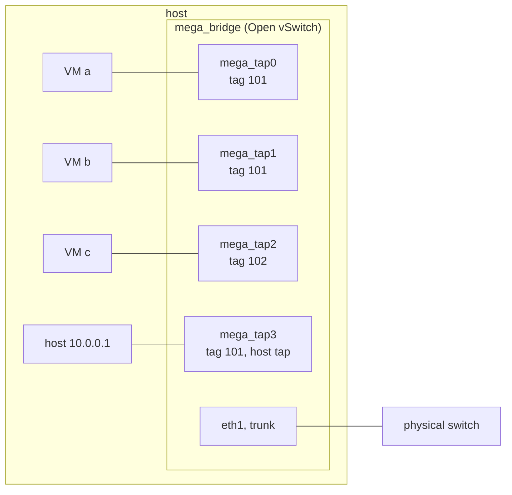

# Host networking

This page explains how minimega connects virtual machines to each other and to the host. It covers the Open vSwitch bridge and 802.1q VLAN underneath every VM interface, the `vm config networks` netspec, and VLAN aliases and ranges. It also covers host taps, DHCP and DNS served from the host with dnsmasq, and bridge trunks and tunnels. The last topics are per-interface quality of service and the two ways to give an experiment a path to the outside world. As soon as an experiment has more than one VM, or a VM must reach something that is not another VM, you need this page.

It assumes that you can already launch a VM (see [VM lifecycle](vm-lifecycle.md) or the [quickstart](quickstart.md)). [Routing with minirouter](router.md) covers routing inside the experiment. [Capture and instrumentation](capture.md) covers packet capture and mirroring. [Cluster setup](cluster.md) covers experiments that span several hosts.

## How minimega wires VMs together

Every VM interface is a Linux tap device (`mega_tap0`, `mega_tap1`, ...). minimega adds the tap device as a port on an Open vSwitch bridge, which is `mega_bridge` unless you say otherwise. The port carries an 802.1q VLAN tag. Two interfaces with the same tag on the same bridge share a layer-2 network. Interfaces with different tags cannot see each other, and nothing else is needed to keep experiments apart.

A host tap is the same kind of port, but the host's network stack is on the other end instead of a VM. A trunk port passes every tag to a physical NIC, so that the same VLANs can exist on other hosts.



Open vSwitch shows the same picture:

```bash
$ sudo ovs-vsctl show
```

```text
    Bridge mega_bridge
        Port mega_tap0
            tag: 101
            Interface mega_tap0
        Port mega_tap2
            tag: 102
            Interface mega_tap2
        Port mega_bridge
            Interface mega_bridge
                type: internal
```

If `mega_bridge` already exists when minimega starts, minimega adopts it and does not create a new one. minimega never destroys a bridge that it did not create. When a physical interface is on the bridge, this distinction matters. See [Bridges, trunks and tunnels](#bridges-trunks-and-tunnels).

!!! tip "Keep management traffic off the experiment bridge"
    A host that only runs single-node experiments can leave its management NIC alone. When you trunk a NIC into `mega_bridge` to reach other hosts or to bridge VMs onto a real LAN, use a second NIC for management. Experiment traffic then cannot saturate the interface that you use to administer the host. A mistake in the bridge configuration cannot lock you out.

## Configuring VM interfaces

`vm config networks` (alias `vm config net`) takes one netspec per interface, in the order that the guest sees them:

```text
[bridge,]vlan[,mac][,driver][,qinq]
```

Only the VLAN is required. The other fields are optional but must keep that order. The defaults are `mega_bridge`, a random MAC (with a few exclusions), and the `e1000` driver.

minimega tells the fields apart by their content. A field that parses as a MAC address is the MAC. A field that names a QEMU network device is the driver. The literal `qinq` is the QinQ flag. In a two-field spec, anything else in front of the VLAN is the bridge.

```minimega
# two interfaces on the VLAN aliases "dmz" and "core"
vm config net dmz core

# a fixed MAC on the first interface
vm config net dmz,00:11:22:33:44:55 core

# a different bridge for the second interface
vm config net dmz other_bridge,core

# a different QEMU device model
vm config net dmz,virtio-net-pci

# an interface in dot1q-tunnel (QinQ) mode with "dmz" as the outer tag
vm config net dmz,qinq
```

The driver must be a network device that QEMU knows about (`-device help` lists them). Containers ignore the driver, and Android VMs always use `virtio-net-pci`. QinQ puts the OVS port in `dot1q-tunnel` mode, so that the guest's own 802.1q tags travel inside the minimega VLAN. `vm config net` with no argument prints the current list.

`vm info` has one column per interface property: `vlan`, `bridge`, `tap`, `mac`, `ip`, `ip6`, `qos`, `qinq` and `bond`. minimega fills in the address columns by snooping ARP and IPv6 neighbor solicitation traffic on the bridge. For this reason, the address columns trail the guest by a moment.

```minimega
minimega$ .columns name,vlan,tap,ip vm info
name | vlan                    | tap                    | ip
r0   | [dmz (101), core (102)] | [mega_tap0, mega_tap1] | [10.0.0.1, 10.0.1.1]
```

### Changing interfaces on a running VM

`vm net` edits the interfaces of running VMs and accepts the same VM targets as `vm start`. You address interfaces by their zero-based position in `vm config networks`:

```minimega
# add an interface, same netspec syntax as vm config networks
vm net add r0 mgmt,00:00:00:00:00:01

# move interface 1 to another VLAN, and optionally another bridge
vm net connect r0 1 core2
vm net connect r0 1 core2 other_bridge

# unplug interface 0; it stays on the VM, disconnected
vm net disconnect r0 0
```

A disconnected interface shows as `disconnected` in the `vlan` column. To plug the interface back in, use `vm net connect`.

### Bonds

`vm config bonds` bonds two or more of a VM's interfaces into one OVS bond, by index:

```text
<interface indexes>,<bond mode>[,<lacp mode>][,no-lacp-fallback][,qinq][,<bond name>]
```

Bond modes are `active-backup`, `balance-slb` and `balance-tcp`. LACP modes are `active` (the default), `passive` and `off`. When LACP negotiation fails, `no-lacp-fallback` disables the bond and does not fall back to `active-backup`. `no-lacp-fallback` also requires an explicit LACP mode. If you say `qinq`, or if any member interface is QinQ, the bond is QinQ.

```minimega
vm config net uplink uplink
vm config bonds 0,1,balance-tcp,active,no-lacp-fallback,uplink
```

To do the same on a running VM, use `vm net bond <vm> <indexes> <mode> <lacp> [no-lacp-fallback] [name <name>] [qinq]`. An example is `vm net bond r0 1,2 active-backup active`. To remove bonds again, use `clear vm net bond <vm> [name]`. Bonds appear in the `bond` column of `vm info` and in the `bridge` listing.

## VLAN aliases and ranges

You rarely pick VLAN numbers yourself. Any netspec VLAN that is not an integer is an alias. The first time minimega sees an alias, it allocates the next free tag from the VLAN range and remembers the mapping. `vlans` lists the mappings of the active namespace:

```minimega
minimega$ vm config net dmz core
minimega$ vm launch kvm a
minimega$ vlans
alias | vlan
core  | 102
dmz   | 101
```

The range comes from the `-vlanrange` flag (`MM_VLANRANGE` under systemd or Docker). The default is `101-4096`, so aliases start at 101 and minimega leaves tags 1 through 100 for you. Ranges are half-open. This means that minimega never allocates the upper bound itself.

Aliases are namespace-scoped. `dmz` in namespace `foo` and `dmz` in namespace `bar` are different VLANs. For this reason, you can run the same script in several namespaces and the experiments do not touch each other. Internally, minimega stores an alias as `namespace//alias`. To join a VLAN that belongs to another namespace on purpose, write that form yourself:

```minimega
minimega[bar]$ vm config net foo//dmz
```

minimega broadcasts alias assignments to the other hosts in the mesh, so a VM on any host that names `dmz` gets the same tag.

`vlans add <alias> <vlan>` pins an alias to a specific tag, for example to match a device on the trunk that expects VLAN 500. `vlans range <min> <max>` restricts the range that minimega uses to allocate new aliases in the current namespace. Set the range before you launch VMs. In the default namespace, the command changes the global range instead. The range of a namespace cannot overlap the range of another namespace. `vlans range` alone prints the active range and the next tag that minimega allocates:

```minimega
minimega[foo]$ vlans range 1500 1600
minimega[foo]$ vlans range
min  | max  | next
1500 | 1600 | 1500
```

minimega blacklists any VLAN that you give as a plain integer. It logs `Blacklisting manually specified VLAN 500` and never allocates that tag to an alias. minimega assumes that you use the tag for something specific.

`vlans blacklist <vlan>` does the same by hand. `vlans blacklist` lists the reserved tags. Valid tags are 0 through 4095. `0` means untagged (see [Bridging VMs onto a real LAN](#bridging-vms-onto-a-real-lan)).

To remove one VLAN from the blacklist, use the `clear vlans blacklist` API with the VLAN ID:

```minimega
minimega[dev2]$ clear vlans blacklist 333
```

If the VLAN is not blacklisted, the command fails. If the VLAN is in use, the command also fails. The command inspects the VMs on this node and on the hosts in each namespace that this node knows about. It inspects VM configurations, saved VM configurations, queued and launching VMs, and host taps on this node only. First, kill and flush those VMs. Then clear those configurations. While the command runs, other commands on this node cannot use the VLAN. The blacklist is local to each node.

If a host in one of those namespaces does not return its VMs, the command also fails. If a host left the mesh, remove the host from each namespace that contains it with `ns del-hosts`. For example, to remove `node5` from the `dev2` namespace:

```minimega
minimega[dev2]$ ns del-hosts node5
```

The command cannot stop commands on other hosts. A host can connect a VM to the VLAN after it returns its VMs. While the command runs, do not use the VLAN on other hosts.

`clear vlans` forgets the aliases of the current namespace. For a namespace other than the default, it also forgets the range. `clear vlans <prefix>` forgets only the aliases that start with the prefix. `clear vlans all` wipes every alias, range and blacklist entry in every namespace. Kill the VMs first. If you clear an alias that VMs still use, its tag becomes available for an unrelated second allocation.

## Host taps

A host tap is a port on the bridge that ends in the host's network stack instead of in a VM. Create a host tap on the VLAN that you want to reach. Give the tap an address. The host is then on that network:

```minimega
minimega$ .columns name,ip,vlan vm info
name | ip           | vlan
web  | [10.0.0.234] | [dmz (101)]
minimega$ tap create dmz ip 10.0.0.1/24
mega_tap3
minimega$ tap
bridge      | tap       | vlan
mega_bridge | mega_tap3 | dmz (101)
```

`tap create` prints the name of the interface it made. From here `ping 10.0.0.234`, `ssh`, a browser pointed at the VM, or a service listening on `10.0.0.1` all work. The forms are:

```minimega
tap create <vlan>                          # no address; configure it yourself
tap create <vlan> name <tap name>
tap create <vlan> ip <address/prefix> [tap name]
tap create <vlan> dhcp [tap name]          # runs dhclient on the new tap
tap create <vlan> bridge <bridge> ...      # same options on another bridge
tap delete <tap name>
tap delete all
```

`dhcp` needs a DHCP server already on that VLAN. The server can be a VM, a minirouter, or dnsmasq as described next. `clear tap` deletes every host tap of the current namespace together with any mirrors. It touches only the local host.

Taps are namespace-aware. A tap that you create while a namespace is active belongs to that namespace. minimega lists the tap only in that namespace, and you can delete the tap only from that namespace. Tap names must be unique on the host. Unlike VLAN aliases, you cannot reuse a name in two namespaces.

!!! warning "A host tap joins the host to the experiment"
    Use host taps for bootstrapping and debugging. For a long-running experiment, serve DHCP and DNS from a router VM instead. When you no longer need the tap, delete it. Anything on the tapped VLAN can now reach the host at the tap's address. The host's routes and services are exposed to that traffic. See [Security considerations](security.md).

## DHCP and DNS from the host

`dnsmasq start` runs an instance of [dnsmasq](https://dnsmasq.org/doc.html) on the host. The instance binds to the address of a host tap. It assigns leases and answers DNS for a VLAN. This is the quickest way to give addresses to a few VMs:

```minimega title="dnsmasq.mm"
--8<-- "articles/networking/dnsmasq.mm"
```

[Download this example](networking/dnsmasq.mm){ download="dnsmasq.mm" }

`dnsmasq` alone lists the running instances, and `dnsmasq kill <id>` or `dnsmasq kill all` stops them:

```minimega
minimega$ dnsmasq
id | address  | min      | max        | path                            | pid
0  | 10.0.0.1 | 10.0.0.2 | 10.0.0.254 | /tmp/minimega/dnsmasq_460796406 | 47997
```

Each instance has a directory under the base directory. The directory holds its pid file, its leases and the fragments that `dnsmasq configure` writes. You can pass a dnsmasq configuration file of your own as a fourth argument (an absolute path). You can also run an instance from a file only, with `dnsmasq start <config>`.

`dnsmasq configure <id> ...` changes a running instance without restarting it. `all` in place of the id applies the change to every instance. The examples on this page use id `0`, the id of the first instance. If other instances run, use the id that `dnsmasq` lists for yours:

```minimega
# a fixed address for a MAC
dnsmasq configure 0 ip 00:11:22:33:44:55 10.0.0.50

# a name that resolves
dnsmasq configure 0 dns 10.0.0.50 db.lan

# where to forward everything else
dnsmasq configure 0 dns upstream server 192.168.1.1

# any DHCP option, in dnsmasq's --dhcp-option syntax
dnsmasq configure 0 options option:ntp-server,10.0.0.1
```

Each form without its trailing arguments (`dnsmasq configure 0 ip`, `... dns`, `... dns upstream`, `... options`) prints what is currently set. Until you add an upstream server, the instance answers only the names that you add with `dns` and the names in `/etc/hosts` on the host.

A DHCP server on the host is fine on a lab bench, but it keeps the host inside the experiment and outside the saved state. For anything larger, or anything that you intend to save and replay, run DHCP and DNS from a [minirouter](router.md) VM. The whole configuration then lives in the experiment.

## Bridges, trunks and tunnels

`bridge` lists the bridges minimega manages, the VLANs in use on each, and any trunk ports, tunnels and bonds:

```minimega
minimega$ bridge
bridge      | preexisting | vlans                 | trunks | tunnels | bonds | config
mega_bridge | false       | [core (102) dmz (101)] | []     | []      | []    | {}
```

Normally, you have only `mega_bridge`. minimega creates it on demand, the first time something needs it. If you name another bridge in a netspec or in `tap create ... bridge`, minimega creates that bridge in the same way. `bridge destroy <bridge>` removes a bridge.

If a bridge already existed when minimega started, the bridge is `preexisting`. minimega uses a `preexisting` bridge but never deletes it, not even on `nuke`. For this reason, a pre-created bridge is the right home for a physical uplink (see [Cluster setup](cluster.md)). Add the uplink to that bridge outside minimega. When minimega exits, and on `nuke`, it removes each trunk that you added with `bridge trunk`, also from a `preexisting` bridge. `bridge` is not namespace-aware, so every namespace sees every bridge.

A trunk connects a bridge to a physical interface so that VLAN-tagged frames leave the host:

```minimega
bridge trunk mega_bridge eth1
bridge notrunk mega_bridge eth1
```

Assume that `eth1` is cabled to a switch port that accepts 802.1q tags. Another host is trunked into the same switch. A VM on VLAN 101 on this host and a VM on VLAN 101 on the other host then share a network. A minimega cluster carries experiment traffic in this way. [Cluster setup](cluster.md) covers this method, including the case where the NIC is also the management interface of the host.

A tunnel does the same over IP in two cases. In the first case, there is no VLAN-capable switch between the hosts. In the second case, the hosts are themselves VMs or cloud instances that already sit inside a VLAN:

```minimega
bridge tunnel vxlan mega_bridge 192.168.1.20
bridge tunnel gre mega_bridge 192.168.1.20 42     # with an optional key
bridge notunnel mega_bridge mega_tap5             # the name from the tunnels column
```

Each tunnel is a port that encapsulates every tagged frame on the bridge in VXLAN or GRE toward the remote address. Create the matching tunnel on the other host. Encapsulation lowers the effective MTU. If large transfers stall while small pings work, raise the MTU on the physical path or lower the MTU in the guests. `ns bridge <bridge> [vxlan,gre]` builds a full mesh of such tunnels between all hosts of a namespace in one step.

For anything that the `bridge` API does not expose, `ovs-vsctl` and `ovs-appctl` work directly on the same bridge. Use `ovs-vsctl show` for the port and tag layout, `ovs-appctl fdb/show mega_bridge` for the MAC learning table, and `ovs-ofctl show mega_bridge` for port numbers. See the [Open vSwitch documentation](https://docs.openvswitch.org/en/latest/).

## Quality of service

`qos add` shapes traffic on one VM interface with Linux `tc` on the host side of the tap. It accepts the same VM targets as `vm start`:

```minimega
qos add client[1-3] 0 loss 5          # drop 5% of packets
qos add client[1-3] 0 delay 100ms     # add 100 ms of latency (no unit means ms)
qos add wan 1 rate 10 mbit            # cap at 10 Mbit/s; kbit, mbit or gbit
clear qos wan 1                       # one interface
clear qos client[1-3] all             # every interface of the VM
```

`loss` and `delay` are both netem parameters and they combine. If you add a delay to an interface that already drops packets, the interface keeps the loss. If you add the same kind again, the new value replaces the previous value.

`rate` uses a separate token-bucket queue and cannot coexist with loss or delay. When you add a rate, minimega removes any loss and delay on that interface. When you add loss or delay, minimega removes the rate. In both cases, minimega logs a warning. The `qos` column of `vm info` shows the shaping that is in force.

Shaping applies to the egress of the host tap, which is the traffic the VM receives. Traffic the VM sends is not shaped. To slow both directions of a link, shape the interface at each end.

## Reaching the outside world

An experiment network is isolated by design. When VMs need to install packages or talk to a real service, there are two patterns.

### NAT through the host

Create a host tap on the experiment VLAN. Enable forwarding and masquerading on the host. Point the VMs at the address of the tap, as their gateway. `eth0` below is the host interface that has the route out:

```minimega title="nat.mm"
--8<-- "articles/networking/nat.mm"
```

[Download this example](networking/nat.mm){ download="nat.mm" }

If the host runs a firewall manager, add the equivalent forward and masquerade rules there instead. Examples of firewall managers are ufw, firewalld, and a distribution nftables policy. If the setup must survive a reboot, make the `ip_forward` sysctl persistent. Guests that do not use DHCP need three items: a static address in `10.0.0.0/24`, `10.0.0.1` as the default gateway, and a resolver that they can reach.

A minirouter in front of the VMs works the same way, with the tap on the outside interface of the router. Give the router `gw 10.0.0.1` and `upstream 10.0.0.1`. Then only the router touches the host. To undo the NAT, delete the tap (`tap delete nat0`) and remove the iptables rules that you added.

### Bridging VMs onto a real LAN

If you trunk a physical NIC into the bridge and put VMs on VLAN `0`, the VMs connect to the LAN of that NIC. Each VM behaves like a computer that is plugged into the same switch. VLAN 0 means that the OVS port gets no tag at all. The frames of the VMs leave the trunk untagged, and the VMs get addresses from the DHCP server that the LAN has:

```minimega
bridge trunk mega_bridge eth1
vm config net 0
vm launch kvm bridged[1-3]
```

Unless you have console access to the host, do this only with a dedicated NIC.

!!! warning "VLAN 0 is not isolated"
    An Open vSwitch port with no tag is a trunk port. A VM on VLAN 0 can send and receive the tagged frames of every VLAN on its bridge. Put only guests that you trust on VLAN 0. To keep them apart from the experiment VLANs, trunk the NIC into a separate bridge and name that bridge in the netspec, for example `vm config net lan_bridge,0`.

!!! warning "Bridging the management NIC"
    If you add the interface that carries the host's own address to a bridge, the host goes off the network. The host stays off the network until the bridge itself has that address. If you must use the only NIC, do the change from the console. Do the change in one step. The step adds the port, releases the address on the NIC, and requests the address on the bridge. Then make the change persistent with the tool that your distribution uses. This tool is netplan or NetworkManager on Ubuntu, and NetworkManager on RHEL-family systems. Both tools can define an Open vSwitch bridge. Create the bridge before you start minimega, so that the bridge is `preexisting`. `nuke` destroys every bridge that minimega created, and destroying the bridge takes the uplink with it. To back the change out, remove the port with `bridge notrunk` (or delete the bridge). Then put the address back on the NIC.

## When VMs cannot talk

Work down the layers. `vm info` shows whether two VMs are on the same `vlan` and `bridge`. It also shows whether the `ip` column of the VMs is populated at all. `ovs-vsctl show` shows the tags on the taps. `bridge` shows whether the trunk that you expect is there.

A guest that is up but silent often waits on DHCP that nobody serves, or has its own firewall. Across hosts, make sure that the switch port trunks the tag. For tunnels, make sure that the MTU is correct. [Troubleshooting](troubleshooting.md) has the longer checklist. [Capture and instrumentation](capture.md) shows how to see the packets themselves.

## See also

- [Routing with minirouter](router.md): DHCP, DNS and routing from inside the experiment.
- [Capture and instrumentation](capture.md): packet capture, netflow and mirrors.
- [Cluster setup](cluster.md): trunks and tunnels between hosts.
- [Namespaces](namespaces.md): how VLANs, taps and captures are scoped.
- [VM configuration reference](vm-config-reference.md): every `vm config` field.
- Reference: [`vm config networks`](../reference/minimega.md#vm-config-networks), [`vm config bonds`](../reference/minimega.md#vm-config-bonds), [`vm net`](../reference/minimega.md#vm-net), [`vlans`](../reference/minimega.md#vlans), [`tap`](../reference/minimega.md#tap), [`dnsmasq`](../reference/minimega.md#dnsmasq), [`dnsmasq configure`](../reference/minimega.md#dnsmasq-configure), [`bridge`](../reference/minimega.md#bridge), [`qos`](../reference/minimega.md#qos).
