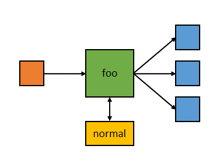

# Plumbing

Plumbing is minimega's facility for moving line-oriented data between VMs,
processes on guests or hosts, and minimega instances. It is a distributed
version of UNIX pipes. Any number of readers and writers can attach to a named
pipe from anywhere in the cluster. Pipelines connect pipes through external
programs.

When the output of one program must drive another program, use plumbing. The two
programs can both be in VMs, both be on the host, or one of each.

You need a running minimega, and miniccc in any guest that takes part. See
[Command and control](cc.md) for the guest side.

## Pipes

A pipe is a named I/O point. Unlike a UNIX pipe, it carries newline-delimited
messages and not a byte stream. This is why it can have any number of readers
and writers at once.

A pipe delivers a write to the readers that the mode of the pipe selects. If
there are no readers, the pipe discards the message. A pipe does not buffer
messages. A write can return before the readers consume the message. A slow
reader blocks the next write, so it slows every writer to the pipe.

Each message is at most 1 MiB. If a single input line exceeds that size,
`minimega -pipe` and `miniccc -pipe` exit with an error.

Pipes belong to the namespace that they are created in, so you can reuse the
same name safely between experiments. To reach a pipe in another namespace, use
`<namespace>//<pipe>`. This fully qualified name is the name that `pipe`
displays.

You can attach to a pipe from four places:

- the minimega CLI, with `pipe <name> <data>` to write.
- the host shell, with `minimega -pipe <name>`. This command connects standard
  input and output to the pipe until standard input closes. A bare name means a
  pipe in the default `minimega` namespace. For any other namespace, use
  `<namespace>//<name>`.
- a guest shell, with `miniccc -pipe <name>`. This command does the same through
  the cc connection.
- a program started with `cc exec` or `cc background`, by prefixing the
  command with `stdin=`, `stdout=` or `stderr=` pairs.

Start a reader on the host:

```bash
$ minimega -pipe foo
```

Write from another shell and from the minimega prompt:

```bash
$ echo "Hallo von minimega!" | minimega -pipe foo
```

```minimega
minimega$ pipe foo "Or would you rather use English?"
```

The reader prints both lines. The same commands work from a VM with
`miniccc -pipe foo` and from any other minimega instance in the mesh.

Attach the streams of a guest program directly:

```minimega
minimega$ cc exec stdin=foo my_program
minimega$ cc background stdin=foo stdout=bar my_program
```

### The pipe API

A pipe comes into existence on its first read, write, mode change or via.
`pipe` with no arguments lists the pipes in the current namespace:

```text
minimega$ pipe
host | name          | mode        | readers | writers | count | via | previous
mm1  | minimega//bar | all         | 1       | 1       | 3     |     | a message!
mm1  | minimega//foo | round-robin | 2       | 2       | 12    |     | hello
```

`count` is the number of messages that the pipe carried, and `previous` is the
last message. `clear pipe <name>` deletes a pipe and closes its readers. The
readers receive an end of file. `clear pipe` alone deletes every pipe. This
fails while the pipe has open writers, such as a running `minimega -pipe` or
`miniccc -pipe` session. Close the writers first.

### Delivery modes

By default, a message goes to every reader (`all`). The other two modes deliver
each message to exactly one reader, including readers on other hosts. This turns
a pipe into a work queue:

```minimega
minimega$ pipe foo mode round-robin
minimega$ pipe foo mode random
minimega$ clear pipe foo mode
```

`clear pipe <name> mode` returns the pipe to `all`.

### Logging a pipe

To see what flows through a pipe without attaching a reader, turn on logging.
minimega then writes every message to its log at the `debug` level as
`pipe <name>: <message>`:

```minimega
minimega$ log level debug
minimega$ pipe foo log true
minimega$ clear pipe foo log
```

### Vias

A via is an external program that runs once for every reader on every write. The
program gets the message on its standard input. minimega delivers the output of
the program to that reader in place of the original message. Use vias for values
that differ per reader. For example, each reader on `foo` gets its own normally
distributed sample around the mean that the writer sent.



```minimega
minimega$ pipe foo via normal -stddev 5.0
```

Here `normal` is a program that reads a mean from standard input and prints one
sample. When you write `1.5` to `foo`, every reader now gets a different value:

```bash
$ echo "1.5" | minimega -pipe foo

# on node A
$ minimega -pipe foo
2.35

# on node B
$ minimega -pipe foo
3.44
```

`clear pipe <name> via` removes the via. The program runs on the host where you
issue `pipe <name> via`. The program must be on the `PATH` of that host.
minimega forwards writes made on other hosts to that host first.

## Pipelines

`plumb` builds a pipeline from pipes and external programs, in the same order
that you write a shell pipeline. `plumb` treats each argument that is not an
executable on the host's `PATH` as a pipe. Programs run on the host where you
issue `plumb`. The pipes at either end are distributed as usual, so readers
anywhere in the experiment see the result.

```text
minimega$ plumb foo "sed -u s/foo/moo/" bar
minimega$ plumb
host | pipeline
mm1  | minimega//foo sed -u s/foo/moo/ minimega//bar

minimega$ pipe foo "the cow says foo"
minimega$ pipe
host | name          | mode | readers | writers | count | via | previous
mm1  | minimega//bar | all  | 0       | 1       | 1     |     | the cow says moo
mm1  | minimega//foo | all  | 1       | 0       | 1     |     | the cow says foo
```

Use `-u` (unbuffered) with `sed`, and the equivalent for other filters.
Otherwise, the program holds output until its buffer fills.

Because pipes accept multiple readers and writers, several linear pipelines
compose into trees and fan-in:

```minimega
minimega$ plumb a b
minimega$ plumb a c
```

A pipeline runs until one of its stages closes. To stop it, clear the first
pipe. This sends end of file down the chain. Or remove pipelines directly:

```minimega
minimega$ clear pipe foo
minimega$ clear plumb minimega//foo sed -u s/foo/moo/ minimega//bar
minimega$ clear plumb
```

`clear plumb` with a pipeline removes that pipeline. Write the pipeline exactly
as `plumb` lists it. `clear plumb` with no arguments removes all pipelines.

!!! warning "Unguarded loops"
    Feed loops through a stage that stops on its own (`head -n 100`,
    `grep -m 1`). Or write to a different pipe. A pipeline whose output reaches
    its own input forwards the same message forever. Examples are
    `plumb foo cat foo` and two pipelines that form a cycle. Such a pipeline
    keeps a CPU busy on every host involved.

### Writing a pipeline to a file

A `file://` argument is a file terminal. It writes every message that it
receives to a file on the host where you issue `plumb`. It must be the last
element of the pipeline, after at least one pipe or program. If the file exists,
minimega appends to the file. Otherwise, minimega creates the file:

```minimega
minimega$ plumb foo file:///tmp/minimega/foo.log
```

Give an absolute path after `file://`, as above. The file terminal does not
use the files directory, and a `file://` argument is not a pipe name.

## Copying a file between VMs

Because both ends can be guests, a pipe is a quick way to move a text file
between two VMs that share no network. On the receiver:

```bash
miniccc -pipe transfer > copy.txt
```

Then on the sender:

```bash
miniccc -pipe transfer < original.txt
```

When the sender finishes, the receiver does not exit on its own. Closing the
standard input of the sender closes only its writer. When the standard input of
the receiver closes, the receiver `miniccc -pipe` exits. When the copy is
complete, end the receiver with Ctrl-D.

This is a line-oriented copy. Each line is one message, so lines longer than 1
MiB abort the transfer. If the original lacks a trailing newline on the final
line, the pipe adds one. For binary data or large files, use `cc send` and
`cc recv` instead (see [Command and control](cc.md)).

## See also

- [Command and control](cc.md) for `cc exec` stream redirection and
  `miniccc -pipe`.
- [Command line and scripting](cli.md) for `minimega -pipe` and the command
  socket.
- Reference: [`pipe`](../reference/minimega.md#pipe),
  [`plumb`](../reference/minimega.md#plumb),
  [`clear pipe`](../reference/minimega.md#clear-pipe),
  [`clear plumb`](../reference/minimega.md#clear-plumb).
