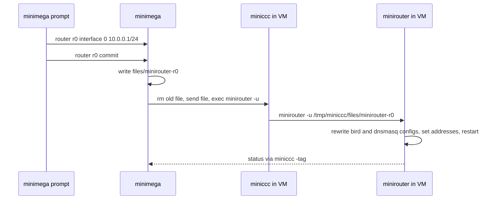
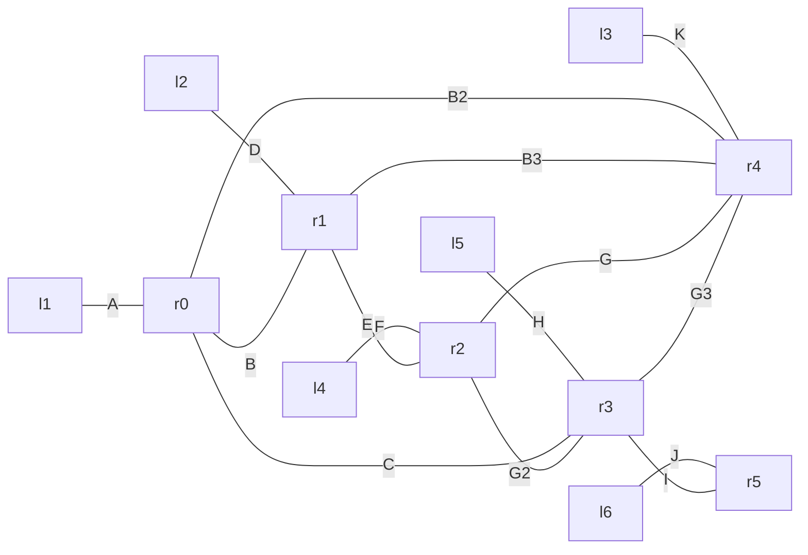

# Routing with minirouter

minirouter is a small daemon that runs inside a VM and turns it into a router you configure from the minimega prompt: interface addresses, DHCP, DNS, IPv6 router advertisements, static routes, OSPF, BGP and a basic firewall. minimega reaches it over the [command and control](cc.md) channel. A router VM therefore needs no management network, and its whole configuration is part of the experiment. This page explains how the pieces fit together and where to get a minirouter image. It also covers the `router` API and three example topologies.

miniccc must work first, because configuration reaches the VM through miniccc. We recommend that you know how [VLANs and taps](networking.md) work, because a router is only useful between two of them.

## How it works

A minirouter VM runs two of minimega's agents: miniccc, which provides the back-channel, and minirouter, which listens on a Unix socket (`/tmp/minirouter/minirouter` by default) for configuration. Each `router <vm> ...` command only edits a description held by minimega.

`router <vm> commit` writes that description to a file named `minirouter-<vm>` in the iomeshage files directory. When a namespace is active, the file goes in the subdirectory of that namespace. The command then queues three cc commands for the VM. The commands remove any earlier copy under `/tmp/miniccc/files/`, send the new file, and run `minirouter -u /tmp/miniccc/files/minirouter-<vm>`.

The `-u` invocation feeds the file into the socket of the running daemon. The daemon then rewrites the configuration of the programs that it drives and restarts the programs. The daemon reports back through VM tags.



| Function | Program minirouter drives |
|---|---|
| Interface addresses, loopbacks | `ip`, `dhclient` |
| Default gateway | `route` |
| DHCP, DNS, router advertisements | `dnsmasq` |
| Static routes, OSPF, BGP | `bird` and `bird6` ([BIRD 1.x](https://bird.network.cz/?get_doc&v=16&f=bird.html)) |
| Firewall | `iptables` |

Delivery is asynchronous, so the VM must run with miniccc connected before the commit does anything. Changes take a few seconds to arrive. `router <vm>` with no subcommand prints the description that minimega holds and the log lines that the router sent back. `vm info` shows the addresses of the router after the router configures them.

minirouter takes a few flags, and all of them have default values:

- `-path` is for its socket directory.
- `-miniccc` is for the miniccc binary that minirouter calls to send logs and tags back (`/miniccc`).
- If a stale socket exists, `-force` still starts minirouter.
- `-u <file>` pushes a configuration file into a running instance.
- `-cli` prints its command grammar.

The [minirouter reference](../reference/minirouter.md) lists that grammar. You never type the grammar yourself, but a committed file contains it.

## Getting a minirouter image

minirouter runs as a container, as a KVM guest, or on any Linux system. The system must have miniccc plus `ip`, `dhclient`, `dnsmasq`, `bird`, `bird6` and `iptables` installed. These programs must not already be running. Containers are the usual choice. They start instantly and route at line rate, which is much faster than an emulated NIC in a KVM guest.

### Container root filesystem

`misc/uminirouter/build.bash` in the source tree builds a minimal busybox-based root filesystem. Run it on a Debian or Ubuntu host that has `bird`, `dnsmasq` and `isc-dhcp-client` installed. The checkout must also contain a built `bin/minirouter` and `bin/miniccc`. Run these commands:

```bash
$ cd misc/uminirouter
$ ./build.bash
```

It produces `uminirouterfs/` and `uminirouterfs.tar.gz`. The `init` of the directory starts miniccc and minirouter. Its `preinit` turns on IPv4 and IPv6 forwarding. You must give the `preinit` to minimega separately, because the `/proc` of a container is read-only after the container starts. Forwarding can only be switched on during setup, and `vm config preinit` provides that setup step:

```minimega
vm config filesystem /root/uminirouterfs
vm config preinit /root/uminirouterfs/preinit
vm launch container r0
```

`vm config filesystem tar:uminirouterfs.tar.gz` unpacks the tarball from the iomeshage directory on the host that launches the container. This is convenient on a cluster. The Debian-based alternative is `misc/vmbetter_configs/minirouter_container.conf`, built with `vmbetter -rootfs`. It installs `bird` and `dnsmasq` from packages, adds sshd and a full userland, and uses the same kind of init.

### KVM image

`misc/vmbetter_configs/minirouter.conf` builds a kernel and initrd pair whose init enables forwarding and starts sshd, miniccc on the virtio serial port and minirouter:

```bash
$ vmbetter misc/vmbetter_configs/minirouter.conf
```

The overlay holds `init` and symlinks to `bin/miniccc` and `bin/minirouter`. Build those two binaries before you run vmbetter. Boot the result with `vm config kernel minirouter.kernel` and `vm config initrd minirouter.initrd`. Give the VM enough memory for a full Debian userland. [Building images with vmbetter](vmbetter.md) covers the tool.

## Configuring a router

The pattern is always the same: describe, then commit.

```minimega
router r0 interface 0 10.0.0.1/24
router r0 dhcp 10.0.0.0 range 10.0.0.100 10.0.0.200
router r0 commit
```

You can commit as often as you want. Each commit sends the complete description, so a change to a running router is another commit. If you need to see what the router is doing, run `router r0 log level debug` before the next commit. The command raises the log level of the router itself. `router r0 rid 10.0.0.1` sets the 32-bit router ID that OSPF and BGP use.

### Interfaces

The number of an interface is its position in the `vm config networks` of the router VM. Give an interface a static IPv4 or IPv6 address, or let it ask for one with DHCP. You can add as many addresses to it as you need:

```minimega
vm config net wan lan
# ...
router r0 interface 0 dhcp
router r0 interface 1 192.168.1.1/24
router r0 interface 1 2001:db8:1::1/64
```

Routing protocols often use a loopback address. The `lo` keyword puts the address on the loopback interface instead. The index is then only a label:

```minimega
router r0 interface 2 10.255.0.1/32 lo
```

`router r0 gw <ip>` sets a default gateway. `router r0 upstream <ip>` sets the DNS server that the resolver of the router forwards to.

### DHCP

The network that a DHCP server serves identifies the server on a router. dnsmasq also uses this network as the tag for its options. Add a range, static leases, and the gateway and DNS server to advertise:

```minimega
router r0 dhcp 192.168.1.0 range 192.168.1.100 192.168.1.200
router r0 dhcp 192.168.1.0 static 00:11:22:33:44:55 192.168.1.10
router r0 dhcp 192.168.1.0 router 192.168.1.1
router r0 dhcp 192.168.1.0 dns 192.168.1.1
```

A router can serve several networks. Use a different network for each interface that the router serves. A server with static entries but no range hands out only the static leases.

### DNS and router advertisements

`router r0 dns <ip> <hostname>` adds an A or AAAA record that dnsmasq on the router serves. `router r0 ra <prefix>` enables IPv6 router advertisements for a /64. Hosts can then configure themselves with SLAAC:

```minimega
router r0 dns 192.168.1.10 fileserver.lan
router r0 dns 2001:db8:1::10 fileserver.lan
router r0 ra 2001:db8:1::
```

### Static routes

A static route is a destination and a next hop, IPv4 or IPv6:

```minimega
router r0 route static 192.168.2.0/24 10.0.0.2
router r0 route static 0.0.0.0/0 10.0.0.254
router r0 route static 2001:db8:2::/64 2001:db8::2
```

A third argument names the route. OSPF and BGP export filters refer to named routes. The documented way to define a named prefix only to advertise it is the pattern `router r0 route static 10.0.0.0/24 0 lan-routes`, with `0` as the next hop.

### OSPF

You configure OSPF (and OSPFv3 for IPv6, enabled together) per area and per interface index. Every network on a listed interface takes part:

```minimega
vm config net a b c
# ...
router r0 route ospf 0 0      # interface a into area 0
router r0 route ospf 0 2      # interface c into area 0
```

To advertise a prefix without running OSPF on the interface that carries it, use `export` with the area. Use the same command to advertise a named static route:

```minimega
router r0 route ospf 0 export 10.0.0.0/24
router r0 route static 0.0.0.0/0 10.0.0.254 default-route
router r0 route ospf 0 export default-route
```

#### Link cost and other interface options

OSPF picks paths by the summed interface cost. The default cost of BIRD for every interface is 10. You can set any interface option that BIRD accepts with a fifth and sixth argument. minirouter copies the option and value verbatim into the interface block of the generated configuration:

```minimega
router routerA route ospf 0 1 cost 20
router routerA commit
```

Costs are the usual way to steer traffic in a test network. `hello`, `dead`, `priority` and the other options in the OSPF interface section of BIRD work the same way. [OSPF and link cost](#ospf-and-link-cost) below shows a triangle where a change of one cost moves the path.

### BGP

A BGP session is a named process with a local address and AS, a neighbor address and AS, and an export policy. `export all all` re-advertises the routes that the router learned over BGP. `export filter <name>` advertises only a named static route. `rrclient` marks the neighbor as a route-reflector client:

```minimega
router r1 route static 10.0.0.0/24 0 r1-lan
router r1 route bgp to-r2 local 10.0.0.1 100
router r1 route bgp to-r2 neighbor 10.0.1.1 200
router r1 route bgp to-r2 export filter r1-lan

router r2 route bgp to-r1 local 10.0.1.1 200
router r2 route bgp to-r1 neighbor 10.0.0.1 100
router r2 route bgp to-r1 export all all
router r2 route bgp to-r1 rrclient
```

!!! note "`export all` takes a trailing token"
    The command pattern is `export <all,filter> <filtername>`, so a third word
    is mandatory even for `all`. The command ignores that word in this case,
    so the example writes `export all all`. `export all` on its own matches no
    pattern, and minimega rejects it.

### Firewall

The `fw` subcommands generate iptables rules on the router. They only work on KVM routers. minimega refuses them for container VMs before anything reaches the router, because a container cannot load netfilter modules of its own. The stock `misc/vmbetter_configs/minirouter.conf` installs `iptables`. When the router applies the commit, every `fw` rule fails on a custom image without `iptables`.

Set the default policy for forwarded traffic. Then allow or deny flows for each interface. `in` and `out` are relative to the interface at the given index. A rule for traffic toward a host on the network of interface 0 is therefore an `out` rule on interface 0. The endpoint is an address with an optional `:port`, and you can omit the source:

```minimega
router fw0 fw default drop
router fw0 fw accept out 0 192.168.0.5:80 tcp
router fw0 fw accept in 1 192.168.0.0/24 0.0.0.0/0 udp
```

Chains group rules so they can be applied to more than one interface:

```minimega
router fw0 fw chain allow-http default action drop
router fw0 fw chain allow-http action accept 192.168.0.5:80 tcp
router fw0 fw chain allow-http apply out 0
```

### Removing configuration

Most subcommands have a `clear router <vm> ...` counterpart that removes that piece of the description. Examples are `clear router r0 dhcp 192.168.1.0`, `clear router r0 route ospf 0`, `clear router r0 interface 1` and `clear router r0 fw`. The counterpart also removes single entries, for example `clear router r0 dhcp 192.168.1.0 static 00:11:22:33:44:55`.

`clear router r0` clears everything except the gateway, the upstream DNS server, and the log level. To clear the first two, run `clear router r0 gw` and `clear router r0 upstream`. `clear router` forgets every router in the namespace. Clearing only edits the description. Commit to make the router match.

## A first router

One container between an outside network and a client LAN, with DHCP, a static lease and a name:

```minimega title="router-basic.mm"
--8<-- "articles/router/router-basic.mm"
```

[Download this example](router/router-basic.mm){ download="router-basic.mm" }

Launch a client on `lan` with DHCP. The client gets an address in the range and gets `192.168.1.1` as its gateway and resolver. The client can resolve `fileserver.lan`. The host can also have a tap at `10.0.0.1` on `wan` and NAT, as shown in [Host networking](networking.md). The host also needs a route back to the client LAN: run `ip route add 192.168.1.0/24 via 10.0.0.2` on the host. Then the client also reaches the outside network through the router.

## Two routers with static routes

Two routers share a transit link, and each router serves a LAN. A static route on each router points at the LAN of the other router:

```minimega title="router-static.mm"
--8<-- "articles/router/router-static.mm"
```

[Download this example](router/router-static.mm){ download="router-static.mm" }

The client VMs boot with DHCP from their own router, and `a1` can reach `b1` through both routers. If you replace the two `route static` lines with `route ospf 0 0` and `route ospf 0 1` on each router, the result is the same. OSPF also keeps working as you add links.

## OSPF and link cost

Three routers form a triangle with every interface in area 0:

```minimega title="router-ospf.mm"
--8<-- "articles/router/router-ospf.mm"
```

[Download this example](router/router-ospf.mm){ download="router-ospf.mm" }

From `routerA` there are two equal-cost ways to reach `10.0.2.1`, routerB's address on the `bc` link: straight to B over `ab`, or through C. Open the console of routerA through [miniweb](miniweb.md) and run a traceroute. The output shows which path OSPF chose in this run:

```text
/ # traceroute 10.0.2.1
traceroute to 10.0.2.1 (10.0.2.1), 30 hops max, 46 byte packets
 1  10.0.1.2 (10.0.1.2)  0.009 ms  0.005 ms  0.005 ms
 2  10.0.2.1 (10.0.2.1)  0.005 ms  0.005 ms  0.005 ms
```

Raise the cost of interface 1 of A, the `ac` link, from the default 10 to 20. Then commit:

```minimega
router routerA route ospf 0 1 cost 20
router routerA commit
```

A few seconds later, OSPF reconverges. The path through C then costs 30, and the path straight to B costs 20. The traceroute shows a single hop:

```text
/ # traceroute 10.0.2.1
traceroute to 10.0.2.1 (10.0.2.1), 30 hops max, 46 byte packets
 1  10.0.2.1 (10.0.2.1)  0.009 ms  0.005 ms  0.006 ms
```

## Appendix: a larger OSPF network

Six routers, nine transit links and six client LANs, all in area 0. The script pins the VLAN range, so the aliases get predictable tags:



```minimega title="router-ospf-large.mm"
--8<-- "articles/router/router-ospf-large.mm"
```

[Download this example](router/router-ospf-large.mm){ download="router-ospf-large.mm" }

After you commit every router, `vm info` shows the layout, and every client can reach every other client. If a router or a link goes down, OSPF reroutes around it without further commits:

| VM | VLANs | Addresses |
|---|---|---|
| r0 | A (1500), B (1501), B2 (1502), C (1503) | 10.1.0.1, 10.21.0.1, 10.22.0.1, 10.3.0.1 |
| r1 | D (1504), B (1501), B3 (1505), E (1506) | 10.4.0.1, 10.21.0.2, 10.23.0.1, 10.5.0.1 |
| r2 | E (1506), G (1507), G2 (1508), F (1509) | 10.5.0.2, 10.71.0.1, 10.72.0.1, 10.6.0.1 |
| r3 | C (1503), G3 (1510), G2 (1508), H (1511), I (1512) | 10.3.0.2, 10.73.0.1, 10.72.0.2, 10.8.0.1, 10.9.0.1 |
| r4 | B3 (1505), K (1513), G (1507), G3 (1510), B2 (1502) | 10.23.0.2, 10.11.0.1, 10.71.0.2, 10.73.0.2, 10.22.0.2 |
| r5 | I (1512), J (1514) | 10.9.0.2, 10.10.0.1 |
| l1 to l6 | A, D, K, F, H, J | one DHCP lease each from the local router |

## When the router does not respond

Before a commit can reach the router, `vm info` must show `cc_active` true for the router VM. If it does not, the image does not start miniccc or the serial channel is missing (see [Command and control](cc.md)). `router <vm>` prints the log lines of the router after the router reports in. To make the log lines verbose, run `router <vm> log level debug` and then commit.

A router that accepts addresses but does not forward has forwarding turned off. For the busybox container, this means that you did not pass the `preinit`. For a KVM image, it means that the init did not set `net.ipv4.ip_forward`.

If routes never appear, make sure that `bird` and `bird6` exist in the image. Also make sure that no other instance of them or of dnsmasq was already running when minirouter started.

## See also

- [Host networking](networking.md): VLANs, host taps, NAT from the host.
- [Command and control](cc.md): the channel the router is configured over.
- [Building images with vmbetter](vmbetter.md): building the KVM and container images.
- [Virtual machine types](vmtypes.md): container versus KVM behavior.
- Reference: [`router`](../reference/minimega.md#router), [`clear router`](../reference/minimega.md#clear-router), [minirouter API](../reference/minirouter.md).
