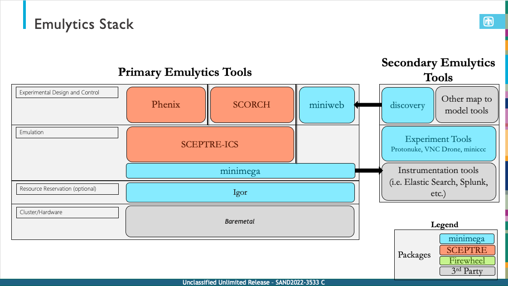

# Tools overview

minimega ships as one daemon plus a set of companion programs. All of them are
built from the `cmd/` directory of the repository. This page lists each
program, what it is for, the flags you most likely need, and where its guide
is. If you wonder which binary does a job, read this page. If you find an
unfamiliar file in `/opt/minimega/bin`, read this page also.

The `.deb` and `.rpm` packages and the Docker image install every binary under
`/opt/minimega/bin`. The packages also link `minimega`, `miniweb`, and
`protonuke` into `/usr/bin`. The Docker image instead adds `/opt/minimega/bin`
to `PATH`. A source build puts them in `bin/`. For details, see
[Installation](articles/installing.md) and
[Running in Docker](articles/docker.md).

Every tool prints its flags with `-h`. Tools built on minimega's logging
library also accept `-level <debug|info|warn|error|fatal>`, `-logfile <path>`,
and `-v` (log to stderr, on by default).

## Where minimega sits

minimega is the emulation layer of a larger stack. Tools above it design and
drive experiments. Tools beside it generate traffic and collect data. A
reservation system below it hands out cluster hardware.

This overview dates from 2022. It still describes the arrangement, with one
change. igor, the reservation system in the bottom layer, is now in its own
repository as [igor2](https://github.com/sandia-minimega/igor2). It no longer
ships with minimega.

## User tools

| Tool | What it does | Key flags and arguments | Guide |
|---|---|---|---|
| `minimega` | The daemon and CLI: launches and manages KVM VMs, containers, Android emulators, networks, and clusters. | `-base`, `-nostdin`, `-e`, `-attach`, `-namespace`, `-cli`, `-completion` | [Running minimega](articles/running.md) |
| `miniweb` | Web interface for a running minimega: VM tables, screenshots, VNC and terminal access, network graph, file listings, and an optional console and JSON command API. It serves every subdirectory of its `-root` as static files. | `-addr :9001`, `-base /tmp/minimega`, `-root web`, `-namespace`, `-passwords`, `-bootstrap`, `-cert`, `-key`, `-console <path to minimega>` | [miniweb](articles/miniweb.md) |
| `vmbetter` | Builds Debian-based kernel and initrd pairs, disk images, ISOs, and container root filesystems from a `.conf` file and an overlay directory. | `vmbetter [option]... <config>`, with `-branch`, `-mirror`, `-disk`, `-size`, `-format`, `-iso`, `-rootfs`, `-O`, `-constraints`, `-dry-run`, `-1`, `-2`, `-noclean` | [Building images with vmbetter](articles/vmbetter.md) |
| `protonuke` | Configuration-free traffic generator, with matching servers, for HTTP, HTTPS, SSH, SMTP, IRC, FTP, FTPS, and DNS. | protocol flags such as `-http`, `-ssh`, and `-dns`. Also `-serve` and `-report`. The timing flags are `-u`, `-s`, `-min`, and `-max` | [protonuke](articles/protonuke.md) |
| `powerbot` | Power control for cluster nodes through IPMI or networked PDUs (Tripp Lite and Server Tech). | `powerbot on <nodelist>`, likewise `off`, `cycle`, `status`, `temp`, and `info`, plus `-config /etc/powerbot.conf` and `-pdu` | [powerbot](articles/powerbot.md) |
| `rfbplay` | Serves a directory of VNC framebuffer recordings as MJPEG streams for a browser, or transcodes one recording to video with `ffmpeg`. | `rfbplay [-port 9004] <directory>` or `rfbplay <input> <output>` | [VNC](articles/vnc.md) |
| `vncdrone` | Replays recorded keyboard and mouse activity on running VMs whose names start with the prefix of a recording. It cycles each VM through `pre`, `run`, and `post` recordings with `vnc play`. | `-recordings <absolute directory, with trailing slash>`, `-base /tmp/minimega` | [VNC](articles/vnc.md) |
| `nfcat` | Prints the binary NetFlow v5 records written by `capture netflow` as text. | `nfcat [-gunzip] FILE...` | [Capture and instrumentation](articles/capture.md) |
| `passwordify` | Unpacks an initramfs and sets a root password. The tool prompts for the password on a terminal. Otherwise it reads the password from the first line of standard input. It optionally installs an `authorized_keys` file for root. By default it generates an SSH key pair, so nodes booted from the image can reach each other without a password. If the sshd of the image allows empty passwords, it turns that off, because sshd then fails keyboard-interactive logins that use a password. It needs `bash`, `chroot`, `find`, `cpio`, `zcat`, `gzip`, and `ssh-keygen` on the path. | `passwordify [-keys <authorized_keys file>] [-passwordless=false] <source initramfs> <destination initramfs>` | none |
| `rond` | Standalone miniccc server for machines that minimega does not manage. It offers the `cc`-style commands at a `rond$` prompt or over its own command socket. The commands are `clients`, `filter`, `exec`, `bg`, `send`, `recv`, `processes`, `responses`, `commands`, and others. | `-port 9005`, `-path /tmp/rond`, `-nostdin`, `-e` (run a command on a running rond) | [Command and control](articles/cc.md) |

igor, the cluster reservation and provisioning manager that used to live in
this repository, is now a separate project:
[sandia-minimega/igor2](https://github.com/sandia-minimega/igor2).

## Guest agents

These run inside guests rather than on the host. The vmbetter configurations
in `misc/vmbetter_configs/` put them into images. `scripts/build.bash` also
cross-compiles `miniccc` and `protonuke` for Windows.

| Tool | What it does | Key flags | Guide |
|---|---|---|---|
| `miniccc` | Command-and-control agent. Connects to minimega over a virtio-serial device, TCP, or a UNIX socket to run commands, transfer files, and set tags. Built for Linux and Windows. | `-parent <host>`, `-port 9002`, `-serial <device>`, `-family tcp` or `unix`, `-path /tmp/miniccc`, `-uuid`, `-pipe`, `-tag` (Linux), `-install manual-start` or `auto-start` (Windows service), `-version` | [Command and control](articles/cc.md) |
| `minirouter` | Router agent driven by minimega's `router` API. Configures interfaces, DHCP and DNS through dnsmasq, static routes, dynamic routing through BIRD, and firewall rules inside a router VM. It reports back through miniccc. | `-miniccc /miniccc`, `-path /tmp/minirouter`, `-force`, `-u <file>` (update), `-cli` | [Routing with minirouter](articles/router.md) |

## Developer tools

| Tool | What it does | Key flags | Notes |
|---|---|---|---|
| `minitest` | Functional test runner. Replays the command files under `tests/` against a running minimega and writes `.got` output to compare against the `.want` expectations. | `-dir tests`, `-base /tmp/minimega`, `-run <regex>` | [minitest](articles/minitest.md) |
| `minifuzzer` | Starts a minimega, generates random commands from its `-cli` description, and runs them until minimega dies. It then restarts minimega with `-force`, runs `nuke`, and starts over. | `-minimega bin/minimega`, `-flags`, `-base`, `-exclude quit,read,write,deploy,nuke,shell`, `-chars`, `-values` | Run it only on a disposable host. |
| `apigen` | Renders the command reference pages (`reference/minimega.md`, `reference/minirouter.md`) from `minimega -cli` JSON and a Markdown template. | `-bin`, `-template`, `-sections` | Run by `scripts/doc.bash`. |
| `pyapigen` | Generates the Python bindings, `lib/minimega.py`, from `minimega -cli`. | `pyapigen [-out minimega.py] <path/to/minimega>` | Run by `scripts/build.bash` and `scripts/doc.bash`. See [Python API](articles/python.md). |
| `vmconfiger` | Generates `cmd/minimega/vmconfiger_cli.go`, the `vm config` handlers, from the Go configuration structs. | `-type BaseConfig,KVMConfig,ContainerConfig,AndroidConfig` | Run through `go generate` in `cmd/minimega`. Never edit the output by hand. |

`cmd/plumbing/` holds four small helper commands (`count`, `delay`, `execf`,
and `normal`) used with the [plumbing](articles/plumbing.md) API. `scripts/build.bash`
builds them along with the rest of `cmd/`.

## See also

- [Installation](articles/installing.md) and [Running in Docker](articles/docker.md)
- [Command line and scripting](articles/cli.md)
- [Command reference](reference/minimega.md), [minirouter reference](reference/minirouter.md), and [Python API reference](reference/python.md)
