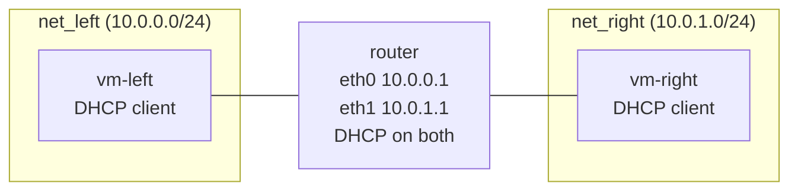

# Chapter 3: The router sandwich

This chapter builds the experiment that the rest of the course extends: two
Linux VMs on separate networks, joined by a router that hands out addresses on
both. You launch the three VMs and configure the router from the minimega
prompt. You start the VMs in the right order. Then you prove that it works by
pinging from one client to the other through the router. You do not log in to a
guest. At the end, you have the running *router sandwich* and a script that
rebuilds it in about two minutes.

It assumes that the images from [chapter 2](02-images.md) are in
`/tmp/minimega/files` and that minimega runs as you set it up in
[chapter 1](01-install.md).



`net_left` and `net_right` are two VLANs on the host's Open vSwitch bridge.
The two clients cannot see each other directly. Every packet between them
crosses the router.

## A namespace for the experiment

Every command in the course runs inside a namespace called `sandwich`.
A namespace is a container for an experiment. The VMs, the VLAN aliases, the
`vm config` template, and the cc state of a namespace are separate from those of
every other namespace. Two experiments on one host cannot collide. When you
destroy the namespace, minimega tears the whole experiment down in one command.

```minimega
minimega$ namespace sandwich
```

If the namespace does not exist, `namespace <name>` creates it. The command also
makes it the active namespace for your prompt. An interactive prompt shows the
active namespace as `minimega[sandwich]$`. An attached prompt does not show it.
To see the active namespace, run `namespace` with no argument:

```minimega
minimega$ .annotate false namespace
namespace | vlans    | active
minimega  | 101-4096 | false
sandwich  |          | true
```

`minimega` is the default namespace, and it is always present. If you come back
to the prompt later and `vm info` looks empty, first make sure that you are
still in `sandwich`. [Chapter 16](16-namespaces.md) covers namespaces in depth.

## Describe and launch the clients

`vm config` holds the description that the next `vm launch` copies. Point it at
the client image. Give the VM 3 GB of memory. Put its single interface on a
network named `net_left`.

The default memory is 2 GB. These images unpack to about 1 GB into a RAM-backed
filesystem that is capped at half of the guest's memory. A 2 GB guest therefore
panics at boot with `VFS: Unable
to mount root fs`. Run these commands:

```minimega
minimega$ vm config kernel miniccc.kernel
minimega$ vm config initrd miniccc.initrd
minimega$ vm config memory 3072
minimega$ vm config net net_left
minimega$ vm launch kvm vm-left
```

`vm config net` is short for `vm config networks`. minimega accepts any
unambiguous prefix of a keyword.

`net_left` is a *VLAN alias*. The first time minimega sees a name, it allocates
a VLAN tag. minimega remembers the mapping for the namespace. From then on, it
uses that tag for every interface that names `net_left`. You never pick tag
numbers yourself. [Chapter 6](06-networking.md) explains the netspec and the
alias table.

`vm launch kvm vm-left` creates one KVM VM named `vm-left` from the current
description. The VM exists now, with its tap on the bridge and a QEMU process
waiting, but it is not running. This is the `BUILDING` state.

The description is still there after the launch, so the second client only
needs a different network:

```minimega
minimega$ vm config net net_right
minimega$ vm launch kvm vm-right
```

## Describe and launch the router

The router boots the other image and has two interfaces, one on each network.
Interfaces are numbered by their position in `vm config networks`. The router
configuration below refers to the interfaces by that number. Interface 0 is on
`net_left`, and interface 1 is on `net_right`.

```minimega
minimega$ vm config kernel minirouter.kernel
minimega$ vm config initrd minirouter.initrd
minimega$ vm config net net_left net_right
minimega$ vm launch kvm router
```

Three VMs, all `BUILDING`:

```minimega
minimega$ .annotate false .columns name,state,vlan vm info
name     | state    | vlan
router   | BUILDING | [net_left (101), net_right (102)]
vm-left  | BUILDING | [net_left (101)]
vm-right | BUILDING | [net_right (102)]
```

The numbers in parentheses are the tags that minimega allocated for the aliases.
The tags start at 101, the bottom of the default VLAN range.

## Configure the router

The router image runs minirouter, a small daemon that turns the VM into a
router. You configure the router from the minimega prompt. Each
`router <vm> ...` command edits a description that minimega holds. Nothing
reaches the VM until you commit. Give interface 0 an address and a DHCP server
for its network. Then do the same for interface 1:

```minimega
minimega$ router router interface 0 10.0.0.1/24
minimega$ router router dhcp 10.0.0.0 range 10.0.0.2 10.0.0.254
minimega$ router router dhcp 10.0.0.0 router 10.0.0.1
minimega$ router router interface 1 10.0.1.1/24
minimega$ router router dhcp 10.0.1.0 range 10.0.1.2 10.0.1.254
minimega$ router router dhcp 10.0.1.0 router 10.0.1.1
```

The first word after `router` is the name of the VM. Here the VM name is also
`router`. The command `router r0 interface ...` configures a VM named `r0`. The
subcommands are:

- `interface <index> <address/prefix>` puts a static address on the
  interface at that position in `vm config networks`.
- `dhcp <network> range <low> <high>` starts a DHCP server for the given
  network with that pool of leases. The network address is the key: every
  later `dhcp 10.0.0.0 ...` line adds to the same server.
- `dhcp <network> router <address>` is the default gateway the server hands
  out with each lease. Without it the clients get addresses but no route to
  the other side.

You set no DNS option, because this router serves no names. The clients only
need to reach each other by address. The router also needs no routing protocol.
It has an interface on both networks, so it knows where each network is. The
default gateway in each lease sends the traffic of the clients to the router.

Now commit:

```minimega
minimega$ router router commit
```

`commit` writes the description to a file, `minirouter-router`, in the
namespace's part of the files directory. Then it queues three command and
control commands for the router VM. The commands remove any older copy of the
file from `/tmp/miniccc/files/` in the guest, send the new file, and run
`minirouter -u` on it. Those commands wait in minimega's queue until the miniccc
agent inside the router connects. You can therefore commit before the VM runs,
and the configuration arrives a few seconds after boot. Every commit sends the
complete description, so you change a running router with another commit.

## Start, in order

Start the router first. Then wait ten seconds. Its `init` waits for devices to
settle before it starts miniccc. minirouter needs the configuration before it
can serve leases. If the clients boot first, their DHCP client can time out
before anyone answers.

```minimega
minimega$ vm start router
minimega$ shell sleep 10
minimega$ vm start all
```

`shell` runs a program on the host and waits for it. A command file uses this to
pause. `vm start all` starts every VM that is `BUILDING` or `PAUSED`. It skips
the VM that already runs, so it is safe to call after `vm start router`.

Booting takes a minute or more, and a fixed `shell sleep` is either too short or
wasteful. Instead, have the shell ask minimega until the answer is the one you
want. The loop below runs `minimega -e`, the same client that you use to send a
one-off command, once every three seconds. When exactly three VMs report a
connected agent (`cc_active` true) and an address that starts with `10.`, the
loop stops. The outer `timeout` gives up after five minutes, so the script fails
instead of hanging. The loop usually returns after about 90 seconds:

```minimega
minimega$ shell timeout 300 sh -c "until minimega -e .annotate false .columns cc_active,ip namespace sandwich vm info 2>/dev/null | grep -c 'true.*10[.]' | grep -qx 3; do sleep 3; done"
```

The guests boot and take their leases before the loop returns:

```minimega
minimega$ .annotate false .columns name,state,vlan,ip vm info
name     | state   | vlan                              | ip
router   | RUNNING | [net_left (101), net_right (102)] | [10.0.0.1, 10.0.1.1]
vm-left  | RUNNING | [net_left (101)]                  | [10.0.0.2]
vm-right | RUNNING | [net_right (102)]                 | [10.0.1.2]
```

minimega learns the `ip` column by watching traffic on each VM's tap. The column
therefore trails the guest by a moment. It stays empty for a VM that sends no
packet. If a client's address never appears, the router did not serve it.
[Chapter 10](10-troubleshooting.md) explains why.

`vlans` shows the alias table that the namespace built:

```minimega
minimega$ .annotate false vlans
alias     | vlan
net_left  | 101
net_right | 102
```

## Ping through the router

Every VM in the sandwich runs miniccc, and `cc` alone reports how many
agents are connected. Three means the router and both clients:

```minimega
minimega$ .annotate false cc
clients
3
```

`cc exec` runs a command on every connected agent, and `cc filter` narrows that
to the VMs you name. Filter on `vm-left`. Then ping `vm-right` through the
router. The command is queued, delivered, and run. Nothing is printed until you
ask for the response:

```minimega
minimega$ cc filter name=vm-left
minimega$ cc exec ping -c 3 10.0.1.2
minimega$ cc commands
```

`cc commands` lists every command that minimega issued in the namespace, with
its id. The first three commands are the router commit. The ping is the fourth
command. The `responses` column turns to 1 after `vm-left` reports back. Read
the response:

```minimega
minimega$ cc responses 4
4/<uuid of vm-left>/stdout:
PING 10.0.1.2 (10.0.1.2) 56(84) bytes of data.
64 bytes from 10.0.1.2: icmp_seq=1 ttl=63 time=1.4 ms
64 bytes from 10.0.1.2: icmp_seq=2 ttl=63 time=0.8 ms
64 bytes from 10.0.1.2: icmp_seq=3 ttl=63 time=0.7 ms

--- 10.0.1.2 ping statistics ---
3 packets transmitted, 3 received, 0% packet loss, time 2003ms
```

The `ttl=63` is the proof. The reply left `vm-right` with a TTL of 64 and
crossed one router. `cc exitcode 4 vm-left` prints `0`. When you are done, clear
the filter. Otherwise, every later `cc` command in the chapter goes to `vm-left`
alone:

```minimega
minimega$ clear cc filter
```

`cc filter name=vm-left` matches on the `name` column of `vm info`. Any column
or tag works the same way. [Chapter 8](08-cc.md) covers the rest of the API.

## Inspect the router

`router <vm>` with no subcommand prints the description that minimega holds for
that VM. It also prints any log lines that the router sent back:

```minimega
minimega$ router router
IPs:
Network: 0: [10.0.0.1/24]
Network: 1: [10.0.1.1/24]

Listen address: 10.0.0.0
Low address:    10.0.0.2
High address:   10.0.0.254
Router:         10.0.0.1
DNS:
Static IPs:

Listen address: 10.0.1.0
Low address:    10.0.1.2
High address:   10.0.1.254
Router:         10.0.1.1
DNS:
Static IPs:

Firewall Rules:
  Default Action: accept
Log:
```

The `Network: 0` and `Network: 1` lines are the two interfaces by index. Each
DHCP server is listed under the network that it serves. This output is the
description, not the live state of the router. The `vm info` output above shows
the two addresses of the router in its `ip` column. This confirms that the
description reached the router. [Chapter 7](07-routers.md) adds static leases,
DNS, static routes and OSPF to it.

## Read the configuration back

The `vm config` template still holds the last description you set, the router's.
Print it to see what minimega recorded:

```minimega
minimega$ vm config
VM configuration:
Memory:           3072
VCPUs:            1
Networks:         [net_left net_right]
Bonds:            []
Snapshot:         true
UUID:
Schedule host:
Coschedule limit: -1
Colocate:
Backchannel:      true
Tags:             {}

KVM configuration:
State Path:
Disks:                     []
CDROM Path:
Kernel Path:               /tmp/minimega/files/minirouter.kernel
Initrd Path:               /tmp/minimega/files/minirouter.initrd
...
```

Three items in this output matter:

- `Kernel Path` and `Initrd Path` are absolute. You typed `minirouter.kernel`.
  When you set the path, minimega resolved the relative name inside the files
  directory. minimega resolves a misspelled name the same way, and at that point
  it only logs a warning. The launch fails, with the reason in the `error` tag
  of the VM.
- `Networks: [net_left net_right]` is the interface list in order. The guest
  sees the interfaces in this order, and the `router ... interface` indexes
  refer to the same order.
- `Snapshot: true` and `Backchannel: true` are defaults that you never set.
  Snapshot mode means that a VM never writes to its image. Because of this, both
  clients can share one image. The backchannel is the virtio-serial port that
  miniccc talks over. If you switch it off, the router has no way to receive its
  configuration.

minimega ignores the container and Android blocks below these for a KVM launch.
Each launched VM carries its own copy of this description.
`vm config clone <vm>` copies the description of a VM back into the template.
[Chapter 4](04-vms.md) uses this to launch spares.

## The script

Everything above, as one command file. The file starts with
`clear namespace sandwich`, so that the file always builds from nothing. That
line destroys the namespace and everything in it. When you are finished, run the
same line to tear the sandwich down.

The file leaves behind one thing: the response files that `cc` wrote under
`/tmp/minimega/files/sandwich/`. Command ids start again at 1 in a new
namespace, so a later `cc responses 4` prints the old output of the same id. The
scripts that read responses therefore follow `namespace sandwich` with
`clear cc responses`. Do the same whenever you rebuild an experiment by hand.

Run the file with `read <path>` at the prompt or with
`sudo minimega -e read <path>` from a shell.

```minimega title="03-router-sandwich.mm"
--8<-- "training/miniclass/scripts/03-router-sandwich.mm"
```

[Download this example](scripts/03-router-sandwich.mm){ download="03-router-sandwich.mm" }

## What you built

- Namespace `sandwich` with `vm-left` on `net_left`, `vm-right` on
  `net_right`, and `router` on both.
- A minirouter that serves addresses and a default gateway on each network.
- A ping from one client to the other through the router. You ran the ping over
  command and control, without logging in to a guest.
- A script that rebuilds all of it from a clean minimega.

## Where to read more

- [VM lifecycle](../../articles/vm-lifecycle.md): the template, launching,
  and the states a VM moves through.
- [Host networking](../../articles/networking.md): VLAN aliases, the bridge,
  and what `vm info` reports per interface.
- [Routing with minirouter](../../articles/router.md): how a commit reaches
  the VM and the full `router` API.
- [Command and control](../../articles/cc.md): `cc exec`, filters and
  responses.
- Reference: [`namespace`](../../reference/minimega.md#namespace),
  [`clear namespace`](../../reference/minimega.md#clear-namespace),
  [`vm config networks`](../../reference/minimega.md#vm-config-networks),
  [`vm launch`](../../reference/minimega.md#vm-launch),
  [`router`](../../reference/minimega.md#router),
  [`cc`](../../reference/minimega.md#cc),
  [`vlans`](../../reference/minimega.md#vlans),
  [`shell`](../../reference/minimega.md#shell).

## Next

[Chapter 4: Configure, launch, and control VMs](04-vms.md) takes the sandwich
through every VM state and explains the commands that you just used.
