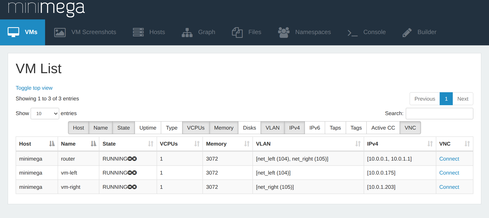
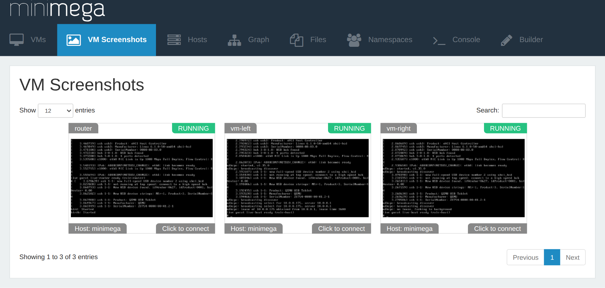

# Chapter 5: See the experiment: miniweb and VNC

Before this chapter, you watched the router sandwich through `vm info`. In this
chapter you start miniweb, the web interface of minimega. You look at the same
experiment in the browser as a table, a screenshot grid, a network graph, and a
console. You also take screenshots from the prompt and learn where the controls
of miniweb end and the prompt takes over. At the end, you can open the console
of any VM from a browser tab, and you know which page of miniweb answers which
question.

This chapter assumes that the sandwich from [chapter 3](03-router-sandwich.md)
is running. The [miniweb guide](../../articles/miniweb.md) documents every page,
URL, and flag. This chapter is a tour.

## Start miniweb

miniweb is a separate program that talks to minimega over the command socket in
the base directory. It therefore runs on the same host as the daemon. It serves
on port 9001 by default.

**Package**

```bash
sudo miniweb -root /opt/minimega/web
```

**Docker**

Nothing to do: the container's entry point starts miniweb before minimega,
and `-p 9001:9001` from chapter 1 publishes it.

**Source**

```bash
sudo ./bin/miniweb -root web        # from the repository root
```

`-root` names the directory of templates and static files (`web/` in the
repository, `/opt/minimega/web` from the packages). The other flag that you can
need now is `-base`. If you changed `-base` of the daemon, the `-base` of
miniweb must match it. Leave miniweb running in its own terminal. Open
<http://localhost:9001/>. It redirects to `/vms`.

## The pages

The navigation bar links to most of these pages. VLANs has no entry, so open
`/vlans` or use the link on the Namespaces page. Each page is a plain URL that
you can bookmark.

| Page | URL | What it shows |
|---|---|---|
| VMs | `/vms` | The `vm info` table for the namespace: the three sandwich VMs with state, VLANs and addresses. `/vms#top` switches to a live `vm top` view. |
| VM Screenshots | `/tilevnc` | A grid of live screenshots, with one tile for each VM. Click a tile to open its console. |
| Hosts | `/hosts` | The output of `host`: resources and load for each node in the namespace. |
| VLANs | `/vlans` | The alias table from `vlans`: `net_left` and `net_right` with their tags. |
| Graph | `/graph` | An interactive graph of the VMs and the VLANs that join them. The sandwich appears as two networks with the router between them. |
| Files | `/files/` | A listing of the files directory, so the images from chapter 2 are downloadable here. There is no upload. |
| Namespaces | `/namespaces` | Every namespace with links to its VM and VLAN pages. |
| Console | `/console` | A minimega prompt in the browser. This page exists only with `-console`. See below. |

Each table gets its data from a JSON endpoint that you can also call from a
script:
`/vms/info.json`, `/vms/top.json`, `/hosts.json`, `/vlans.json`,
`/namespaces.json` and `/files.json?path=<dir>`.

### The VM table

The State column carries the controls. A play icon starts a `BUILDING` or
`PAUSED` VM, a pause icon stops a `RUNNING` one, and an X kills it. They run the
same `vm start`, `vm stop`, and `vm kill` commands as in [chapter 4](04-vms.md),
so the same rules apply. The table differs from the prompt in one way: it hides
VMs in the `QUIT` or `ERROR` state. A VM that you kill here drops out of the
page, but it still exists until you run `vm flush` at the prompt. You restart
the VM from the prompt by name.

miniweb hides several columns by default (uptime, type, disks, IPv6, taps, tags,
active CC). `/vms/new` is a form that launches one VM from a name, a type, and
one of the configurations that you saved with `vm config save`. You can use it
to add a VM during a demonstration.



The screenshot shows the sandwich. The table has three rows, `router`,
`vm-left`, and `vm-right`, with the addresses that the router handed out in
[chapter 3](03-router-sandwich.md). The addresses of your clients can be
different.

We recommend that you keep the VM Screenshots page open during a demonstration.
It has one live tile for each VM, and a click on a tile connects you to that VM.



## A console in the browser

The VNC column of the VM table and every screenshot tile link to
`/vm/<name>/connect/`. For a KVM VM, that page loads noVNC and opens a
WebSocket. miniweb proxies the WebSocket to the VNC port of the VM, so the
keyboard, the mouse, and the display all work in the tab.

Open `vm-left`. The client image runs a root shell on its console, so you do not
log in. You land at a prompt. Type `ip addr` to see the address that the router
handed out. Type `ping 10.0.1.2` to reach `vm-right`, the way `cc exec` did in
chapter 3.

Open `router` the same way. Its console is another root shell. `ip addr` shows
both interfaces, `10.0.0.1` and `10.0.1.1`.
`ps ax | grep -e minirouter -e dnsmasq -e bird` shows the daemons that chapter 3
configured.

Containers get an xterm.js terminal on the same URL instead of noVNC. minimega
keeps a scrollback buffer, so a newly opened terminal shows recent output.
Android VMs get a console that streams the display of the emulator.

Every KVM VM has a VNC listener on the host. The port is in the `vnc_port`
column of `vm info`. Any VNC client can connect to it directly:

```minimega
minimega$ .annotate false .columns name,vnc_port vm info
```

miniweb connects to those ports itself, so in a cluster the miniweb host must
be able to reach them on every node. [Chapter 13](13-vnc.md) uses the same
ports to record and replay what happens on a console.

## Screenshots from the prompt

`vm screenshot` captures the framebuffer of a VM as a PNG. Without a
destination, it writes `screenshot.png` into the instance directory of the VM
(`/tmp/minimega/<id>/`). With `file`, it writes to the path that you give. A
trailing number caps the larger dimension in pixels. Run these commands:

```minimega
minimega$ vm screenshot vm-left
minimega$ vm screenshot vm-right file /tmp/minimega/files/vm-right.png 400
```

The second form puts the image into the files directory, so the image appears on
the Files page of miniweb. On a cluster, you can also fetch the image with
`file get`. The VM Screenshots page and the URL `/vm/<name>/screenshot.png` take
the same kind of picture on every refresh. `?size=<pixels>` scales the picture,
and `&base64=1` returns a `data:` URI. The tile grid embeds the pictures this
way. Containers have no framebuffer and answer 404.

The script for this chapter rebuilds the sandwich and takes both
screenshots:

```minimega title="05-miniweb.mm"
--8<-- "training/miniclass/scripts/05-miniweb.mm"
```

[Download this example](scripts/05-miniweb.mm){ download="05-miniweb.mm" }

## Namespaces in the URL

Unprefixed pages show the namespace that the head node is currently in. If your
prompt is in `sandwich`, `/vms` is also in `sandwich`. If the prompt went back
to the default namespace, the VM table is empty. You have two ways to be
explicit:

- Prefix any path with the namespace: `/sandwich/vms`, `/sandwich/vlans`,
  `/sandwich/vm/vm-left/connect/`. The Namespaces page links to each.
- Start miniweb with `-namespace sandwich`. miniweb then pins every command that
  it sends to that namespace and disables the URL prefix. `/namespaces` answers
  501.

We recommend the second way for a class or a kiosk, where you want the browser
to see only one experiment.

## The console page and the command API

If you pass `-console` with the path to the minimega binary, miniweb enables
three more routes. `/console` is a browser terminal that runs `minimega -attach`
for each visitor. `/command` and `/commands` are a JSON API that runs any
minimega command from a POST. The commands below start miniweb with `-console`
and call the API:

```bash
sudo miniweb -root /opt/minimega/web -console /usr/bin/minimega
```

```bash
curl http://localhost:9001/command -d '{"command": "vm info", "columns": ["name", "state"]}'
```

These are the full CLI, including `shell`, for anyone who can reach the port.
Without `-console`, all three answer 501. This is the safe default.

!!! warning "miniweb has no login by default"
    Restrict `-addr` to a trusted interface (`-addr 127.0.0.1:9001`) or add
    authentication before you expose miniweb. miniweb listens on every address
    of the host. Without `-passwords`, anyone who can reach port 9001 can start,
    stop, and kill VMs. They can also download every file in the files directory
    and type into every console.

## Authentication and TLS

miniweb supports HTTP basic authentication with rules for URL path prefixes, so
you can limit a user to one namespace or one VM. `-bootstrap` writes the
password file interactively. Then you start miniweb with `-passwords` alone:

```bash
sudo miniweb -bootstrap -passwords /etc/minimega/miniweb.passwd
sudo miniweb -root /opt/minimega/web -passwords /etc/minimega/miniweb.passwd
```

A rule for `/` covers the whole site. A rule for `/sandwich/` covers the pages
of that namespace. A rule for `/vm/vm-left` covers one VM.

Basic authentication sends the password with every request, so use it with TLS.
`-cert` and `-key` take a PEM certificate and key, and you must set both. The
[miniweb guide](../../articles/miniweb.md#authentication) shows the file format
and a self-signed certificate.
[Security considerations](../../articles/security.md#miniweb) explains what each
miniweb route exposes and how the VNC ports behave.

## What you built

- miniweb running against the sandwich, with the VMs, screenshot, graph and
  namespace pages showing the three VMs and two networks.
- A console on `vm-left` and on `router` in the browser, and the `vnc_port`
  behind it.
- Screenshots of both clients taken from the prompt, one of them served by
  miniweb's Files page.

## Where to read more

- [miniweb](../../articles/miniweb.md): every page, per-VM route, flag, the
  console and command API, authentication and TLS.
- [Security considerations](../../articles/security.md): what miniweb, the
  VNC ports and the command socket expose.
- [VNC](../../articles/vnc.md): recording and replaying consoles.
- Reference: [`vm screenshot`](../../reference/minimega.md#vm-screenshot),
  [`vm info`](../../reference/minimega.md#vm-info).

## Next

[Chapter 6: Networking basics](06-networking.md) opens the sandwich up to the
host with a tap and a DHCP server of your own.
