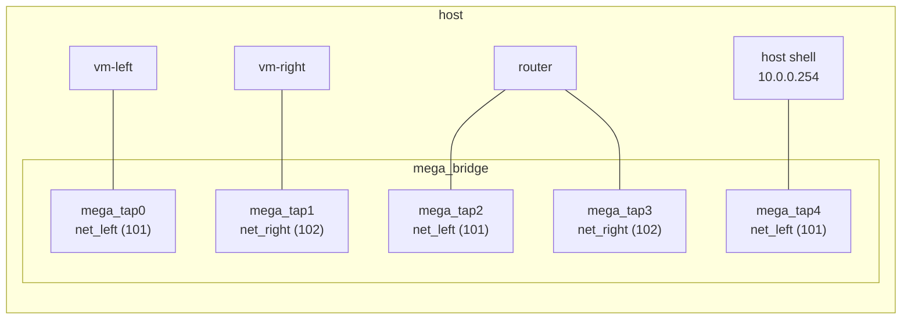

# Chapter 6: Networking basics

In [chapter 3](03-router-sandwich.md) you gave each VM a network with one
`vm config networks` line and let minimega do the rest. This chapter shows
the details. You look at how minimega wires the three VMs of the sandwich
together on the host. You learn what a netspec and a VLAN alias are. Then
you extend the experiment. The host gets its own tap into `net_left`, so you
can reach `vm-left` from a host shell. You unplug and replug a running VM.
You shape the traffic that a VM receives. At the end the sandwich runs as
before, and the host attaches to its left network.

This chapter assumes that the sandwich from
[chapter 3](03-router-sandwich.md) is running. It also assumes that you know
`vm info` and the `.columns` builtin from [chapter 4](04-vms.md). One step
runs a command inside a VM with `cc exec`. Chapter 3 introduced `cc exec`,
and [chapter 8](08-cc.md) covers it in full.
[Host networking](../../articles/networking.md) is the guide behind this
chapter. Read it afterwards for bridges, trunks, tunnels, and NAT.

## How the sandwich is wired

Every VM interface is a tap device on the host. minimega adds each tap as a
port on an Open vSwitch bridge called `mega_bridge`. Each port carries an
802.1q VLAN tag.

Two ports with the same tag share a layer-2 network. Ports with different
tags cannot see each other. That tag is the whole mechanism. On a freshly
started daemon, the sandwich has four VM ports on two tags. After this
chapter, it also has a fifth port that ends in the host's own network stack:



`vm info` has one column for each interface property. The tables in this
chapter omit the leading `host` column that `.annotate` adds by default. Ask
for the columns that matter here:

```minimega
minimega$ .columns name,vlan,tap,ip vm info
name     | vlan                              | tap                   | ip
router   | [net_left (101), net_right (102)] | [mega_tap2, mega_tap3] | [10.0.0.1, 10.0.1.1]
vm-left  | [net_left (101)]                  | [mega_tap0]           | [10.0.0.37]
vm-right | [net_right (102)]                 | [mega_tap1]           | [10.0.1.112]
```

The router's two entries in each column are its two interfaces, in the order
that you listed them. Your client addresses differ because the DHCP server of
the router does not hand out leases in order. minimega fills in the `ip`
column by watching traffic on the tap. For this reason, the column can lag a
moment behind the guest.

Open vSwitch shows the same thing from the host side, with the tag on every
port:

```bash
$ sudo ovs-vsctl show
```

```text
    Bridge mega_bridge
        Port mega_tap0
            tag: 101
            Interface mega_tap0
        Port mega_tap2
            tag: 101
            Interface mega_tap2
        Port mega_tap3
            tag: 102
            Interface mega_tap3
        ...
```

## The netspec

`vm config networks` takes one *netspec* per interface, in the order the
guest will see them:

```text
[bridge,]vlan[,mac][,driver][,qinq]
```

Only the VLAN is required. The sandwich never used any other field. The
router's `net_left net_right` produced interface 0 on `net_left` and
interface 1 on `net_right`. The guest names the interfaces in the same order
(`eth0`, `eth1`). `router router interface 0` and
`vm net disconnect vm-right 0` use the same index.

minimega recognizes the other fields by what they look like. A MAC address is
a MAC. The name of a QEMU network device is the driver. The literal `qinq` is
a flag. Anything else in front of the VLAN is a bridge name. The defaults are
`mega_bridge`, a random MAC, and the `e1000` driver.

```minimega
# a fixed MAC, so a DHCP server can give the VM a static lease (chapter 7)
vm config net net_right,00:00:00:00:02:01

# a paravirtual NIC instead of the emulated e1000
vm config net net_left,virtio-net-pci
```

Two things you will not need in this course exist in the same place.
`vm config bonds` bonds two or more of a VM's interfaces into one Open
vSwitch bond. The `qinq` flag puts a port in dot1q-tunnel mode. In this mode,
the 802.1q tags of the guest travel inside the minimega VLAN.
[Host networking](../../articles/networking.md#configuring-vm-interfaces)
describes both.

## VLAN aliases

`net_left` and `net_right` are not VLAN numbers. They are aliases. The first
time that minimega sees an alias, it allocates the next free tag from its
VLAN range and remembers the mapping. `vlans` lists the mappings of the
current namespace:

```minimega
minimega$ vlans
alias     | vlan
net_left  | 101
net_right | 102
```

The range is `101-4096`. A daemon that you start with another `-vlanrange`
uses that range instead. With the default range, aliases start at 101 and you
can use tags 1 through 100 directly.

minimega uses a plain number in a netspec as the tag itself. Then minimega
blacklists the number, so no alias is ever given that number. If something on
the other side of a trunk expects a specific tag, use
`vlans add <alias> <vlan>` to pin an alias to that tag.
To remove one tag from the blacklist, use `clear vlans blacklist <vlan>`. If
the tag is not blacklisted or in use, the command fails.

Aliases belong to the namespace. `net_left` in `sandwich` and `net_left` in
another namespace are different VLANs. For this reason,
[chapter 16](16-namespaces.md) can run a second copy of the sandwich next to
this one, and the two copies do not touch. `clear vlans` forgets the mappings
of the current namespace. Kill the VMs first, because a VM keeps its tag even
after the alias that produced it is gone.

## A tap for the host

So far nothing on the host can talk to the experiment. A *host tap* is a
port on the bridge that ends in the host's network stack instead of in a VM.
Put one on `net_left` with an address in that subnet. Then the host is on the
left network, like a fourth VM there.

Make one preparation first. The router serves leases from `10.0.0.2` to
`10.0.0.254`. Therefore the router can also give a client any static address
that you choose for the tap. Narrow the range and commit. A commit sends the
router its whole description again, so you change a running router with
another commit:

```minimega
minimega$ router router dhcp 10.0.0.0 range 10.0.0.2 10.0.0.200
minimega$ router router commit
```

Now create the tap. `tap create` prints the name of the interface it made,
and `tap` lists the host taps of the namespace:

```minimega
minimega$ tap create net_left ip 10.0.0.254/24
mega_tap4
minimega$ tap
bridge      | tap       | vlan
mega_bridge | mega_tap4 | net_left (101)
```

The host now has `10.0.0.254` on `mega_tap4` and a route to `10.0.0.0/24`
through it. To show this from the other side, have `vm-left` ping the tap
address of the host with `cc`. `cc` runs a command inside a guest, and
chapter 8 covers it in full. This works wherever minimega runs, including the
Docker image. The Docker image has no `ping` of its own for `shell` to run on
the host:

```minimega
minimega$ cc filter name=vm-left
minimega$ cc prefix tap
minimega$ cc exec ping -c 3 10.0.0.254
minimega$ shell sleep 8
minimega$ cc responses tap
minimega$ clear cc prefix
minimega$ clear cc filter
```

The responses show three replies from `10.0.0.254`.

From a host shell, ping `vm-left` at the address that `vm info` showed, or
log in over SSH. The stock miniccc image allows root to log in with no
password.

```bash
$ ping -c 3 10.0.0.37
$ ssh root@10.0.0.37
```

To reach `net_right` as well, give the host a route through the router. The
router forwards the traffic. The reply finds its way back, because the router
is directly connected to `10.0.0.0/24`:

```bash
$ sudo ip route add 10.0.1.0/24 via 10.0.0.1
$ ping -c 3 10.0.1.112
```

Two other forms exist.
`tap create net_left ip 10.0.0.254/24 left0` names the tap instead of
taking the next `mega_tapN`. `tap create net_left dhcp` runs `dhclient` on
the new tap, so the router leases an address to the tap. Be careful with the
second form on a host that you administer over the network. `dhclient` can
rewrite the resolver configuration of the host and add a default route, as it
does for any other interface.

!!! warning "A host tap joins the host to the experiment"
    Everything on `net_left` can now reach the host at `10.0.0.254`. The
    services of the host are exposed to everything on `net_left`. Taps are
    useful for bootstrapping and debugging. When you finish, delete the tap
    with `tap delete mega_tap4`, or delete every tap in the namespace with
    `tap delete all`. `clear namespace sandwich` also deletes them.
    [Security considerations](../../articles/security.md) has the longer
    discussion.

## DHCP and DNS from the host

The sandwich gets its addresses from the router. This is the right place for
them, because the whole configuration lives inside the experiment. On a VLAN
with no router, minimega can serve DHCP and DNS from the host instead. For
this, create a tap with an address. Then run
`dnsmasq start <address> <low> <high>`:

```minimega
minimega$ tap create scratch ip 10.0.9.1/24
minimega$ dnsmasq start 10.0.9.1 10.0.9.2 10.0.9.254
minimega$ dnsmasq
minimega$ dnsmasq kill all
```

Do not start one on `net_left`. Two DHCP servers on one network give
unpredictable results. `dnsmasq configure` adds static leases, names, and
DHCP options to a running instance.
[DHCP and DNS from the host](../../articles/networking.md#dhcp-and-dns-from-the-host)
has the full walk-through.
If `dnsmasq start` appears to succeed and the instance is gone a moment
later, another DNS server on the host owns port 53.
[Chapter 10](10-troubleshooting.md) shows how to find it.

## Unplugging a running VM

`vm net` changes the interfaces of a running VM. It identifies each interface
by its index. Unplug `vm-right` and look at the `vlan` column:

```minimega
minimega$ vm net disconnect vm-right 0
minimega$ .columns name,vlan vm info
name     | vlan
router   | [net_left (101), net_right (102)]
vm-left  | [net_left (101)]
vm-right | [disconnected]
```

The interface still exists inside the guest and still has its address. Only
the port on the bridge is gone. A ping from `vm-left` to the address of
`vm-right` now fails, but it worked in chapter 3:

```minimega
minimega$ cc filter name=vm-left
minimega$ cc exec ping -c 3 10.0.1.112
```

Plug it back into `net_right`. The next ping succeeds. `vm net connect`
takes a VLAN and, optionally, a bridge, so the same command moves an
interface to a different network:

```minimega
minimega$ vm net connect vm-right 0 net_right
minimega$ clear cc filter
```

`vm net add <vm> <netspec>` adds a whole new interface to a running VM. The
guest sees a new NIC without a configuration. Configure it with
`cc exec dhclient eth1` or a static address. Do not add an interface to a
sandwich client now, because a client on both networks bypasses the router.
[Chapter 14](14-runtime-changes.md) unplugs and replugs a router interface and
describes `vm net add`.

## Quality of service

`qos add` shapes traffic on one VM interface with `tc` on the host side of
the tap. `loss` is a percentage, so the first command drops one packet in four of the
traffic that `vm-left` receives. `delay` adds latency and combines with loss.
`rate` caps bandwidth and replaces both, because the two use different
queueing disciplines:

```minimega
minimega$ qos add vm-left 0 loss 25
minimega$ qos add vm-left 0 delay 100ms
minimega$ .columns name,qos vm info
minimega$ qos add vm-left 0 rate 10 mbit
minimega$ clear qos vm-left all
```

The constraint applies to traffic that the VM *receives*, not to traffic that
it sends. With loss in place, `ping vm-left` from the host through the tap
loses about a quarter of its requests. A ping from `vm-left` outward loses
nothing on the way out. To shape a link in both directions, shape the
interface at each end. The `qos` column shows each constraint that is in
force.
[Chapter 14](14-runtime-changes.md) uses qos with real traffic on the
sandwich.

## The script

The script rebuilds the sandwich with the narrower `net_left` range. Then it
creates the host tap, unplugs and replugs `vm-right`, and tries the loss
example. It leaves the host tap in place:

```minimega title="06-networking.mm"
--8<-- "training/miniclass/scripts/06-networking.mm"
```

[Download this example](scripts/06-networking.mm){ download="06-networking.mm" }

## What you built

- The sandwich as in chapter 3, with the router's `net_left` range narrowed
  to `10.0.0.2` to `10.0.0.200` by a second commit.
- A host tap at `10.0.0.254` on `net_left`, and a host shell that can ping
  and log in to `vm-left`.
- You know what the `vlan`, `tap`, and `ip` columns of `vm info` show. You
  also know what the `vlans` and `tap` tables show.

## Where to read more

- [Host networking](../../articles/networking.md): the netspec in full,
  bonds and QinQ, VLAN ranges and blacklists, dnsmasq, trunks and tunnels,
  and NAT to the outside world.
- [Capture and instrumentation](../../articles/capture.md): mirroring a
  VM's traffic to another VM, which [chapter 12](12-capture.md) does on the
  sandwich.
- Reference: [`vm config networks`](../../reference/minimega.md#vm-config-networks),
  [`vm config bonds`](../../reference/minimega.md#vm-config-bonds),
  [`vlans`](../../reference/minimega.md#vlans),
  [`tap`](../../reference/minimega.md#tap),
  [`clear tap`](../../reference/minimega.md#clear-tap),
  [`dnsmasq`](../../reference/minimega.md#dnsmasq),
  [`vm net`](../../reference/minimega.md#vm-net),
  [`qos`](../../reference/minimega.md#qos),
  [`bridge`](../../reference/minimega.md#bridge),
  [`shell`](../../reference/minimega.md#shell).

## Next

[Chapter 7: Routers and services](07-routers.md) uses the rest of the
`router` API: static leases, DNS, static routes, and a second router that
runs OSPF.
