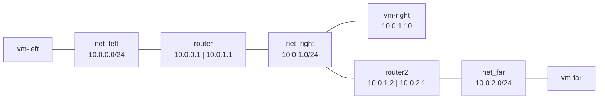

# Chapter 7: Routers and services

Until now, the sandwich router handed out addresses and a default gateway
on each side. In this chapter you use the rest of the `router` API on it.
You give `vm-right` a fixed address and a name that `vm-left` can resolve.
Then you grow the experiment. A second router, `router2`, joins `net_right`
to a third network, `net_far`. A client, `vm-far`, is on `net_far`. You
connect the two routers first with static routes and then with OSPF. You
look at what the routers report back and see where firewall rules fit. At
the end, the sandwich is a three-network topology with two routers that
exchange routes.

This chapter needs the running sandwich from
[chapter 3](03-router-sandwich.md). Chapter 3 also showed how `router <vm>`
prints the description of a router. This chapter also needs the `vm net` and
`vlans` material from [chapter 6](06-networking.md). The guide behind this
chapter is [Routing with minirouter](../../articles/router.md).

## What a router command does

`router router ...` commands never touch the VM. Each one edits a
description that minimega keeps for that VM. `router router commit` writes
the description to a file named `minirouter-router` in the namespace's
subdirectory of the files directory (`files/sandwich/` here). Then it queues
three `cc` commands for the VM. The commands remove any earlier copy under
`/tmp/miniccc/files/`, send the new file, and run `minirouter -u` on it.

Inside the guest, minirouter rewrites the configuration of the programs it
drives (`dnsmasq` for DHCP and DNS, `bird` for routing, `ip` for addresses).
Then it restarts the programs and reports its log lines back through a VM
tag. Because of this, the `cc_active` column of `vm info` must be `true` for
the router before a commit does anything. Also, a change takes a few seconds
to take effect.

Every commit sends the complete description. So configuring a router the
first time is the same as changing it later. Describe and commit. If you
change your mind, describe and commit again.

## A static lease and a name

DHCP identifies leases by MAC address, so a static lease needs a VM with a
known MAC. `vm-right` launched with a random MAC. Relaunch it with a fixed
MAC in its netspec. The template still holds the kernel and initrd of the
router from chapter 3. First, point the template back at the client image:

```minimega
minimega$ vm kill vm-right
minimega$ vm flush vm-right
minimega$ vm config kernel miniccc.kernel
minimega$ vm config initrd miniccc.initrd
minimega$ vm config net net_right,00:00:00:00:02:01
minimega$ vm launch kvm vm-right
```

Before you start it, describe the lease and a DNS record for the address.
Also tell both DHCP servers to advertise the router as the DNS server.
`dhcp <network> static <mac> <ip>` adds the lease to the server for that
network. `dns <ip> <hostname>` adds a record to the resolver of the router.
`dhcp <network> dns <address>` sets the DHCP option that clients write into
their resolver configuration:

```minimega
minimega$ router router dhcp 10.0.1.0 static 00:00:00:00:02:01 10.0.1.10
minimega$ router router dns 10.0.1.10 right.sandwich
minimega$ router router dhcp 10.0.0.0 dns 10.0.0.1
minimega$ router router dhcp 10.0.1.0 dns 10.0.1.1
minimega$ router router commit
minimega$ vm start vm-right
```

Give the commit a few seconds before the client boots. Then the first DHCP
request of the client already uses the new configuration. `vm-right` now
comes up at `10.0.1.10`. The description shows the lease under its network
and the record in a DNS section after the networks:

```minimega
minimega$ router router
...
Listen address: 10.0.1.0
Low address:    10.0.1.2
High address:   10.0.1.254
Router:         10.0.1.1
DNS:            10.0.1.1
Static IPs:
     00:00:00:00:02:01 10.0.1.10

DNS:
10.0.1.10       right.sandwich
...
```

`vm-left` took its lease at boot, before the DNS option existed. A lease
refreshes only at renewal time, so its resolver still points to the address
that it used before. Do not wait. For now, ask it to ping by address. After
its next boot, ask it to ping by name. The script at the end of the chapter
builds everything in the right order, so the name works immediately:

```minimega
minimega$ cc filter name=vm-left
minimega$ cc exec ping -c 3 10.0.1.10
minimega$ cc exec ping -c 3 right.sandwich
```

The resolver of the router knows only the records that you add. It forwards
nothing else, so a name that it does not know fails.
`router router upstream <ip>` names a server to forward everything else to.
This is useful after the experiment has a path to the outside world
([Host networking](../../articles/networking.md#reaching-the-outside-world)).

## A second router and a third network

Now extend the topology. `router2` has one interface on `net_right`. This
network becomes the transit link between the two routers. `router2` has a
second interface on the new `net_far`, where it serves DHCP to `vm-far`:



Launch the client first, while the template still describes a client. Then
switch to the router image for `router2`. Its interface 0 is on `net_right`
and its interface 1 is on `net_far`, in the order of the netspec:

```minimega
minimega$ vm config net net_far
minimega$ vm launch kvm vm-far
minimega$ vm config kernel minirouter.kernel
minimega$ vm config initrd minirouter.initrd
minimega$ vm config net net_right net_far
minimega$ vm launch kvm router2
minimega$ router router2 interface 0 10.0.1.2/24
minimega$ router router2 interface 1 10.0.2.1/24
minimega$ router router2 dhcp 10.0.2.0 range 10.0.2.2 10.0.2.254
minimega$ router router2 dhcp 10.0.2.0 router 10.0.2.1
minimega$ router router2 commit
minimega$ vm start router2
minimega$ vm start vm-far
```

`router2` takes a static address on `net_right` and ignores the leases that
the sandwich router offers there. A minirouter asks for DHCP only on an
interface that you configure with `interface <n> dhcp`. After `vm-far` has
its lease, try to reach the far side of `router2` from `vm-left`:

```minimega
minimega$ cc exec ping -c 3 10.0.2.1
```

The ping fails. The response says why: the sandwich router replies that the
network is unreachable. `vm-left` sent the packet to its default gateway,
`10.0.0.1`. That router knows its two connected networks and nothing else.
What is missing is routing between the two routers.

## Static routes first

The simplest fix is to tell each router where the network of the other
router is. A static route is a destination and a next hop. The next hop must
be on a network that the router connects to:

```minimega
minimega$ router router route static 10.0.2.0/24 10.0.1.2
minimega$ router router commit
minimega$ router router2 route static 10.0.0.0/24 10.0.1.1
minimega$ router router2 commit
```

`router2` needs the second route as much as the sandwich router needs the
first. Without it, the ping from `vm-left` arrives and the reply has nowhere
to go. After both commits, the ping succeeds and `traceroute` shows the path:

```minimega
minimega$ cc exec traceroute -n 10.0.2.1
minimega$ cc responses 19
19/<uuid of vm-left>/stdout:
traceroute to 10.0.2.1 (10.0.2.1), 30 hops max, 60 byte packets
 1  10.0.0.1  0.412 ms  0.388 ms  0.371 ms
 2  10.0.2.1  0.913 ms  0.878 ms  0.860 ms
```

The command id depends on how many `cc` commands came before. `cc commands`
lists them. Under the description, minirouter turns each static route into a
`route ... via ...` line in a `protocol static` block of its BIRD
configuration. Then BIRD installs the route in the kernel routing table of
the router.

## OSPF instead

When a third router appears, static routes stop scaling. When a link goes
down, static routes do not adapt. Remove the static routes and let the
routers exchange routes with OSPF. `route ospf <area> <interface>` puts an
interface, and every network on it, into an OSPF area. Put both interfaces
of both routers into area 0:

```minimega
minimega$ clear router router route static 10.0.2.0/24
minimega$ router router route ospf 0 0
minimega$ router router route ospf 0 1
minimega$ router router commit
minimega$ clear router router2 route static 10.0.0.0/24
minimega$ router router2 route ospf 0 0
minimega$ router router2 route ospf 0 1
minimega$ router router2 commit
```

The two routers now hear the hello packets of each other on `net_right` and
form an adjacency. Then each router learns the client network of the other
router. This takes a few tens of seconds with the default timers of BIRD.
After that, the same ping and traceroute work again with no static route
anywhere. The description shows the area and its interfaces:

```minimega
minimega$ router router2
...
OSPF Area:      0
Interfaces:
        0
        1
...
```

To see the state of the routing daemon, ask it through `cc`. The control
socket of BIRD in the minirouter image is `/bird.sock`:

```minimega
minimega$ cc filter name=router2
minimega$ cc exec birdc -s /bird.sock show protocols
minimega$ cc exec birdc -s /bird.sock show route
minimega$ clear cc filter
```

`show protocols` lists the OSPF protocol as `up`. `show route` includes
`10.0.0.0/24` learned via `10.0.1.1`. If a route that you expect is missing,
use these two commands and the `Log:` section of `router router2`. OSPF
picks paths by the summed interface cost. The cost is 10 per interface
unless you set another value. `router router2 route ospf 0 1 cost 20` sets a
cost. [OSPF and link cost](../../articles/router.md#ospf-and-link-cost)
describes a triangle of routers where a change of cost moves the path. The
[appendix](../../articles/router.md#appendix-a-larger-ospf-network) of the
same guide applies the idea to six routers and nine links.

## Firewall rules

A minirouter can also filter the traffic that it forwards, with iptables
rules that it generates from `fw` subcommands. `in` and `out` are relative
to the interface at the given index. So a rule for traffic toward
`vm-right` is an `out` rule on interface 1 of the sandwich router. This rule
drops ICMP addressed to `vm-right` and leaves all other traffic alone:

```minimega
minimega$ router router fw drop out 1 10.0.1.10 icmp
minimega$ router router commit
```

After the commit, a ping from `vm-left` to `10.0.1.10` gets no replies and
`cc exitcode` reports `1`. `10.0.2.1` still answers. A commit restarts the
routing daemon of the router, so wait about 30 seconds before you ping
`10.0.2.1`. OSPF needs that time to exchange the routes again.

`fw default drop` reverses the policy, so the router forwards only what you
`accept`. Chains group rules that apply to more than one interface.
`clear router router fw` followed by a commit removes every rule again. The
syntax is in [Firewall](../../articles/router.md#firewall).

!!! note "Only KVM routers"
    `fw` rules work only on KVM routers. The guest must have `iptables`.
    The `minirouter.conf` that you built the image from in
    [chapter 2](02-images.md) installs `iptables`. On an image without
    `iptables`, the rules do not take effect, and the `Log:` section of the
    router shows the failure.

## Removing configuration

Every subcommand has a `clear router <vm> ...` form that removes that part
of the description, down to a single entry:
`clear router router dns 10.0.1.10`,
`clear router router dhcp 10.0.1.0 static 00:00:00:00:02:01`,
`clear router router2 route ospf 0`. `clear router router2` empties the
description of one router. `clear router` forgets every router in the
namespace. Clearing edits only the description. To make the router match,
commit the change. Alternatively, as the next chapter shows, tear the
namespace down and rebuild it from a script.

## The script

The script builds the whole topology from a clean minimega. It sets up the
static lease, the DNS record, and OSPF from the start. Then it pings across
the topology in both directions and adds and removes the firewall rule:

```minimega title="07-routers.mm"
--8<-- "training/miniclass/scripts/07-routers.mm"
```

[Download this example](scripts/07-routers.mm){ download="07-routers.mm" }

## What you built

- `vm-right` at a fixed `10.0.1.10`, resolvable as `right.sandwich` from
  the other clients. Both DHCP servers advertise the router as the resolver.
- A third network, `net_far`, behind a second router, with `vm-far` on it.
- Two routers exchanging routes over OSPF on `net_right`, and the tools to
  see what they learned: the description, its `Log:` section, and `birdc`
  over `cc`.
- A firewall rule on `router` that drops ICMP to `vm-right`, and its
  removal.

## Where to read more

- [Routing with minirouter](../../articles/router.md): the full `router`
  API, IPv6 and router advertisements, BGP, link costs, and the six-router
  OSPF appendix.
- [Command and control](../../articles/cc.md): the channel every commit
  travels over.
- [Building images with vmbetter](../../articles/vmbetter.md): adding
  packages to the router image.
- Reference: [`router`](../../reference/minimega.md#router),
  [`clear router`](../../reference/minimega.md#clear-router),
  [`vm net`](../../reference/minimega.md#vm-net), and the
  [minirouter API](../../reference/minirouter.md). A committed description
  file contains the minirouter API.

## Next

[Chapter 8: Command and control](08-cc.md) explains the `cc` commands that
you used so far without explanation. It covers the whole API: clients,
filters, files, mounts, and tunnels.
