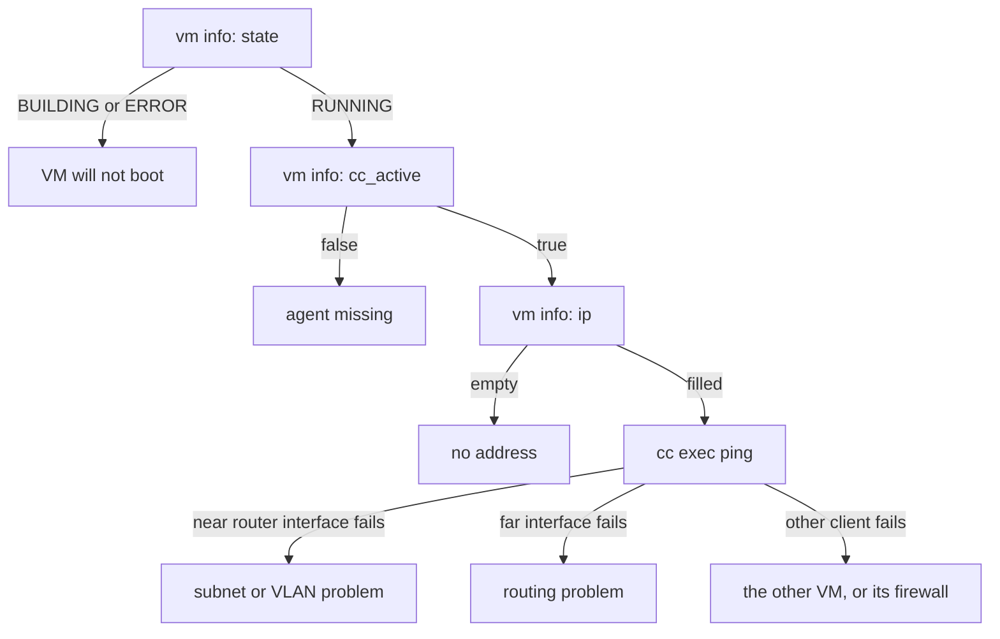

# Chapter 10: Troubleshooting walk

Part I ends with the sandwich failing on purpose. This chapter is a guided
diagnosis of the ways that the experiment most often goes wrong:

- a VM that will not boot
- a client with no address
- a ping that never returns
- an agent that never connects

For each failure, you learn which command shows the symptom and what the usual
causes are on this topology. You also learn how to make sure that a cause is the
real one before you change anything. The chapter closes with the logs and with
the steps to take after minimega itself dies.

This chapter assumes Part I so far, in particular the network layout from
[chapter 6](06-networking.md), the router from [chapter 7](07-routers.md), and
`cc` from [chapter 8](08-cc.md). [Troubleshooting](../../articles/troubleshooting.md)
is the guide behind this chapter, and it has the longer list of symptoms. This
chapter is conceptual and has no script. Chapter 9 removed the sandwich. To
build it again, `read` the script of chapter 7, which gives `vm-right` the
address `10.0.1.10`. Then break your own sandwich as you read.

## Two habits first

Raise the log level and read the log. `log level debug` at the prompt shows the
QEMU, dnsmasq, and Open vSwitch commands that minimega runs, and their output.
Most answers are there. Under systemd the file is `/var/log/minimega.log`.
`log file <path>` sends the log elsewhere. `log ring` keeps recent messages in
memory for a daemon with no file. When you are done, turn the level back down
with `log level error`. Debug output on a busy host fills disks.

Run `check`. It makes sure that the kernel, QEMU, dnsmasq, and Open vSwitch are
present and new enough. minimega depends on these components. It also makes sure
that Open vSwitch is running. If no `kvm` module is loaded, it warns. If all is
well, it prints nothing. Otherwise it prints an error for each missing
program. It stops at the first failed kernel, version, or Open vSwitch test.

The walk below works from the VM outward, one layer at a time:



## A VM will not boot

The `state` column of `vm info` tells you which kind of failure you have.
`ERROR` means that the launch failed or the process died. The reason is in the
`error` tag of the VM:

```minimega
minimega$ .columns name,state vm info
minimega$ vm tag router error
```

The most common message says that QEMU exited before minimega reached its
control socket. Everything after `qemu output:` is the explanation that QEMU gives:

```text
unable to connect to qmp socket: dial unix /tmp/minimega/2/qmp: connect:
connection refused. qemu output: Could not access KVM kernel module: No such
file or directory
```

That message is about the `kvm` module. Run `lsmod | grep kvm` on the host, and
then `modprobe kvm_intel` or `kvm_amd`. If the modprobe itself fails, either
hardware virtualization is off in the firmware, or the host is a VM without
nested virtualization. [Chapter 1](01-install.md) checked for nested
virtualization.

Other frequent `qemu output` lines have two causes. The first cause is an image
that does not exist. minimega resolved a relative path in `vm config kernel`
against the files directory, and the file is not there (`file list` shows what
is there). The second cause is a `-cpu` or `-machine` option that the installed
QEMU does not know. Fix the cause. Then run `vm flush` for the failed VM and
launch it again. A failed VM keeps its name until you flush it.

A VM that stays in `BUILDING` is not started. Recall from
[chapter 4](04-vms.md) that `vm start all` skips VMs in `QUIT` and `ERROR`. Name
them explicitly to relaunch them.

## A client has no address

`vm-left` is `RUNNING`, but its `ip` column stays empty. minimega learns the
column from traffic, so give the guest a moment. If the column stays empty, work
through the three things that must be true for a lease to arrive.

First, make sure that the router got its configuration. `router router` prints
the description and, at the end, the `Log:` lines that the router sent back. An
empty log means that the commit never reached the VM. There are two causes. Either
you never ran `router router commit`, or the `cc_active` of the router is
`false`. In the second case, the commit is still queued in `cc commands` and
waits for an agent. Fix the agent (next section). Then minimega delivers the queued commit on its own.

Second, make sure that the client is on the same VLAN as the router. Compare the
`vlan` column of `vm info` for both. A typo such as `net_lef` is a new alias with
its own tag, and `vlans` shows it as a third entry. `ovs-vsctl show` on the host
shows the `tag:` on each port. This tag is the ground truth.

Third, make sure that nothing else answers or blocks. Inside the router,
`cc filter name=router` and `cc exec ps` show one `dnsmasq`. If dnsmasq failed
to start, the `Log:` section reports it. On the host, a tap plus `dnsmasq start`
on the same VLAN as the router means two DHCP servers. The server that answers
first wins. The host-side failure from chapter 1 also belongs here. A system
dnsmasq, or the dnsmasq that NetworkManager starts, holds port 53. Then the
`dnsmasq start` command of minimega exits at once, and `ss -ulpn 'sport = :53'`
names the owner. Finally, ask the guest itself. Select the client with
`cc filter name=vm-left`. Then `cc exec dhclient -v eth0` runs the exchange
again, and `cc responses all` shows it. `cc exec ip addr` shows the address that
the guest got.

## A ping does not return

Ping in steps, because each step rules out a layer. From `vm-left`:

1. Its own gateway, `10.0.0.1`. A failure here is a subnet problem: wrong VLAN,
   an address in the wrong subnet, or a duplicate address.
   `cc exec ip neighbor` shows whether ARP resolved the router. An entry marked
   `FAILED`, or no entry, means layer 2. Then run `ovs-vsctl show`.
2. The router's far interface, `10.0.1.1`. If step 1 works and this step fails,
   an address on the router is wrong. Make sure that every address and mask in
   `router router` is correct. A wrong mask hides a whole subnet.
3. The other client, `10.0.1.10`. If steps 1 and 2 work and this step fails, the
   router does not forward, or the problem is on the far side. The router
   answers step 2 itself, so step 2 does not test forwarding. A minirouter
   image turns `net.ipv4.ip_forward` on at boot.
   `cc exec sysctl net.ipv4.ip_forward` on the router shows whether it is on.
   On the far side, there are three causes. The client has no address
   (previous section). The client has no default route back (`cc exec ip route`
   on `vm-right` shows `default via 10.0.1.1`). Or a firewall blocks the
   traffic. A reply that has nowhere to go looks like a request that never
   arrived. `cc exec timeout 30 tcpdump -c 5 -n icmp` on the target shows which
   one happened. Select the target with `cc filter name=vm-right` before the
   capture. While the capture runs, select the sender with
   `cc filter name=vm-left` and run `cc exec ping -c 3 10.0.1.10`. Then read the
   output with `cc responses all`. Without `timeout`, a capture that sees fewer
   than five packets does not end, and the client runs no other command.

If you have OSPF between two routers, as in chapter 7, add a step between steps
2 and 3. Make sure that the router knows the far network.
`cc exec birdc -s /bird.sock show route` on either router lists what BIRD
learned. `show protocols` lists OSPF as `up`. Adjacencies take tens of seconds
to form. A router whose interface is not in the area advertises nothing.
`traceroute -n` from the client shows where packets stop.

## The agent is missing

`cc_active` is `false` for a VM that is running. In order of likelihood:

- The image does not start miniccc, or you launched the VM from the wrong image.
  The stock images of chapter 2 start it from their init script. A guest that
  you built yourself must do the same (see
  [Creating VMs from install media](../../articles/newvm.md)).
- The agent and the daemon are from different releases. The log says
  `mismatched miniccc version on <hostname>: <revision>`, or it refuses the
  agent with `miniccc client too old`. Rebuild the images.
- The backchannel is off (`vm config backchannel false`), or a
  `vm config virtio-ports` port named `cc` took its place. The `virtio-ports`
  column of `vm info` shows the second case.
- The agent connected and then lost the daemon, for instance after a restart.
  The agent retries for up to two hours. minimega redials the port as long as
  the VM exists. So give it a minute.

In the stock images, the guest keeps its own record in `/miniccc.log`. Without
an agent, you cannot `cc recv` it. But you can read it on the console through
miniweb ([chapter 5](05-miniweb.md)). With a host tap from chapter 6, you can
also read it over SSH.

## Reading the log

With `log level debug` set, four kinds of lines are worth knowing on the
sandwich:

- The QEMU command line that minimega built for each VM. minimega prints it at
  launch, and it shows exactly which kernel, initrd, and interfaces the VM got.
- The `ovs-vsctl` calls that add each tap with its tag.
- The `dnsmasq` command line and any error that dnsmasq printed.
- The `cc` messages as agents connect, send heartbeats, and pick up commands.

If one subsystem produces so many lines that you cannot see the rest,
`log filter <text>` drops lines that contain a string. `clear log filter`
restores them. Under systemd, output to stderr also reaches
`journalctl -u minimega`.

## When minimega itself dies

A daemon that crashes leaves its QEMU processes running and its socket behind.
The message `minimega appears to already be running, override with -force` at
the next start means that the socket is there. Start with one of these flags:

- `-recover` removes the socket and adopts the VMs that are still running. It
  reattaches their taps.
- `-force` removes the socket and starts clean. It ignores the old state.

Under systemd, set `MM_RECOVER=true` in `/etc/minimega/minimega.conf` for one
restart. Then turn it off again, because a recovery that finds inconsistent
state fails the start. minimega recovers only KVM VMs. If neither flag leaves a
usable host, run `nuke`, as [chapter 9](09-save-replay-cleanup.md) describes. It
kills what is left and deletes the base directory. Report a reproducible crash
as an issue with the version, the command file, and the log. With `-panic` at
startup, minimega dumps goroutine stacks when it gets SIGINT or SIGTERM (for
example from `kill -INT`). A report needs those stacks.

## What you built

- A diagnosis order for the sandwich: state, agent, address, then ping one
  hop at a time.
- The three commands that answer most questions: `vm info` with the right
  columns, `router <vm>` for the log lines, and `log level debug`.
- A checklist of what `-recover`, `-force` and `nuke` each do.

## Where to read more

- [Troubleshooting](../../articles/troubleshooting.md): the full symptom
  list, the Open vSwitch cheat sheet, and the network walk on a
  three-VM topology.
- [Running minimega](../../articles/running.md#recovering-from-a-previous-instance):
  recovery, logging and the base directory.
- [Routing with minirouter](../../articles/router.md#when-the-router-does-not-respond)
  and [Command and control](../../articles/cc.md): what each expects of the
  guest.
- Reference: [`check`](../../reference/minimega.md#check),
  [`log level`](../../reference/minimega.md#log-level),
  [`log file`](../../reference/minimega.md#log-file),
  [`log filter`](../../reference/minimega.md#log-filter),
  [`vm tag`](../../reference/minimega.md#vm-tag),
  [`router`](../../reference/minimega.md#router),
  [`nuke`](../../reference/minimega.md#nuke).

## Next

That is the end of Part I. Part II starts with
[Chapter 11: Background traffic with protonuke](11-traffic.md), which puts
real traffic on the sandwich. You can read its labs in any order.
