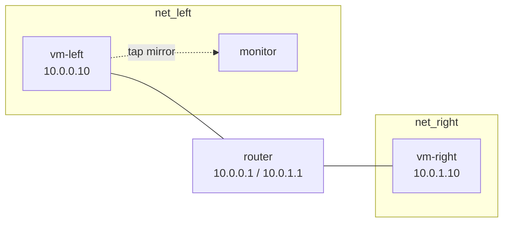

# Chapter 12: Capture and mirrors

In this lab you record the traffic that crosses the sandwich in three ways.
You capture a PCAP of one VM interface and a PCAP of the whole bridge. You
also capture netflow summaries of the bridge, as text and as compressed
binary that you convert with `nfcat`. Then you add a fourth VM, `monitor`.
You use `tap mirror` to feed it a copy of everything that `vm-left` sends
and receives. Then a tool inside a guest can watch the traffic live. All of
this happens on the host side of the taps, so the guests cannot detect it.

Prerequisites: Part I, in particular [Chapter 3](03-router-sandwich.md),
[Chapter 6](06-networking.md) for taps, bridges and VLANs, and
[Chapter 8](08-cc.md) for `cc`. [Chapter 11](11-traffic.md) is a good source
of traffic to capture, but it is not required. The lab uses `ping`.

## Rebuild the sandwich

Start from the sandwich with fixed client addresses, exactly as in
[chapter 11](11-traffic.md#rebuild-the-sandwich-with-fixed-addresses):
`vm-left` is `10.0.0.10`, `vm-right` is `10.0.1.10`, and the script at the
end of the chapter rebuilds it. The topology, with the monitor that you add
later:



## PCAP from one interface

`capture pcap vm` captures a single VM interface, named by VM and zero-based
interface index, into a file. A relative file name goes in the files
directory, `/tmp/minimega/files`, of the host that runs the VM:

```minimega
minimega[sandwich]$ capture pcap vm vm-left 0 vm-left.pcap
minimega[sandwich]$ .annotate false .columns bridge,type,interface,mode,compress,path capture
bridge      | type | interface | mode | compress | path
mega_bridge | pcap | vm-left:0 |      |          | /tmp/minimega/files/vm-left.pcap
```

Make some traffic that crosses that interface. A ping from `vm-left` to
`vm-right` goes out through the router. The replies come back the same way:

```minimega
minimega[sandwich]$ cc filter name=vm-left
minimega[sandwich]$ cc exec ping -c 5 10.0.1.10
minimega[sandwich]$ shell sleep 10
minimega[sandwich]$ capture pcap delete vm vm-left
```

`capture pcap delete vm <name>` stops every capture on that VM. To stop
one, add the interface index. The file is an ordinary PCAP, readable with
`tcpdump -n -r /tmp/minimega/files/vm-left.pcap` or Wireshark on the host.
It contains the ten ICMP packets, five requests and five replies, plus any
ARP. It contains nothing from `net_right`, because the tap sees only the
frames of `vm-left`.

Two settings apply to captures that you start afterwards.
`capture pcap snaplen` limits the bytes kept per packet. It prints `0` until
you set a value, and `0` means the default of 1600. `capture pcap filter "icmp"`
applies a BPF expression. Without an argument, it shows the current filter.

## PCAP from the bridge

`capture pcap bridge` captures everything that crosses a bridge, on every
VLAN. So one capture on `mega_bridge` holds both sides of the sandwich. Run
the same ping and compare:

```minimega
minimega[sandwich]$ capture pcap bridge mega_bridge sandwich.pcap
minimega[sandwich]$ cc exec ping -c 5 10.0.1.10
minimega[sandwich]$ shell sleep 10
minimega[sandwich]$ capture pcap delete bridge mega_bridge
```

This time each ping appears twice. It appears once on `net_left` between
`vm-left` and the router, and once on `net_right` between the router and
`vm-right`. Bridge captures run only on the host that you are attached to.
A bridge carries every namespace that uses it. So on a shared host, a bridge
capture also contains the experiments of other people. When hosts are
shared, we recommend that you use per-VM captures.
[Captures and namespaces](../../articles/capture.md#captures-and-namespaces)
has the details.

## Netflow

Netflow keeps one record per conversation instead of every packet. A record
has endpoints, ports, protocol, byte and packet counts, and timing. Netflow
attaches to a bridge. When a writer starts, minimega reads two settings.
`mode` chooses `ascii` or `raw` (binary, the default). `gzip` compresses
file output. Start a text writer first:

```minimega
minimega[sandwich]$ capture netflow mode ascii
minimega[sandwich]$ capture netflow bridge mega_bridge sandwich.nf
minimega[sandwich]$ cc exec ping -c 5 10.0.1.10
minimega[sandwich]$ shell sleep 15
minimega[sandwich]$ capture netflow delete bridge mega_bridge
```

The wait matters. When a flow is idle or active for the timeout, the flow
is written out. The timeout is 10 seconds by default
(`capture netflow timeout`). `sandwich.nf` is now a text file with one line
per flow. Raw mode is the compact form for long runs. Combine it with gzip
and convert afterwards with `nfcat`. The packages install `nfcat` as
`/opt/minimega/bin/nfcat`, and a source build has it as `bin/nfcat`:

```minimega
minimega[sandwich]$ capture netflow mode raw
minimega[sandwich]$ capture netflow gzip true
minimega[sandwich]$ capture netflow bridge mega_bridge sandwich.nf.gz
minimega[sandwich]$ cc exec ping -c 5 10.0.1.10
minimega[sandwich]$ shell sleep 15
minimega[sandwich]$ capture netflow delete bridge mega_bridge
minimega[sandwich]$ shell /opt/minimega/bin/nfcat -gunzip /tmp/minimega/files/sandwich.nf.gz
```

`capture` lists netflow writers with their `mode` and `compress` columns.
A writer can also send to a collector: `capture netflow bridge mega_bridge
udp collector.example.org:2055`. Open vSwitch keeps a single netflow object
per bridge, so every writer on a bridge shares the timeout.

## A monitor VM on a mirror

Host-side captures answer "what was sent". Sometimes you want a tool to see
the traffic as it happens. If that tool is easier to run in a guest than on
the host, mirror the traffic into a VM. Launch a third client-image VM on
`net_left`. Let it boot and take a lease. Then create the mirror:

```minimega
minimega[sandwich]$ vm config kernel miniccc.kernel
minimega[sandwich]$ vm config initrd miniccc.initrd
minimega[sandwich]$ vm config net net_left
minimega[sandwich]$ vm launch kvm monitor
minimega[sandwich]$ vm start monitor
minimega[sandwich]$ shell timeout 300 sh -c "until minimega -e .annotate false .columns cc_active,ip namespace sandwich vm info 2>/dev/null | grep -c 'true.*10[.]' | grep -qx 4; do sleep 3; done"
minimega[sandwich]$ tap mirror vm-left 0 monitor 0
```

`tap mirror <vm> <index> <vm> <index>` tells Open vSwitch to copy every frame
that enters or leaves the first port to the second. Both VMs must be on the
same bridge, and therefore on the same host. The other form names taps
directly, as `vm info` shows them, so a host tap can be either end. Use the
second form instead of the first, because a destination accepts one mirror.
Or run `clear tap mirror monitor 0` first:

```minimega
minimega[sandwich]$ .annotate false .columns name,tap vm info
name     | tap
monitor  | [mega_tap4]
router   | [mega_tap2, mega_tap3]
vm-left  | [mega_tap0]
vm-right | [mega_tap1]
minimega[sandwich]$ tap mirror mega_tap0 mega_tap4
```

The monitor boots first because of the order of the mirror. While a port is
a mirror destination, Open vSwitch reserves it for mirrored frames. Open
vSwitch drops anything that the VM itself sends, so you cannot reach the
monitor over the network. That is no obstacle, because you drive it over cc.
The client image includes tcpdump. Write what arrives to a file. Give tcpdump
a few seconds to start. Ping across the sandwich from the other client. Then
stop tcpdump and read the file back:

```minimega
minimega[sandwich]$ cc filter name=monitor
minimega[sandwich]$ cc prefix monitor
minimega[sandwich]$ cc background tcpdump -U -n -i eth0 -w /tmp/mirror.pcap
minimega[sandwich]$ shell sleep 5
minimega[sandwich]$ cc filter name=vm-right
minimega[sandwich]$ cc exec ping -c 3 10.0.0.10
minimega[sandwich]$ shell sleep 10
minimega[sandwich]$ cc filter name=monitor
minimega[sandwich]$ cc process killall tcpdump
minimega[sandwich]$ cc exec tcpdump -n -r /tmp/mirror.pcap
minimega[sandwich]$ shell sleep 5
minimega[sandwich]$ cc responses monitor
```

`-U` makes tcpdump flush each packet to the file. So when
`cc process killall` stops tcpdump, nothing is lost. The ping of `vm-right`
also has the prefix, so the response starts with its output. The tcpdump
output follows. It shows the six ICMP packets between `10.0.1.10` and
`10.0.0.10` as they crossed the interface of `vm-left`. It also shows any ARP
and DHCP traffic that the interface saw.

In your own image, replace tcpdump with Zeek, Suricata, or Snort. The same
mirror then feeds a real sensor. The
[capture guide](../../articles/capture.md#a-zeek-sensor-on-the-mirror)
describes a Zeek VM with a persistent log disk.

Mirrors are keyed by their destination, since one source can feed several
monitors. Remove this one by VM and interface, or by tap name:

```minimega
minimega[sandwich]$ clear tap mirror monitor 0
```

`clear tap mirror` with no name removes every mirror in the namespace, and
`clear tap` removes them along with the host taps.

## Clean up

`clear capture` stops every capture of every kind in the namespace.
`clear capture pcap` and `clear capture netflow` stop one kind. The files
stay in `/tmp/minimega/files` until you delete them. On a cluster,
`file get` fetches them from the host that wrote them.

## What you built

- PCAPs of one interface (`vm-left.pcap`) and of the whole bridge
  (`sandwich.pcap`), and the difference between them.
- Netflow of the bridge as text (`sandwich.nf`) and as gzipped raw records
  converted with `nfcat`.
- A `monitor` VM on `net_left` that receives a mirror of the interface of
  `vm-left` and runs tcpdump on it. You drive the VM entirely over cc.

## Where to read more

- [Capture and instrumentation](../../articles/capture.md): choosing a
  method, [PCAP](../../articles/capture.md#pcap),
  [netflow](../../articles/capture.md#netflow), and
  [mirroring](../../articles/capture.md#mirroring-traffic-to-a-monitor-vm).
- [Host networking](../../articles/networking.md) for taps and bridges.
- [File management](../../articles/file.md) for fetching capture files
  from other hosts.
- Reference: [`capture`](../../reference/minimega.md#capture),
  [`clear capture`](../../reference/minimega.md#clear-capture),
  [`tap`](../../reference/minimega.md#tap),
  [`clear tap`](../../reference/minimega.md#clear-tap).

## Script

```minimega title="12-capture.mm"
--8<-- "training/miniclass/scripts/12-capture.mm"
```

[Download this example](scripts/12-capture.mm){ download="12-capture.mm" }
