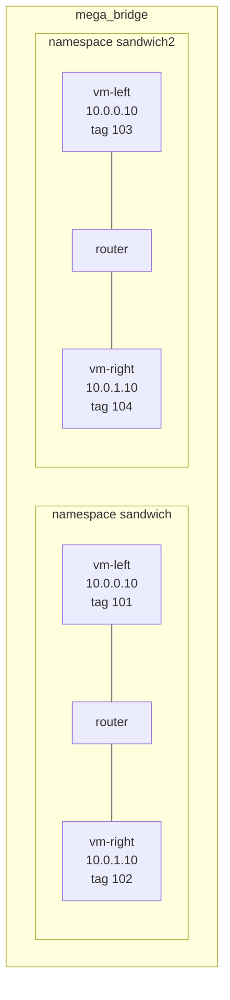

# Chapter 16: Namespaces

Since chapter 3, the sandwich lives in a namespace called `sandwich`, and
you do not need to think about it. In this lab you look at what that gives
you. Then you launch a second, identical sandwich in a namespace called
`sandwich2` on the same host. It has the same VM names, the same VLAN
aliases, and the same IP addresses. You see that the two never touch. You
also use the `ns` API. You queue VMs, ask the scheduler where it places
them, and tear the copy down with one command.

Prerequisites: Part I, in particular [Chapter 3](03-router-sandwich.md), where
`clear namespace` first appeared, and [Chapter 9](09-save-replay-cleanup.md),
which explains it. [Chapter 20](20-clusters.md) uses the same commands across
several hosts.

## Rebuild the sandwich and look around

Start from the sandwich with fixed client addresses, as in
[chapter 11](11-traffic.md#rebuild-the-sandwich-with-fixed-addresses). The
script at the end rebuilds it. `namespace` with no argument lists the
namespaces, and the prompt shows which one is active:

```minimega
minimega[sandwich]$ .annotate false namespace
namespace | vlans    | active
minimega  | 101-4096 | false
sandwich  |          | true
minimega[sandwich]$ .annotate false vlans
alias     | vlan
net_left  | 101
net_right | 102
```

`minimega` is the default namespace. When no other namespace is active, you
are in this namespace. Everything that you created so far belongs to `sandwich`.
This includes VMs, VLAN aliases, host taps, captures, the `vm config`
template, and cc commands and responses. Every `vm`, `cc`, `capture`, and
`vnc` command that you typed applied to `sandwich` only. The `vlans` column
is empty because the namespace did not set its own range with `vlans range`.
minimega allocates aliases from the global range in the default namespace.

## A second sandwich, queued and scheduled

Create the second namespace and switch to it. It starts empty, with its own
template, so you repeat the description in full. This time, turn on queueing
first. Then `vm launch` only records the VMs, and the VMs do not exist until
the scheduler runs:

```minimega
minimega[sandwich]$ clear namespace sandwich2
minimega[sandwich]$ namespace sandwich2
minimega[sandwich2]$ ns hosts
minimega[sandwich2]$ ns queueing true
minimega[sandwich2]$ vm config kernel miniccc.kernel
minimega[sandwich2]$ vm config initrd miniccc.initrd
minimega[sandwich2]$ vm config memory 3072
minimega[sandwich2]$ vm config net net_left,00:00:00:00:01:01
minimega[sandwich2]$ vm launch kvm vm-left
minimega[sandwich2]$ vm config net net_right,00:00:00:00:02:01
minimega[sandwich2]$ vm launch kvm vm-right
minimega[sandwich2]$ vm config kernel minirouter.kernel
minimega[sandwich2]$ vm config initrd minirouter.initrd
minimega[sandwich2]$ vm config net net_left net_right
minimega[sandwich2]$ vm launch kvm router
minimega[sandwich2]$ vm info
```

`ns hosts` prints the hosts that the namespace spans, here only this one.
`vm info` is empty because the three VMs are in the queue. `ns queue` prints
the queue with the configuration of each VM. Ask the scheduler for a
placement without launching anything:

```minimega
minimega[sandwich2]$ .annotate false ns schedule dry-run
vm       | dst
router   | mm1
vm-left  | mm1
vm-right | mm1
```

With one host, there is only one answer. On a cluster, the scheduler picks
the least loaded host for each VM. `ns schedule mv <vm> <host>` edits the
plan, and `ns schedule dump` shows the plan again. Then launch:

```minimega
minimega[sandwich2]$ ns schedule
minimega[sandwich2]$ .annotate false ns schedule status
start               | end                 | state     | launched | failures | total | hosts
17 Sep 26 10:02 UTC | 17 Sep 26 10:02 UTC | completed | 3        | 0        | 3     | 1
minimega[sandwich2]$ .annotate false .columns name,state,vlan vm info
name     | state    | vlan
router   | BUILDING | [net_left (103), net_right (104)]
vm-left  | BUILDING | [net_left (103)]
vm-right | BUILDING | [net_right (104)]
```

`ns schedule` and a bare `vm launch` do the same thing. The VMs exist now,
and minimega resolved the aliases. `net_left` in `sandwich2` is VLAN 103,
not 101. minimega looks up aliases per namespace, and each namespace gets
its own tags from the shared range. Two VMs called `vm-left` exist on the
host, one per namespace. Names must be unique only within a namespace.

Configure and start the router, then the clients, exactly as before, in this
namespace:

```minimega
minimega[sandwich2]$ router router interface 0 10.0.0.1/24
minimega[sandwich2]$ router router dhcp 10.0.0.0 range 10.0.0.2 10.0.0.254
minimega[sandwich2]$ router router dhcp 10.0.0.0 router 10.0.0.1
minimega[sandwich2]$ router router dhcp 10.0.0.0 static 00:00:00:00:01:01 10.0.0.10
minimega[sandwich2]$ router router interface 1 10.0.1.1/24
minimega[sandwich2]$ router router dhcp 10.0.1.0 range 10.0.1.2 10.0.1.254
minimega[sandwich2]$ router router dhcp 10.0.1.0 router 10.0.1.1
minimega[sandwich2]$ router router dhcp 10.0.1.0 static 00:00:00:00:02:01 10.0.1.10
minimega[sandwich2]$ router router commit
minimega[sandwich2]$ vm start router
minimega[sandwich2]$ shell sleep 10
minimega[sandwich2]$ vm start all
```

## Two experiments, same addresses

Both sandwiches now have a `10.0.0.1` router, a `10.0.0.10` and a
`10.0.1.10`, and the same MAC addresses on the clients. On one bridge, the
duplicate addresses conflict. On four VLANs, they are two separate networks:



Prove it. `cc` is scoped too. Each namespace runs its own cc server. So
`cc filter name=vm-left` in `sandwich2` matches only the second `vm-left`,
and the ping reaches only the second `vm-right`:

```minimega
minimega[sandwich2]$ cc filter name=vm-left
minimega[sandwich2]$ cc exec ping -c 3 10.0.1.10
minimega[sandwich2]$ shell sleep 10
minimega[sandwich2]$ cc responses 4
minimega[sandwich2]$ clear cc filter
```

Command ids restart at 1 because this is a different cc server. The router
commit used 1 to 3, so the ping is 4. Its responses are written under
`/tmp/minimega/files/sandwich2/miniccc_responses/`.
To look at the other namespace without leaving this one, prefix a command
with its name:

```minimega
minimega[sandwich2]$ .annotate false namespace sandwich .columns name,state,vlan vm info
name     | state   | vlan
router   | RUNNING | [net_left (101), net_right (102)]
vm-left  | RUNNING | [net_left (101)]
vm-right | RUNNING | [net_right (102)]
```

Pipes follow the same rule, as `sandwich//pings` in chapter 15 showed. You
reach a pipe in another namespace as `<namespace>//<pipe>`. Host taps belong
to the namespace that created them. Bridges do not belong to a namespace, so
the diagram has one `mega_bridge`.

## What the scheduler can do

On a single host, the scheduler has no decisions to make. The machinery is
the same on a cluster. On a cluster, a new namespace contains every host in
the mesh except the one that you are attached to. `ns load` chooses how
minimega measures load (`cpucommit`, the default, `memcommit`, or
`netcommit`).

Three `vm config` fields override this choice for each VM. `schedule <host>`
pins a VM. `coschedule <n>` limits how many other VMs can share its host.
`colocate <vm>` puts the VM next to another VM. `ns run <command>` runs a
command on every host in the namespace. Chapter 20 spreads the sandwich over
two hosts with these commands.

`ns save <name>` pauses every VM in the active namespace and writes a
`launch.mm` under `/tmp/minimega/files/saved/<name>/` that relaunches the
experiment. Chapter 9 and the
[save and restore guide](../../articles/save-restore.md) describe what it
captures for each VM type.

## Tear it down

Destroying a namespace kills its VMs, stops its captures, and deletes its
VLAN aliases and host taps. It also removes any `ns bridge` that it created
and does the same on every host in the cluster. If the namespace that you
destroyed was active, minimega also leaves you in the default namespace:

```minimega
minimega[sandwich2]$ clear namespace sandwich2
minimega$ .annotate false namespace
namespace | vlans    | active
minimega  | 101-4096 | true
sandwich  |          | false
```

A script that runs with `read` keeps its own namespace, and does not follow
this change. Thus the chapter script runs `namespace minimega` after
`clear namespace sandwich2`.

The first sandwich is untouched. `clear namespace` with no name only
switches back to the default namespace. `clear namespace all` destroys every
namespace, and minimega recreates the default namespace empty. Everything
that an experiment creates belongs to its namespace. So we recommend
`clear namespace <name>` as the first cleanup step, before `vm kill all` or
`nuke`.

## What you built

- A second copy of the sandwich in `sandwich2`, launched through the queue
  and the scheduler, with the same names and addresses as the first.
- Evidence that VLAN aliases, VMs, cc and pipes are all scoped to their
  namespace, and the `namespace <name> <command>` form for looking across.
- One command, `clear namespace sandwich2`, that removed all of it.

## Where to read more

- [Namespaces](../../articles/namespaces.md): the
  [`namespace` command](../../articles/namespaces.md#the-namespace-command),
  [queueing and the scheduler](../../articles/namespaces.md#queueing-and-the-scheduler),
  [placement hints](../../articles/namespaces.md#placement-hints), and how
  the other commands behave inside a namespace.
- [Host networking](../../articles/networking.md#vlan-aliases-and-ranges)
  for per-namespace VLAN ranges.
- [Cluster setup](../../articles/cluster.md) for the mesh the scheduler
  places VMs on.
- Reference: [`namespace`](../../reference/minimega.md#namespace),
  [`ns`](../../reference/minimega.md#ns),
  [`clear namespace`](../../reference/minimega.md#clear-namespace),
  [`vm config schedule`](../../reference/minimega.md#vm-config-schedule),
  [`vm config coschedule`](../../reference/minimega.md#vm-config-coschedule),
  [`vm config colocate`](../../reference/minimega.md#vm-config-colocate).

## Script

```minimega title="16-namespaces.mm"
--8<-- "training/miniclass/scripts/16-namespaces.mm"
```

[Download this example](scripts/16-namespaces.mm){ download="16-namespaces.mm" }
