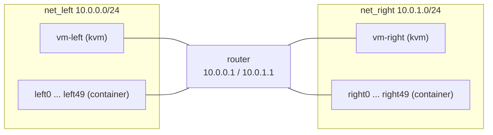

# Chapter 17: Containers

In this chapter you build a container root filesystem and launch it as a
`container` VM next to the KVM guests of the router sandwich. You learn the
few `vm config` fields that only containers use. Then you launch one hundred
containers at once to see why they exist. At the end, the sandwich router
serves DHCP to two KVM clients and a hundred containers, fifty on each
network, all reachable through `cc`.

This chapter needs the images from [Chapter 2](02-images.md), the running
example from [Chapter 3](03-router-sandwich.md), and the `cc` commands from
[Chapter 8](08-cc.md). Unlike the other chapters, it also needs a host that
boots with cgroup v1. The chapter explains this requirement first.

## What a container VM is

A `container` VM is a full-system Linux container that minimega builds
itself. It uses no Docker, LXC, or other runtime. Each container gets its own
PID, network, mount, and IPC namespaces. minimega chroots it into a root
filesystem, limits it with cgroups, and runs it with a reduced set of root
capabilities. Containers share the host kernel, so there is no boot.
`vm start` execs the `init` program of the container. A fraction of a second
later, the container runs and uses a few tens of megabytes of memory.

Everything you already know applies. You describe containers with
`vm config` and launch them with `vm launch container`. They appear in
`vm info` with `type` set to `container`. They get the same VLAN aliases,
taps on the same bridges, and the same `cc` commands. They also get the same
web console, a terminal instead of a VNC session. The differences are what
they boot from and how they talk to the host. The rest of this chapter
covers these differences.

## What the host needs

minimega drives containers with the cgroup v1 controllers `freezer`,
`memory`, `devices`, and `cpu`. The host mounts each controller as its own
hierarchy under `/sys/fs/cgroup`, or under the path that you give with
`-cgroup`. In the packaged service, `MM_CGROUP` sets this flag. Current Debian, Ubuntu, and
RHEL-family releases boot with the unified cgroup v2 hierarchy instead. Then
the first `vm launch container` fails with
`cgroups are not initialized, cannot continue`. Before you start, make sure
that your host has cgroup v1:

```bash
$ ls /sys/fs/cgroup
```

If you see `memory`, `freezer`, `devices`, and `cpu` directories, the host
is ready. If you see `cgroup.controllers` and no such directories, do these
steps to boot the host with cgroup v1:

1. Put `systemd.unified_cgroup_hierarchy=0` in `GRUB_CMDLINE_LINUX_DEFAULT`
   in `/etc/default/grub`. On Debian-family kernels, also put
   `cgroup_enable=memory` there. With systemd 256 or 257 (`systemctl --version`),
   also put `SYSTEMD_CGROUP_ENABLE_LEGACY_FORCE=1` there. systemd 258 and later
   have no cgroup v1 support, so use a host with an older systemd.
2. Run `update-grub`.
3. Reboot.

[Installation](../../articles/installing.md#containers-need-cgroup-v1) has
the RHEL-family form. KVM VMs work with either cgroup version.

When you launch many containers, two more host details matter. Snapshot mode
uses overlayfs, which every kernel since 3.18 has. Every container is a
process tree on the host. So you reach the limits on open files and
processes long before you reach the limit on memory. The packaged systemd
unit raises these limits (`LimitNOFILE=1024000`, `LimitNPROC=4096000`). If
you started minimega by hand, first run `ulimit -n 1024000 -u 4096000` in
that shell.

## Build a container filesystem

A container needs a directory that looks like the root of a Linux system.
The directory needs `/dev`, `/proc`, and `/sys` for minimega to mount over.
It also needs an executable `init` for minimega to run as PID 1. The
repository ships a vmbetter configuration that builds one with miniccc
inside, `misc/vmbetter_configs/miniccc_container.conf`.

The `init` of this configuration brings up `veth0` with DHCP, starts `sshd`,
and starts `miniccc -family unix -parent /cc`. A container reaches minimega
over a UNIX socket that minimega creates at `/cc` in the root of the
container. A KVM guest uses the virtio-serial port instead.

Build it the way that you built the KVM images in Chapter 2. As in that
chapter, first change `branch=stable` to `branch=bookworm` in
`misc/vmbetter.bash`. Use a source tree with a built `bin/miniccc`, because the
overlay links to it:

```bash
$ cd ~/minimega
$ sudo bash misc/vmbetter.bash minicccfs
```

The wrapper runs `vmbetter -O minicccfs -rootfs` on the configuration and
then packs the resulting `minicccfs/` directory into `minicccfs.tar.gz`. Put
the tarball in the files directory. Then let minimega unpack it with the
`tar:` prefix:

```bash
$ sudo cp minicccfs.tar.gz /tmp/minimega/files/
```

```minimega
minimega$ vm config filesystem tar:minicccfs.tar.gz
minimega$ vm config filesystem
/tmp/minimega/files/minicccfs
```

If necessary, `tar:` fetches the tarball from any node in the mesh. Then it
unpacks the tarball next to itself and substitutes the directory that the
tarball contained. The rest of this chapter uses that directory path
directly.

You do not have to use vmbetter. Any root filesystem with a working `init`
script works.
[Building images with vmbetter](../../articles/vmbetter.md#container-root-filesystems-from-docker-or-lxc)
shows how to export one from a Docker image or an LXC template. It also
shows what the `init` script must do.

## Launch one container

Start from the sandwich of Chapter 3 running in namespace `sandwich`. Point
the template at the filesystem and launch:

```minimega
minimega$ namespace sandwich
minimega$ vm config filesystem /tmp/minimega/files/minicccfs
minimega$ vm config memory 256
minimega$ vm config net net_left
minimega$ vm launch container ctr0
minimega$ vm start ctr0
```

The template still holds `kernel`, `initrd`, and the other KVM fields from
Chapter 3. That is fine, because minimega ignores fields that do not apply
to the type named in `vm launch`. `memory` and `vcpus` do apply, as cgroup
limits rather than allocations. So 256 MB is enough here. The netspec is the
same as for a KVM guest, except that minimega ignores the device driver
field. The container sees each network as `veth0`, `veth1`, and so on.

A few seconds later, the container gets a lease from the router and miniccc
connects:

```minimega
minimega$ .columns name,type,state,vlan,ip,cc_active vm info
host  | name     | type      | state   | vlan                              | ip                   | cc_active
node1 | ctr0     | container | RUNNING | [net_left (101)]                  | [10.0.0.4]           | true
node1 | router   | kvm       | RUNNING | [net_left (101), net_right (102)] | [10.0.0.1, 10.0.1.1] | true
node1 | vm-left  | kvm       | RUNNING | [net_left (101)]                  | [10.0.0.2]           | true
node1 | vm-right | kvm       | RUNNING | [net_right (102)]                 | [10.0.1.2]           | true
```

`cc` treats it like any other client:

```minimega
minimega$ cc filter name=ctr0
minimega$ cc exec ping -c 3 10.0.1.1
minimega$ cc responses all
```

In miniweb, the connect page of a container is a terminal on its console,
not a VNC session. Several people can share it. When you open it, it replays
recent output. The port is in the `console_port` column of `vm info`.

## The container fields

Six `vm config` fields are specific to containers. You used `filesystem`
already. The other fields adjust what happens around `init`.

- `init` names the program, with arguments, that minimega execs as PID 1,
  relative to the filesystem root. The default is `/init`. It must not exit.
  If it exits, the container is gone.
- `preinit` names a program that runs as root before minimega isolates the
  container. This happens after the namespaces and mounts exist, but before
  minimega applies cgroups, capabilities, and the chroot. It is for one-off
  privileged setup that you cannot do from inside, such as enabling IP
  forwarding. The minirouter container configuration uses it for this
  purpose. It must finish before the container can start.
- `hostname` sets the hostname of the container before `init` runs. The
  default is the VM name, so `ctr0` above reports itself as `ctr0`.
- `fifos <n>` creates named pipes shared with the host: `fifo0`, `fifo1`,
  and so on in the VM's instance directory, and `/dev/fifos/fifo0`, ...
  inside the container.
- `volume <target> <source>` bind-mounts a host directory into the
  container. Repeat it for more volumes. The same target replaces an earlier
  one. `vm config volume` alone lists the volumes.
- `snapshot`, shared with KVM, decides whether writes are kept. With the
  default `true`, minimega mounts the filesystem through an overlay, and
  changes vanish on `vm flush`. With `false`, the container writes into the
  directory itself. Other containers must not use that directory.

Use volumes to give data to a container or to collect results from it:

```minimega
minimega$ shell mkdir -p /tmp/minimega/scratch
minimega$ vm config volume /scratch /tmp/minimega/scratch
minimega$ vm config volume
/scratch -> /tmp/minimega/scratch
minimega$ vm launch container ctr1
minimega$ vm start ctr1
minimega$ cc filter name=ctr1
minimega$ cc exec ls /scratch
```

The complete list, with types and defaults, is in the
[VM configuration reference](../../articles/vm-config-reference.md#container).

## One hundred containers

The point of containers is scale. Launch fifty on each side of the router
with a range name and start them all:

```minimega
minimega$ vm config net net_left
minimega$ vm launch container left[0-49]
minimega$ vm config net net_right
minimega$ vm launch container right[0-49]
minimega$ vm start all
```

Give the DHCP leases half a minute. Then look at the result. `.filter` limits
the table to the containers, and `.columns` limits it to the columns that
matter:

```minimega
minimega$ .columns name,state,ip,cc_active .filter type=container vm info
```

Every container has an address in its network and a live `cc` connection.
`host` shows what the containers cost. This is a fraction of what a hundred
KVM guests use:

```minimega
minimega$ .columns vms,memused,memtotal,cpucommit host
```

`cc` works across all of them at once. Clear the filter. Then the next
`cc exec` runs in every client in the namespace, KVM and container alike:

```minimega
minimega$ clear cc filter
minimega$ cc exec hostname
```

Chapter 3's diagram now looks like this:



## Clean up

Containers stop and go away exactly like KVM guests. `vm kill` sends them to
`QUIT`, and `vm flush` removes them. `clear namespace sandwich` does both for
everything in the namespace and unmounts the overlays. If the `init` of a
container exits on its own, the VM shows `QUIT` in `vm info`. You do not
need to do anything.

## The script

The script rebuilds the sandwich from scratch and adds the hundred
containers and the volume. It expects that you unpacked the container
filesystem at `/tmp/minimega/files/minicccfs`, as above.

```minimega title="17-containers.mm"
--8<-- "training/miniclass/scripts/17-containers.mm"
```

[Download this example](scripts/17-containers.mm){ download="17-containers.mm" }

## What you built

- A container root filesystem with miniccc inside, built with vmbetter and
  distributed through the files directory.
- One hundred containers on the sandwich networks, each with a DHCP lease
  from the router and a `cc` connection. They start in seconds.
- A bind-mounted volume shared between a container and the host.

## Where to read more

- [Virtual machine types](../../articles/vmtypes.md#containers) explains
  what minimega does at each step of a container launch and the host limits
  that matter at scale.
- [Building images with vmbetter](../../articles/vmbetter.md) covers
  `-rootfs` builds and turning Docker or LXC filesystems into container
  images.
- [File management](../../articles/file.md#tar) for the `tar:` prefix.
- [Command and control](../../articles/cc.md#unix-socket-containers) for
  how miniccc connects from inside a container.
- Reference: [`vm launch`](../../reference/minimega.md#vm-launch),
  [`vm config filesystem`](../../reference/minimega.md#vm-config-filesystem),
  [`vm config init`](../../reference/minimega.md#vm-config-init),
  [`vm config preinit`](../../reference/minimega.md#vm-config-preinit),
  [`vm config hostname`](../../reference/minimega.md#vm-config-hostname),
  [`vm config fifos`](../../reference/minimega.md#vm-config-fifos),
  [`vm config volume`](../../reference/minimega.md#vm-config-volume).
