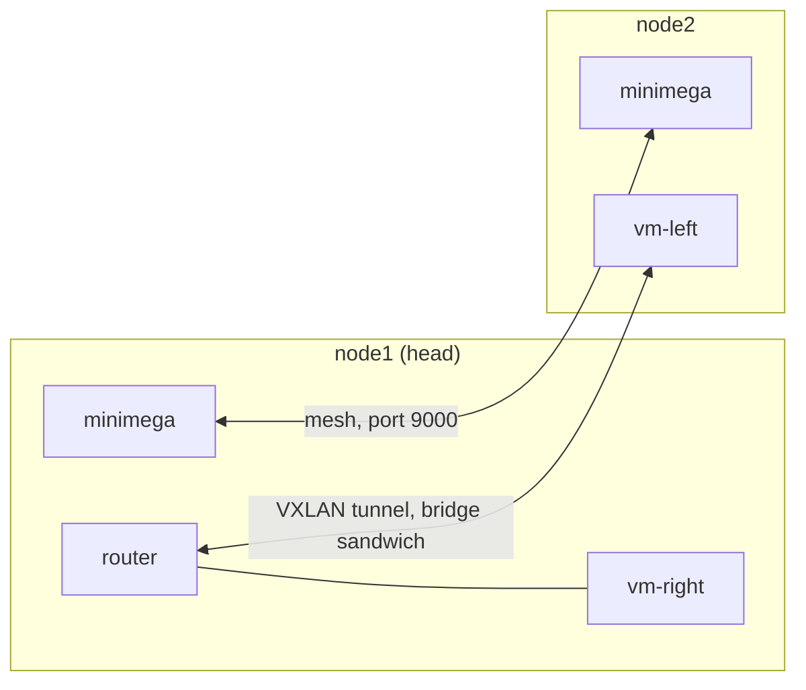

# Chapter 20: Clusters

In this chapter you join two minimega hosts into a mesh. Then you spread the
router sandwich across the two hosts. A client on one host gets its DHCP lease
from the router on the other host. You watch the images, the
VLANs, and the results follow the VMs from host to host. At the end, `router`
and `vm-right` run on `node1`, and `vm-left` runs on `node2`. The three VMs
talk through a VXLAN tunnel that minimega built for the namespace.

This chapter assumes the installation from [Chapter 1](01-install.md), the
sandwich from [Chapter 3](03-router-sandwich.md), and namespaces from
[Chapter 16](16-namespaces.md).

!!! warning "This chapter needs two hosts"
    Everything before this point runs on one machine. A mesh needs at least
    two minimega instances on two hosts with unique hostnames and a network
    between them. You cannot fake that on a single machine. If each of two VMs
    runs minimega with nested virtualization enabled, the VMs are enough for
    learning. The [syllabus](syllabus.md) lists what a classroom needs.
    The chapter names the hosts `node1` (where you type) and `node2`.

## The lab



The two hosts talk to each other on a management network. A tunnel over that
same network carries the sandwich's `net_left` VLAN between the hosts. In a
production cluster, the experiment traffic normally uses a second NIC instead.
The NIC is trunked to a VLAN-capable switch. A later section covers this
setup.

## Prepare both hosts

Install the same minimega release, with QEMU, Open vSwitch, and dnsmasq, on
both hosts as in Chapter 1. Commands that you send over the mesh are ordinary
minimega commands, so a difference in versions shows up as unknown commands.
Then make sure that these four things are true:

1. Each host has a unique hostname, and both names resolve on both hosts to
   their management addresses. If DNS is not available, put the names in
   `/etc/hosts`. Remove any `127.0.1.1 node1` line that Debian-family
   installers add, because `ns bridge` looks up the tunnel endpoint of a host
   by name and skips loopback addresses.
2. TCP and UDP port 9000 are open between the hosts. Discovery uses UDP
   broadcast. Peers connect over TCP.
3. For `deploy`, `node1` can SSH to `node2` without a password as a user
   that can run minimega. `ssh-copy-id` handles the key.
4. UDP port 4789 is open between the hosts. The VXLAN tunnel that `ns bridge`
   makes uses this port, which is the Open vSwitch default.

Copy the Chapter 2 images into `node1`'s files directory only. `node2` will
fetch what it needs.

## Start the mesh

Three flags define a mesh, and they must agree on every host. `-context` is
a label that keeps unrelated clusters on the same network apart. `-degree` is
the number of peers that each instance tries to connect to. The default, `0`,
disables discovery. The third flag is `-port`. With the packaged service, set
the flags in `/etc/minimega/minimega.conf` on both hosts and restart:

```text
MM_CONTEXT="miniclass"
MM_DEGREE=2
MM_PORT=9000
```

```bash
$ sudo systemctl restart minimega
```

The instances find each other by broadcast as they come up. Nothing has to
run first on the head node. The context is the value that must be identical
everywhere. A mesh of two needs only a degree of one, but a higher value costs
nothing.

The other way is `deploy`. `deploy` copies the running minimega binary to
other hosts with `scp` and starts it there with `ssh`. It uses the flags that
started this instance, plus `-nostdin=true` and `-headnode=node1`. `deploy` is
made for a head node that you start by hand with the mesh flags:

```bash
$ sudo minimega -nostdin -context miniclass -degree 2 &
$ sudo minimega -attach
```

```minimega
minimega$ deploy flags
minimega$ deploy launch node2
minimega$ deploy launch node2 admin sudo
```

`deploy flags` prints what the remote instance will be started with.
`deploy flags <flags>` replaces it. The second `launch` form logs in as
`admin` and prefixes the remote command with `sudo`, for hosts where root
cannot log in directly. Unless you set `deploy stdout` and `deploy stderr`,
the output of the remote process goes to `/dev/null`.

## Check the mesh

Give discovery a few seconds. Then ask either host:

```minimega
minimega$ mesh status
host  | size | degree | peers | context   | port
node1 | 2    | 2      | 1     | miniclass | 9000
minimega$ mesh list
node1
 |--node2
node2
 |--node1
```

`size` is the number to watch. When `size` equals the number of hosts, every
host is in the mesh. `mesh send` runs a command on other hosts and prints
their answers here. With this command, you administer the cluster without
logging in to each host:

```minimega
minimega$ mesh send node2 host
minimega$ mesh send all version
```

If `size` stays at 1, compare `mesh status` on both hosts. `context` and
`port` must match exactly. If they match, the broadcast is not getting
through. In this case, `mesh dial node2` from `node1` joins the hosts over TCP
directly.
[Cluster setup](../../articles/cluster.md#when-hosts-do-not-join) has the
rest of the checklist.

## Images travel by themselves

Every minimega instance serves its files directory to the mesh through
iomeshage. If you launch a VM on `node2` with `vm config kernel miniccc.kernel`,
the path is relative and `node2` does not have the file. `node2` then asks the
mesh for the file and receives it before launching.

`file list` shows what a node has, `file
status` shows transfers in flight, and `file get` fetches something by hand:

```minimega
minimega$ mesh send node2 file list
minimega$ mesh send node2 file get miniccc.kernel
minimega$ mesh send node2 file status
```

Transfers are always pulls, so to push a file, tell the other node to fetch
it, as above. Two files with the same name but different content on different
nodes are a problem, because iomeshage identifies files by path alone. Start
every instance with `-hashfiles`. Also start every instance with
`-headnode node1`, so that the head node's copy always wins. `deploy` sets
`-headnode` for you.
[File management](../../articles/file.md#same-name-different-content) has
the details.

## A namespace that spans both hosts

In a mesh, a new namespace contains every host except the host that you
create it on. This follows the assumption that the head node stays free. For
a two-host lab, you want both hosts:

```minimega
minimega$ clear namespace sandwich
minimega$ namespace sandwich
minimega$ ns hosts
node2
minimega$ ns add-hosts localhost
minimega$ ns hosts
node[1-2]
```

If the sandwich from Chapter 3 still runs, the first command removes it.
minimega resolves `localhost` to the name of this host. `ns del-hosts`
removes hosts from the list. From here on, `vm launch` places each VM on the
least loaded host in that list. Every `vm`, `cc`, and `router` command finds
the VM wherever it is.

## Carrying VLANs between hosts

Because minimega broadcasts alias assignments across the mesh, `net_left` on
`node1` and `net_left` on `node2` are the same VLAN. But frames cross between
two hosts only over connected bridges. There are two ways.

The production way is a trunk. A trunk is a dedicated NIC on each host. You
cable each NIC to a switch that accepts 802.1q tags, and you add it to the
bridge on every host:

```minimega
minimega$ mesh send all bridge trunk mega_bridge eth1
minimega$ bridge trunk mega_bridge eth1
```

The switch does the rest, and the sandwich script from Chapter 3 then runs
unchanged on the cluster. If you have no second NIC and no trunking switch,
use a tunnel instead. `bridge tunnel vxlan <bridge> <remote ip>` connects one
bridge to one remote host. `ns bridge` builds the whole thing for a namespace.
It creates a bridge of the given name on every host, plus a full mesh of
tunnels between the bridges. A key on each tunnel keeps the bridge separate
from the bridges of other namespaces:

```minimega
minimega$ ns bridge sandwich vxlan
```

By convention, you name the bridge after the namespace, because bridge names
are not namespaced. VMs join the bridge through the bridge field of the
netspec. For this reason, the chapter script writes `sandwich,net_left`
instead of `net_left`. Tunnels cost MTU. If large transfers between the hosts
stall while pings work, lower the MTU in the guests.

## Placing the VMs

By default, `vm launch` places each VM immediately. Turn on queueing, so that
the scheduler sees the whole experiment first. Pin the router to the head node
with `vm config schedule`:

```minimega
minimega$ ns queueing true
minimega$ vm config memory 3072
minimega$ vm config kernel minirouter.kernel
minimega$ vm config initrd minirouter.initrd
minimega$ vm config net sandwich,net_left sandwich,net_right
minimega$ vm config schedule node1
minimega$ vm launch kvm router
minimega$ clear vm config schedule
minimega$ vm config kernel miniccc.kernel
minimega$ vm config initrd miniccc.initrd
minimega$ vm config memory 3072
minimega$ vm config net sandwich,net_left
minimega$ vm launch kvm vm-left
minimega$ vm config net sandwich,net_right
minimega$ vm launch kvm vm-right
```

Nothing is launched yet. `ns queue` lists the three waiting VMs. A dry run
shows where the scheduler places them. `ns schedule mv` overrides the
placement. `ns schedule dump` prints the result. `ns schedule` (the same as a
bare `vm launch`) carries it out:

```minimega
minimega$ ns schedule dry-run
minimega$ ns schedule mv vm-left node2
minimega$ ns schedule mv vm-right node1
minimega$ ns schedule dump
host  | vm       | dst
node1 | router   | node1
node1 | vm-left  | node2
node1 | vm-right | node1
minimega$ ns schedule
minimega$ .columns name,state,vlan vm info
host  | name     | state    | vlan
node1 | router   | BUILDING | [net_left (101), net_right (102)]
node1 | vm-right | BUILDING | [net_right (102)]
node2 | vm-left  | BUILDING | [net_left (101)]
```

The placement that the dry run proposes depends on the load of the hosts. The
two `mv` commands make the outcome the same every time. They also put a client
on the far side of the tunnel from the router. `host` shows the load that the
scheduler looked at. You can also run it with `ns run host`, which runs a
command on every host in the namespace. `ns load` changes how the load is
measured.

Queueing stays on for the namespace. A later `vm launch kvm x` queues until
the next bare `vm launch`.

minicli adds the `host` column to every table while `.annotate` is on. This
column is now the interesting one, because `vm-left` is on `node2`.

## Bring up the sandwich

You configure and start the router exactly as in Chapter 3. `router` commands
are namespace-aware. If the router lands on `node2`, they work in the same
way:

```minimega
minimega$ router router interface 0 10.0.0.1/24
minimega$ router router dhcp 10.0.0.0 range 10.0.0.2 10.0.0.254
minimega$ router router dhcp 10.0.0.0 router 10.0.0.1
minimega$ router router interface 1 10.0.1.1/24
minimega$ router router dhcp 10.0.1.0 range 10.0.1.2 10.0.1.254
minimega$ router router dhcp 10.0.1.0 router 10.0.1.1
minimega$ router router commit
minimega$ vm start router
minimega$ vm start all
```

Twenty seconds later, `vm-left` on `node2` has a lease from the router on
`node1`. Its DHCP request crossed the tunnel and the answer came back the
same way:

```minimega
minimega$ .columns name,state,vlan,ip vm info
host  | name     | state   | vlan                              | ip
node1 | router   | RUNNING | [net_left (101), net_right (102)] | [10.0.0.1, 10.0.1.1]
node1 | vm-right | RUNNING | [net_right (102)]                 | [10.0.1.2]
node2 | vm-left  | RUNNING | [net_left (101)]                  | [10.0.0.2]
minimega$ cc filter name=vm-left
minimega$ cc exec ping -c 3 10.0.0.1
minimega$ cc responses all
minimega$ clear cc filter
```

`cc` does not depend on the host that runs `vm-left`. Every namespace runs its
own `cc` server on every host, and minimega collects commands and responses on
the node that you typed at. The same holds for `vm screenshot`, VNC through
miniweb, and captures. A `capture pcap vm vm-left 0 left.pcap` writes the file
on `node2`. After the capture is done, `file get left.pcap` brings the file to
`node1`.

Finally, look at what iomeshage did while you were not watching:

```minimega
minimega$ mesh send node2 file list
host  | dir | name           | size      | modified
node2 |     | miniccc.initrd | 141852672 | 2026-09-17T14:02:11Z
node2 |     | miniccc.kernel | 7815424   | 2026-09-17T14:02:09Z
```

`node2` fetched the two files it needed for `vm-left` and nothing else.

## Clean up

`clear namespace sandwich` kills the VMs on both hosts, deletes the VLAN
aliases, and tears down the `sandwich` bridge and its tunnels everywhere.
The mesh itself stays up until the instances stop.

## The script

After `mesh status` reports a size of 2, run the script on `node1`. The script
adds `node1` to the namespace and builds the tunneled bridge. It queues and
places the VMs as above, brings up the sandwich, and shows what `node2`
fetched.

```minimega title="20-clusters.mm"
--8<-- "training/miniclass/scripts/20-clusters.mm"
```

[Download this example](scripts/20-clusters.mm){ download="20-clusters.mm" }

## What you built

- A two-host mesh, started from the service configuration or with `deploy`,
  and checked with `mesh status`.
- The router sandwich spread across both hosts by the namespace scheduler,
  with placement inspected and adjusted before launch.
- A VXLAN-tunneled bridge carrying `net_left` between the hosts, and images
  fetched to `node2` by iomeshage without any copying by hand.

## Where to read more

- [Cluster setup](../../articles/cluster.md): host preparation, trunks and
  tunnels, `deploy`, the service and Docker variants, and what to do when
  hosts do not join.
- [Namespaces](../../articles/namespaces.md): hosts, queueing, the
  scheduler, placement hints, `ns bridge`, and `ns run`.
- [File management](../../articles/file.md): the `file` API, `-hashfiles`,
  `-headnode`, and the `file:` prefix.
- [Host networking](../../articles/networking.md#bridges-trunks-and-tunnels)
- Reference: [`mesh status`](../../reference/minimega.md#mesh-status),
  [`mesh send`](../../reference/minimega.md#mesh-send),
  [`mesh dial`](../../reference/minimega.md#mesh-dial),
  [`deploy`](../../reference/minimega.md#deploy),
  [`ns`](../../reference/minimega.md#ns),
  [`file`](../../reference/minimega.md#file),
  [`bridge`](../../reference/minimega.md#bridge),
  [`vm config schedule`](../../reference/minimega.md#vm-config-schedule).
