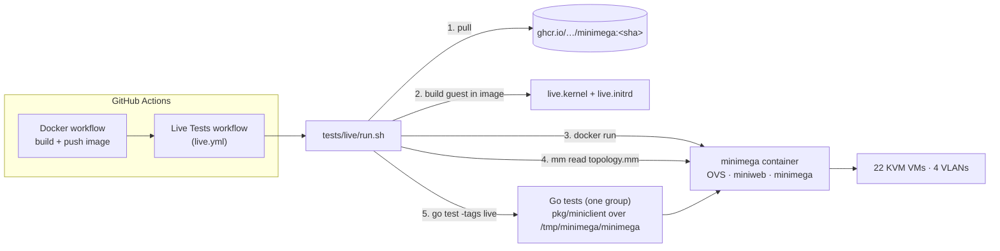
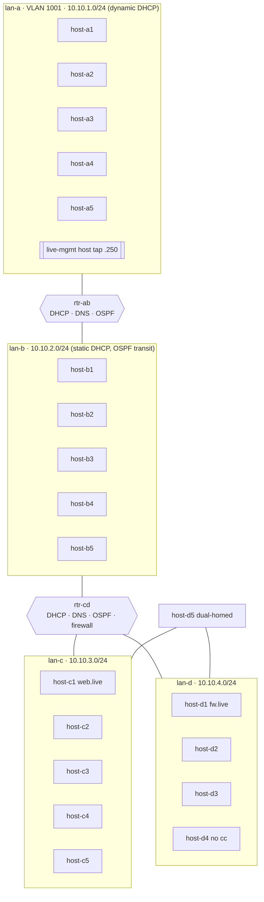

# minimega live integration tests

End-to-end tests that run minimega the way it is deployed in practice — from
the published Docker image — boot a real KVM experiment, and drive it over the
command socket the way phēnix does. They answer one question: **does a change
to minimega still run a working experiment?**

Unit tests (`scripts/test.bash`) and minitest (`tests/*.want`) stay as they
are. These tests sit on top and need a Linux host with KVM.

## What runs



1. **Image** — CI tests the exact image the Docker workflow just built
   (the immutable short-SHA tag on pushes; a `docker save` artifact on pull
   requests, which cannot push). Run by hand (`gh workflow run live.yml --ref
   <branch>`, also on a fork) the workflow builds the dispatched branch and
   tests that; its optional `image` input tests an existing image instead.
2. **Guest image** — `run.sh` runs the `vmbetter` shipped *in that image*
   (in a privileged container with `debootstrap`) on `image/live.conf`: a
   Debian bookworm kernel plus a busybox initramfs with `bird`, `dnsmasq`, and
   `iptables` for routers, and the image's own `miniccc`, `minirouter`, and
   `protonuke` copied into the overlay first. `live.conf` has no parent
   (`default.conf` makes a 360 MB initrd that needs ~3 GB per VM). The boot
   scripts are in `image/overlay/`. The unpacked rootfs is ~100 MiB and an
   initramfs lives in RAM (it may use about half of it), so the guests get
   352–448 MB each: 22 VMs take ~8.5 GB of a standard runner's 16 GB.
3. **Deployment** — the container starts with the flags from
   `docker/README.md` (privileged, `/dev`, `/lib/modules`, `/tmp/minimega`).
4. **Topology** — the group's `topology.mm` is loaded with `mm read`, exercising the CLI
   and script path used by people and FIREWHEEL.
5. **Tests** — the group's Go tests (`//go:build live`) talk to the bind-mounted socket
   with `pkg/miniclient`, the integration path phēnix uses.

## Layout

```
tests/live/
  run.sh        run one group against a Docker image
  image/        vmbetter config (live.conf) and overlay for the guest kernel and initramfs
  harness/      package harness: shared helpers (socket client, cc, polling,
                artifact parsers) and their offline unit tests
  core/         the 22-VM test group: topology.mm, topology_test.go, live_test.go
```

Each test group is a sub-folder holding its `topology.mm` and the Go tests
(`//go:build live`) that check it. `run.sh` runs one group, chosen with
`LIVE_GROUP` (default `core`).

## Topology (core group)



| Group | VMs | What it exercises |
|---|---|---|
| Routers | `rtr-ab`, `rtr-cd` | minirouter: interfaces, DHCP ranges and static leases, DNS records, OSPF (bird), `fw` (iptables), `rid`, `schedule` |
| lan-a | `host-a1..a5` | dynamic leases, range launch (`host-a[2-5]`), `serial-ports`, `virtio-ports`, `colocate`, host tap |
| lan-b | `host-b1..b5` | static MACs, `e1000` vs `virtio-net-pci`, `vcpus`/`cores` |
| lan-c | `host-c1..c5` | `disk create`, virtio/IDE disks, cache mode, snapshot isolation, `qemu-append`, `machine q35`, `usb-use-xhci`, `vga cirrus` |
| lan-d | `host-d1..d5` | firewall target, `backchannel false`, dual-homed NICs, fixed `uuid` |

Every VM shares one saved configuration (`vm config save live-base`), launches
through the namespace queue (`ns queueing true` + `vm launch`), and is started
with `vm start all`.

## What is tested

In the core group, `TestLive` runs ordered phases. Each phase names the phases it needs (for
example cc clients, or cc clients and DHCP for networking) and is skipped
unless they passed, so one root cause produces one failure while unrelated
phases (screenshots, QMP, serial, ...) still run.

| Area | Checks |
|---|---|
| Control plane | `version`, `check`, `host`, `namespace`, `ns hosts/queue/queueing`, `vm info`, `vm info summary`, `vlans`, `bridge` + OVS port/VLAN tags, `file list`, `disk info/snapshot`, miniweb (`/`, `/vms/info.json`) |
| Boot | all 22 VMs `RUNNING`, 21 miniccc clients, every expected address learned from tap snooping |
| Command and control | `cc exec` (one, all, tag and column filters), `cc exitcode`, `cc send`/`recv`, `cc background`, `cc process list/kill`, `cc responses`, `cc delete` |
| Guest view of config | SMBIOS serial from `qemu-append`, VM UUID, disk sizes per interface, snapshot isolation, Q35 vs i440FX, xHCI, SMP, NIC driver and MAC, dual-homed addressing |
| Networking | same-LAN ping, OSPF routes, cross-router ping and traceroute, no-cc host reachable, DNS, HTTP to protonuke, firewall drop vs control, host tap (both directions), QoS delay and loss, `capture pcap` |
| VM operations | `vm screenshot` (std and cirrus), `vm serial`, `vm qmp`, `vnc record`, `vm tag` + tag filter, `vm top`, `vm stop/start`, `vm net disconnect/connect`, `vm hotplug add/remove`, `vm save`, `vm kill` + `vm flush` + `vm config clone` + queued relaunch |
| Teardown | `clear namespace` removes VMs, QEMU processes, and OVS ports |

Out of scope: containers, Android, bare-metal VMs, and multi-node meshes.

## Running locally

Needs Linux, root, Docker, `/dev/kvm`, the `openvswitch` kernel module, and Go.

```bash
# test the image CI publishes for master
sudo tests/live/run.sh ghcr.io/sandia-minimega/minimega:master

# test a local build
docker build -t minimega:dev -f docker/Dockerfile .
sudo LIVE_PULL=0 tests/live/run.sh minimega:dev

# run a subset and keep the experiment up to poke at it
sudo LIVE_KEEP=1 LIVE_TEST_ARGS='-test.run TestLive/(Version|Namespace|Inventory|CCClients|DHCP|DNS)$' \
  tests/live/run.sh minimega:dev
docker exec minimega mm namespace live vm info
```

`run.sh` refuses to replace an existing `minimega` container, or to delete a
non-empty `/tmp/minimega` (`LIVE_MM_BASE`), unless `LIVE_FORCE=1` is set, and
always refuses a base directory that is not an absolute, normalized path at
least two levels deep or that is a home or system directory; a finished run removes both
unless `LIVE_KEEP=1` kept them. `LIVE_GROUP=<name>` runs
the group in `tests/live/<name>`. Results land in
`./live-artifacts`: the test log, a Markdown summary, minimega and container
logs, diagnostics (`vm info`, routers, OVS), cc responses, screenshots, and a
pcap.

### Without x86 KVM (e.g. an arm64 host)

The guests are x86. On a host that cannot run them under KVM, run them in
QEMU's TCG emulator and supply an x86 guest image. `vmbetter` builds an x86 guest from the
image's own binaries only on x86, so take the `guest/` directory (`live.kernel`
and `live.initrd`) from the `live-test-artifacts` artifact of a CI run:

```bash
sudo LIVE_PULL=0 LIVE_GUEST_DIR=/path/to/x86-guest \
  LIVE_QEMU=/usr/bin/qemu-system-x86_64 LIVE_CPU=qemu64 \
  tests/live/run.sh minimega:dev
```

The image must contain `qemu-system-x86_64`. The suite passes this way, only
slower.

## Changing the tests

- Add a phase by writing a `func(t *testing.T)` in `core/live_test.go` and
  adding it to the list in `TestLive` with the phases it needs. Use
  `harness.CCOK`/`harness.CCEventually` for guest commands and
  `harness.Eventually` for anything asynchronous.
- If you change `core/topology.mm`, update `core/topology_test.go` to match.
- Add a group by creating `tests/live/<name>/` with a `topology.mm` and
  `//go:build live` tests in `package <name>` that import
  `github.com/sandia-minimega/minimega/v2/tests/live/harness`. Call
  `harness.Connect()` from `TestMain`, then use the harness helpers. Run it
  with `LIVE_GROUP=<name> tests/live/run.sh`. Put anything a second group
  would reuse in `harness/`, with an offline test.
- Validate a `topology.mm` syntax against any running minimega, without
  launching VMs: `minimega -e read /abs/path/topology.mm check`.
- Without a deployment: `GOFLAGS=-mod=vendor go test ./tests/live/...` runs the
  harness unit tests, and `GOFLAGS=-mod=vendor go vet -tags live ./tests/live/...`
  compiles the live tests.
